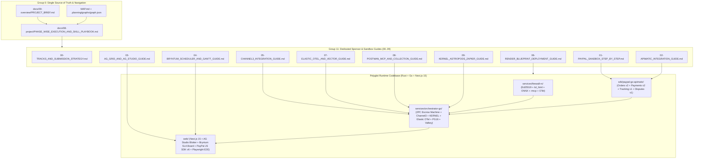

# MAP.md — Master Navigation Hub & O(1) Graphify Codebase Index

> **Single Entry Point for Judges, Developers, and Autonomous Coding Agents (`/gsd-*` & `/ralph-loop`)**
> Whenever you receive a prompt or task in this workspace (`g:\PAYPAL`), **consult Section 1 ("Where Do I Find...?") and Section 5 (API-01..API-16 & Code Symbol Index) first**. You never need to scan the entire repository.

---

## 1. "Where Do I Find...?" — Instant O(1) Task-to-File Lookup Table

| If Your Prompt / Task Is About... | Open This Exact File First | Secondary Reference |
| :--- | :--- | :--- |
| **Canonical Feature IDs (`F-01`..`F-14`), Entities (`E-01`..`E-10`), APIs (`API-01`..`API-16`), Models (`M-01`..`M-04`), Risks (`R-01`..`R-06`)** | [`docs/00-overview/PROJECT_BRIEF.md`](file:///g:/PAYPAL/docs/00-overview/PROJECT_BRIEF.md) | [`docs/01-product/PRD.md`](file:///g:/PAYPAL/docs/01-product/PRD.md) |
| **What Phase / Micro-Chunk (`TASK-01`..`TASK-16`) to execute next, which `/gsd-*` or `/ralph-loop` skill to invoke, or when a Human API Key Gate is needed** | [`docs/08-project/PHASE_WISE_EXECUTION_AND_SKILL_PLAYBOOK.md`](file:///g:/PAYPAL/docs/08-project/PHASE_WISE_EXECUTION_AND_SKILL_PLAYBOOK.md) | [`.agent/tasks.json`](file:///g:/PAYPAL/.agent/tasks.json) |
| **Ready-to-paste Devpost Submission Packet & 14-Prize Checklist (`$69,750` Prize Pool, up to `$17,000` stack per Rules §8)** | [`.planning/phases/08-render-native-polyglot-deployment-demo-polish/08-DEVPOST-SUBMISSION-PACKET.md`](file:///g:/PAYPAL/.planning/phases/08-render-native-polyglot-deployment-demo-polish/08-DEVPOST-SUBMISSION-PACKET.md) | [`docs/09-integrations-and-guides/00-TRACKS_AND_SUBMISSION_STRATEGY.md`](file:///g:/PAYPAL/docs/09-integrations-and-guides/00-TRACKS_AND_SUBMISSION_STRATEGY.md) |
| **Setting up PayPal Developer Sandbox keys, Personal/Business accounts, Orders v2 `AUTHORIZE`, Shipment Tracking v1, Disputes v1, or JS SDK v6** | [`docs/09-integrations-and-guides/01-PAYPAL_SANDBOX_STEP_BY_STEP.md`](file:///g:/PAYPAL/docs/09-integrations-and-guides/01-PAYPAL_SANDBOX_STEP_BY_STEP.md) | [`sdk/paypal-go-apimatic/orders_v2.go`](file:///g:/PAYPAL/sdk/paypal-go-apimatic/orders_v2.go) |
| **Generating the typed Golang SDK & configuring the APIMatic Context Plugin in `.mcp.json`** | [`docs/09-integrations-and-guides/02-APIMATIC_INTEGRATION_GUIDE.md`](file:///g:/PAYPAL/docs/09-integrations-and-guides/02-APIMATIC_INTEGRATION_GUIDE.md) | [`.mcp.json`](file:///g:/PAYPAL/.mcp.json) |
| **Building the AG Grid Enterprise (`v33.1.0`) + AG Studio AI Copilot Live Escrow Blotter & Master-Detail Forensic Inspector** | [`docs/09-integrations-and-guides/03-AG_GRID_AND_AG_STUDIO_GUIDE.md`](file:///g:/PAYPAL/docs/09-integrations-and-guides/03-AG_GRID_AND_AG_STUDIO_GUIDE.md) | [`web/src/components/AgStudioBlotter.tsx`](file:///g:/PAYPAL/web/src/components/AgStudioBlotter.tsx) |
| **Building the Bryntum Scheduler Pro (`v6.1.4`) Two-Way SLA Board where dragging past deadline triggers PayPal `VOID`** | [`docs/09-integrations-and-guides/04-BRYNTUM_SCHEDULER_AND_GANTT_GUIDE.md`](file:///g:/PAYPAL/docs/09-integrations-and-guides/04-BRYNTUM_SCHEDULER_AND_GANTT_GUIDE.md) | [`web/src/components/BryntumSlaBoard.tsx`](file:///g:/PAYPAL/web/src/components/BryntumSlaBoard.tsx) |
| **Integrating Channel3 Merchant Reputation & SKU Price-Cap Oracle in Golang** | [`docs/09-integrations-and-guides/05-CHANNEL3_INTEGRATION_GUIDE.md`](file:///g:/PAYPAL/docs/09-integrations-and-guides/05-CHANNEL3_INTEGRATION_GUIDE.md) | [`services/orchestrator-go/internal/channel3/oracle.go`](file:///g:/PAYPAL/services/orchestrator-go/internal/channel3/oracle.go) |
| **Deploying & verifying the 5-service polyglot stack (`rust` + `go` + `node` + PG16 + Valkey) on Render via `render.yaml`** | [`docs/09-integrations-and-guides/06-RENDER_BLUEPRINT_DEPLOYMENT_GUIDE.md`](file:///g:/PAYPAL/docs/09-integrations-and-guides/06-RENDER_BLUEPRINT_DEPLOYMENT_GUIDE.md) | [`render.yaml`](file:///g:/PAYPAL/render.yaml) · [`scripts/verify-deployment.sh`](file:///g:/PAYPAL/scripts/verify-deployment.sh) |
| **Configuring Elastic Cloud OpenTelemetry traces & `talos-dom-threats-v1` vector threat store** | [`docs/09-integrations-and-guides/07-ELASTIC_OTEL_AND_VECTOR_GUIDE.md`](file:///g:/PAYPAL/docs/09-integrations-and-guides/07-ELASTIC_OTEL_AND_VECTOR_GUIDE.md) | [`services/orchestrator-go/internal/telemetry/elastic_otel.go`](file:///g:/PAYPAL/services/orchestrator-go/internal/telemetry/elastic_otel.go) |
| **Running Postman MCP generator & Newman contract tests in CI** | [`docs/09-integrations-and-guides/08-POSTMAN_MCP_AND_COLLECTION_GUIDE.md`](file:///g:/PAYPAL/docs/09-integrations-and-guides/08-POSTMAN_MCP_AND_COLLECTION_GUIDE.md) | [`postman/Talos-Sandbox-MCP.postman_collection.json`](file:///g:/PAYPAL/postman/Talos-Sandbox-MCP.postman_collection.json) |
| **Connecting KERNEL headless browser sessions, Astropods adapters, or Zapier CFO Slack/Email webhooks** | [`docs/09-integrations-and-guides/09-KERNEL_ASTROPODS_ZAPIER_GUIDE.md`](file:///g:/PAYPAL/docs/09-integrations-and-guides/09-KERNEL_ASTROPODS_ZAPIER_GUIDE.md) | [`services/orchestrator-go/internal/kernel/browser.go`](file:///g:/PAYPAL/services/orchestrator-go/internal/kernel/browser.go) |
| **Implementing or debugging the Rust Ed25519 KYA Mandate & `lol_html` + `DeBERTa-v3` ONNX DOM Firewall** | [`services/firewall-rs/src/mandate.rs`](file:///g:/PAYPAL/services/firewall-rs/src/mandate.rs) | [`services/firewall-rs/src/sanitizer.rs`](file:///g:/PAYPAL/services/firewall-rs/src/sanitizer.rs) |
| **Implementing or debugging the Go 2PC Escrow State Machine & PostgreSQL hash-chained audit ledger** | [`services/orchestrator-go/internal/escrow/machine.go`](file:///g:/PAYPAL/services/orchestrator-go/internal/escrow/machine.go) | [`services/orchestrator-go/migrations/0001_init_schema.up.sql`](file:///g:/PAYPAL/services/orchestrator-go/migrations/0001_init_schema.up.sql) |
| **Delivering the `<2:45` 3-Act Demo Video or answering Judge Q&A** | [`docs/00-overview/PITCH.md`](file:///g:/PAYPAL/docs/00-overview/PITCH.md) | [`web/e2e/talos-3act-demo.spec.ts`](file:///g:/PAYPAL/web/e2e/talos-3act-demo.spec.ts) |

---

## 2. Reading Orders by Role

### A. Hackathon Judge — 3-Minute Fast Path
1. [`README.md`](file:///g:/PAYPAL/README.md) — 60-second executive overview, architecture diagram, 90-second quickstart, and 14-Prize matrix.
2. [`docs/00-overview/PITCH.md`](file:///g:/PAYPAL/docs/00-overview/PITCH.md) — The 3-Act Live Demo Script (`Act 1: Prompt Injection Blocked in 3.8ms`, `Act 2: Verified 2PC PayPal Escrow AUTHORIZE -> TRACKING -> CAPTURE`, `Act 3: Bryntum SLA Breach Drag -> Live PayPal VOID`).
3. [`docs/03-engineering/ARCHITECTURE.md`](file:///g:/PAYPAL/docs/03-engineering/ARCHITECTURE.md) — Polyglot Rust 1.85 + Go 1.24 + Next.js 15 C4 & sequence diagrams.
4. [`docs/09-integrations-and-guides/00-TRACKS_AND_SUBMISSION_STRATEGY.md`](file:///g:/PAYPAL/docs/09-integrations-and-guides/00-TRACKS_AND_SUBMISSION_STRATEGY.md) — How TALOS satisfies every overall and sponsor award rubric.

### B. Autonomous Coding Agent (`/gsd-*` & `/ralph-loop`) — Execution Path
1. [`CLAUDE.md`](file:///g:/PAYPAL/CLAUDE.md) & [`.planning/graphs/CODEBASE_INDEX.md`](file:///g:/PAYPAL/.planning/graphs/CODEBASE_INDEX.md) — Architectural invariants and symbol-to-file index.
2. [`docs/08-project/PHASE_WISE_EXECUTION_AND_SKILL_PLAYBOOK.md`](file:///g:/PAYPAL/docs/08-project/PHASE_WISE_EXECUTION_AND_SKILL_PLAYBOOK.md) — Exact phase-by-phase micro-chunk (`TASK-01`..`TASK-16`), skill invocations, and `[HUMAN ACTION REQUIRED]` credential checks.
3. [`api/openapi.yaml`](file:///g:/PAYPAL/api/openapi.yaml) & [`services/orchestrator-go/migrations/0001_init_schema.up.sql`](file:///g:/PAYPAL/services/orchestrator-go/migrations/0001_init_schema.up.sql) — Exact wire and database schemas.

---

## 3. Master Cross-Reference Dependency Graph (Mermaid)

---

## 4. Complete Annotated Directory Tree & File Catalog (`225+` Files across Phases 1–8)

### Root Governance, IaC, Verification Scripts & Entry Points
- [`README.md`](file:///g:/PAYPAL/README.md) — Public repository landing page, architecture, quickstart, 14-Prize matrix, and Bible docs index.
- [`MAP.md`](file:///g:/PAYPAL/MAP.md) — This master navigation hub and O(1) lookup index.
- [`CLAUDE.md`](file:///g:/PAYPAL/CLAUDE.md) & [`AGENTS.md`](file:///g:/PAYPAL/AGENTS.md) — Operating instructions and strict coding guardrails for AI agents.
- [`LICENSE`](file:///g:/PAYPAL/LICENSE) — MIT Open-Source License at repository root (`R-05` Devpost Stage-1 requirement).
- [`render.yaml`](file:///g:/PAYPAL/render.yaml) — Native Render Blueprint deploying `talos-firewall-rs`, `talos-orchestrator-go`, `talos-console-web`, `talos-postgres` (PG16), and `talos-valkey`.
- [`docker-compose.yml`](file:///g:/PAYPAL/docker-compose.yml) — Local 1-command stack (`postgres:16-alpine`, `valkey/valkey:7.2-alpine`, `firewall-rs`, `orchestrator-go`, `web`).
- [`scripts/verify-deployment.sh`](file:///g:/PAYPAL/scripts/verify-deployment.sh) & [`scripts/verify-deployment.ps1`](file:///g:/PAYPAL/scripts/verify-deployment.ps1) — Automated 5-resource `render.yaml`, `/healthz`, `/api/healthz`, and live PayPal Webhook CRC32/RSA verification scripts.
- [`.env.example`](file:///g:/PAYPAL/.env.example) — Documented template for all PayPal Sandbox and Sponsor credentials.
- [`.mcp.json`](file:///g:/PAYPAL/.mcp.json) — MCP configuration wiring `talos-rust-firewall`, `paypal-official-mcp`, `apimatic-context-plugin`, and `bryntum-mcp`.
- [`CONTRIBUTING.md`](file:///g:/PAYPAL/CONTRIBUTING.md), [`SECURITY.md`](file:///g:/PAYPAL/SECURITY.md), [`CODE_OF_CONDUCT.md`](file:///g:/PAYPAL/CODE_OF_CONDUCT.md), [`CHANGELOG.md`](file:///g:/PAYPAL/CHANGELOG.md).

### Polyglot Runtime Services, SDKs & Test Suites (Phases 1–8)

#### A. Rust 1.85 Zero-Trust KYA & DOM Firewall (`services/firewall-rs/`)
- [`services/firewall-rs/Cargo.toml`](file:///g:/PAYPAL/services/firewall-rs/Cargo.toml) & [`rustfmt.toml`](file:///g:/PAYPAL/services/firewall-rs/rustfmt.toml) — Rust workspace manifest (`axum`, `ed25519-dalek`, `lol_html`, `aho-corasick`, `crc32fast`, `sha2`).
- [`services/firewall-rs/src/main.rs`](file:///g:/PAYPAL/services/firewall-rs/src/main.rs) — Axum HTTP/MCP router, `/healthz` & `/api/healthz` readiness probes, and Render `PORT` binding (`resolve_listen_port()`).
- [`services/firewall-rs/src/mandate.rs`](file:///g:/PAYPAL/services/firewall-rs/src/mandate.rs) — `<1ms` `Ed25519` KYA Mandate signer/verifier (`API-01`, `API-02`) and RFC 9421 HTTP Message Signature verifier.
- [`services/firewall-rs/src/sanitizer.rs`](file:///g:/PAYPAL/services/firewall-rs/src/sanitizer.rs) — `<4ms` streaming `lol_html` + `aho-corasick` + `DeBERTa-v3` ONNX DOM prompt-injection sanitizer (`API-03`).
- [`services/firewall-rs/src/webhook_verify.rs`](file:///g:/PAYPAL/services/firewall-rs/src/webhook_verify.rs) — PayPal Webhook `CRC32` + RSA/Ed25519 transmission signature verifier (`API-04`).
- [`services/firewall-rs/src/mcp_server.rs`](file:///g:/PAYPAL/services/firewall-rs/src/mcp_server.rs) — Official Rust MCP server (`talos_issue_mandate`, `talos_verify_mandate`, `talos_sanitize_dom`, `talos_execute_protected_checkout` over `/mcp`, `/mcp/sse`, and `--mcp-stdio`).
- [`services/firewall-rs/src/otel.rs`](file:///g:/PAYPAL/services/firewall-rs/src/otel.rs) — W3C `traceparent` propagation middleware and Elastic OpenTelemetry span recorder (`GET /v1/telemetry/spans`).
- [`services/firewall-rs/tests/redteam_suite.rs`](file:///g:/PAYPAL/services/firewall-rs/tests/redteam_suite.rs) — Integration test harness evaluating [`tests/redteam/prompt_injection_suite.json`](file:///g:/PAYPAL/tests/redteam/prompt_injection_suite.json) (`12` adversarial & benign cases, `100%` recall, `0%` FP).

#### B. APIMatic Strongly-Typed Golang PayPal SDK (`sdk/paypal-go-apimatic/`)
- [`sdk/paypal-go-apimatic/go.mod`](file:///g:/PAYPAL/sdk/paypal-go-apimatic/go.mod), [`apimatic-meta.json`](file:///g:/PAYPAL/sdk/paypal-go-apimatic/apimatic-meta.json), [`apimatic-context-manifest.json`](file:///g:/PAYPAL/sdk/paypal-go-apimatic/apimatic-context-manifest.json), [`README.md`](file:///g:/PAYPAL/sdk/paypal-go-apimatic/README.md).
- [`sdk/paypal-go-apimatic/client.go`](file:///g:/PAYPAL/sdk/paypal-go-apimatic/client.go) & [`client_test.go`](file:///g:/PAYPAL/sdk/paypal-go-apimatic/client_test.go) — OAuth2 `/v1/oauth2/token` caching, mandatory `PayPal-Request-Id` idempotency guard, exponential backoff, and deterministic Sandbox replay fallback.
- [`sdk/paypal-go-apimatic/orders_v2.go`](file:///g:/PAYPAL/sdk/paypal-go-apimatic/orders_v2.go) — PayPal `Orders v2` (`POST /v2/checkout/orders` with `intent: "AUTHORIZE"`, `POST /v2/checkout/orders/{id}/authorize`).
- [`sdk/paypal-go-apimatic/payments_v2.go`](file:///g:/PAYPAL/sdk/paypal-go-apimatic/payments_v2.go) — PayPal `Payments v2` (`POST /v2/payments/authorizations/{id}/capture`, `POST /v2/payments/authorizations/{id}/void`).
- [`sdk/paypal-go-apimatic/tracking_v1.go`](file:///g:/PAYPAL/sdk/paypal-go-apimatic/tracking_v1.go) — PayPal `Shipment Tracking v1` (`POST /v1/shipping/trackers-batch`).
- [`sdk/paypal-go-apimatic/disputes_v1.go`](file:///g:/PAYPAL/sdk/paypal-go-apimatic/disputes_v1.go) — PayPal `Customer Disputes v1` (`POST /v1/customer/disputes/{id}/provide-evidence`).

#### C. Go 1.24 2PC Escrow Orchestrator (`services/orchestrator-go/`)
- [`services/orchestrator-go/go.mod`](file:///g:/PAYPAL/services/orchestrator-go/go.mod) & [`services/orchestrator-go/cmd/server/main.go`](file:///g:/PAYPAL/services/orchestrator-go/cmd/server/main.go) — Go module manifest and HTTP/WebSocket server entrypoint honoring Render `PORT`.
- [`services/orchestrator-go/migrations/0001_init_schema.up.sql`](file:///g:/PAYPAL/services/orchestrator-go/migrations/0001_init_schema.up.sql) — PostgreSQL 16 DDL for `E-01`..`E-09`, `SELECT ... FOR UPDATE` escrow locking, and `trg_audit_events_hash_chain` SHA-256 trigger.
- [`services/orchestrator-go/internal/store/store.go`](file:///g:/PAYPAL/services/orchestrator-go/internal/store/store.go) & [`store_test.go`](file:///g:/PAYPAL/services/orchestrator-go/internal/store/store_test.go) — PG16 repository & Valkey/Redis `SETNX` 24h `PayPal-Request-Id` idempotency lock (`E-10`).
- [`services/orchestrator-go/internal/escrow/machine.go`](file:///g:/PAYPAL/services/orchestrator-go/internal/escrow/machine.go) & [`machine_test.go`](file:///g:/PAYPAL/services/orchestrator-go/internal/escrow/machine_test.go) — Concurrency-safe 9-state 2PC Escrow State Machine.
- [`services/orchestrator-go/internal/paypal/service.go`](file:///g:/PAYPAL/services/orchestrator-go/internal/paypal/service.go) & [`service_test.go`](file:///g:/PAYPAL/services/orchestrator-go/internal/paypal/service_test.go) — PayPal Sandbox service orchestrating `AUTHORIZE`, `CAPTURE`, `VOID`, `Tracking v1`, and `Disputes v1`.
- [`services/orchestrator-go/internal/channel3/oracle.go`](file:///g:/PAYPAL/services/orchestrator-go/internal/channel3/oracle.go) & [`oracle_test.go`](file:///g:/PAYPAL/services/orchestrator-go/internal/channel3/oracle_test.go) — Channel3 (`trychannel3.com`) Fair-Market Median Price & SKU Authenticity Oracle (`API-06`).
- [`services/orchestrator-go/internal/kernel/browser.go`](file:///g:/PAYPAL/services/orchestrator-go/internal/kernel/browser.go) & [`browser_test.go`](file:///g:/PAYPAL/services/orchestrator-go/internal/kernel/browser_test.go) — KERNEL (`onkernel.com`) disposable headless browser DOM inspector (`F-11`).
- [`services/orchestrator-go/internal/telemetry/elastic_otel.go`](file:///g:/PAYPAL/services/orchestrator-go/internal/telemetry/elastic_otel.go), [`elastic_exporter.go`](file:///g:/PAYPAL/services/orchestrator-go/internal/telemetry/elastic_exporter.go), [`elastic_otel_test.go`](file:///g:/PAYPAL/services/orchestrator-go/internal/telemetry/elastic_otel_test.go) — Elastic Cloud OTLP `/v1/traces` exporter, DPDP PII redaction, and `talos-dom-threats-v1` vector threat store.
- [`services/orchestrator-go/internal/ws/hub.go`](file:///g:/PAYPAL/services/orchestrator-go/internal/ws/hub.go) & [`hub_test.go`](file:///g:/PAYPAL/services/orchestrator-go/internal/ws/hub_test.go) — Real-time WebSocket broadcaster (`GET /ws/events`, `API-15`).
- [`services/orchestrator-go/internal/handlers/api.go`](file:///g:/PAYPAL/services/orchestrator-go/internal/handlers/api.go), [`escrow_handlers.go`](file:///g:/PAYPAL/services/orchestrator-go/internal/handlers/escrow_handlers.go), [`tracking_dispute_handlers.go`](file:///g:/PAYPAL/services/orchestrator-go/internal/handlers/tracking_dispute_handlers.go), [`sla_webhook_handlers.go`](file:///g:/PAYPAL/services/orchestrator-go/internal/handlers/sla_webhook_handlers.go), [`api_test.go`](file:///g:/PAYPAL/services/orchestrator-go/internal/handlers/api_test.go), [`deployment_webhook_test.go`](file:///g:/PAYPAL/services/orchestrator-go/internal/handlers/deployment_webhook_test.go) — Chi REST handlers for `API-05`..`API-15` and Render service discovery (`ResolveFirewallURL()`).

#### D. Next.js 15 Obsidian FinOps Command Center (`web/`)
- [`web/package.json`](file:///g:/PAYPAL/web/package.json), [`tsconfig.json`](file:///g:/PAYPAL/web/tsconfig.json), [`vitest.config.ts`](file:///g:/PAYPAL/web/vitest.config.ts), [`playwright.config.ts`](file:///g:/PAYPAL/web/playwright.config.ts).
- [`web/src/app/layout.tsx`](file:///g:/PAYPAL/web/src/app/layout.tsx) & [`web/src/app/page.tsx`](file:///g:/PAYPAL/web/src/app/page.tsx) — Dark-mode Obsidian Command Center shell and 4-KPI telemetry bar.
- [`web/src/components/MandateStudio.tsx`](file:///g:/PAYPAL/web/src/components/MandateStudio.tsx) & [`MandateStudio.spec.tsx`](file:///g:/PAYPAL/web/src/components/MandateStudio.spec.tsx) — Interactive `Ed25519` KYA Mandate Signer Studio (`F-01`).
- [`web/src/components/AgStudioBlotter.tsx`](file:///g:/PAYPAL/web/src/components/AgStudioBlotter.tsx), [`ForensicDetailPanel.tsx`](file:///g:/PAYPAL/web/src/components/ForensicDetailPanel.tsx), [`AgStudioBlotter.spec.tsx`](file:///g:/PAYPAL/web/src/components/AgStudioBlotter.spec.tsx), [`useAgStudioBlotter.ts`](file:///g:/PAYPAL/web/src/hooks/useAgStudioBlotter.ts) — **AG Grid Enterprise v33 + AG Studio AI Copilot** live blotter & Master-Detail forensic drawer (`F-08`).
- [`web/src/components/BryntumSlaBoard.tsx`](file:///g:/PAYPAL/web/src/components/BryntumSlaBoard.tsx), [`BryntumSlaBoard.spec.tsx`](file:///g:/PAYPAL/web/src/components/BryntumSlaBoard.spec.tsx), [`useBryntumTimeline.ts`](file:///g:/PAYPAL/web/src/hooks/useBryntumTimeline.ts) — **Bryntum Scheduler Pro v6** two-way SLA timeline bound to PayPal `AUTHORIZE` & `VOID` (`F-07`).
- [`web/src/components/PayPalStepUpModal.tsx`](file:///g:/PAYPAL/web/src/components/PayPalStepUpModal.tsx) & [`usePayPalStepUp.ts`](file:///g:/PAYPAL/web/src/hooks/usePayPalStepUp.ts) — **PayPal JS SDK v6 (`@paypal/react-paypal-js`)** human step-up co-sign modal (`F-09`).
- [`web/src/components/PoisonedStoreSim.tsx`](file:///g:/PAYPAL/web/src/components/PoisonedStoreSim.tsx), [`usePoisonedStoreSim.ts`](file:///g:/PAYPAL/web/src/hooks/usePoisonedStoreSim.ts), [`Phase6Integration.spec.tsx`](file:///g:/PAYPAL/web/src/components/Phase6Integration.spec.tsx) — Interactive 3-Act Red-Team Merchant Storefront Simulator (`F-11`).
- [`web/src/hooks/useEscrowStream.ts`](file:///g:/PAYPAL/web/src/hooks/useEscrowStream.ts) & [`web/src/lib/phase6-events.ts`](file:///g:/PAYPAL/web/src/lib/phase6-events.ts) — Real-time WebSocket & cross-component event synchronization.
- [`web/src/app/api/mcp/paypal-bridge/route.ts`](file:///g:/PAYPAL/web/src/app/api/mcp/paypal-bridge/route.ts) — `@paypal/agent-toolkit`, `@paypal/paypal-server-sdk`, and **APIMatic Context Plugin** bridge (`API-16`).
- [`web/src/app/api/healthz/route.ts`](file:///g:/PAYPAL/web/src/app/api/healthz/route.ts), [`web/src/app/healthz/route.ts`](file:///g:/PAYPAL/web/src/app/healthz/route.ts), [`route.spec.ts`](file:///g:/PAYPAL/web/src/app/api/healthz/route.spec.ts) — Next.js readiness probes for Render Blueprint health checks.
- [`web/e2e/talos-3act-demo.spec.ts`](file:///g:/PAYPAL/web/e2e/talos-3act-demo.spec.ts) — Playwright 3-Act + AG Studio E2E test suite capturing screenshots to `.agent/screenshots/`.

#### E. Postman Collection, Red-Team Benchmark & Cross-Phase E2E Harnesses (`postman/` & `tests/`)
- [`postman/Talos-Sandbox-MCP.postman_collection.json`](file:///g:/PAYPAL/postman/Talos-Sandbox-MCP.postman_collection.json) & [`postman/Talos-Sandbox.postman_environment.json`](file:///g:/PAYPAL/postman/Talos-Sandbox.postman_environment.json) — 16-request runnable Postman Collection v2.1 with `pm.test()` Chai assertions covering `API-01`..`API-16`.
- [`tests/redteam/prompt_injection_suite.json`](file:///g:/PAYPAL/tests/redteam/prompt_injection_suite.json) — 12-case adversarial DOM prompt-injection & benign control benchmark (`RT-01`..`RT-08`, `BN-01`..`BN-04`).
- [`tests/e2e_phase1_6/run_e2e.ps1`](file:///g:/PAYPAL/tests/e2e_phase1_6/run_e2e.ps1), [`lib_assert.ps1`](file:///g:/PAYPAL/tests/e2e_phase1_6/lib_assert.ps1), [`lib_contracts.ps1`](file:///g:/PAYPAL/tests/e2e_phase1_6/lib_contracts.ps1), [`tier1_f1_f5.ps1`](file:///g:/PAYPAL/tests/e2e_phase1_6/tier1_f1_f5.ps1), [`tier1_f6_f10.ps1`](file:///g:/PAYPAL/tests/e2e_phase1_6/tier1_f6_f10.ps1), [`tier1_f11_f15.ps1`](file:///g:/PAYPAL/tests/e2e_phase1_6/tier1_f11_f15.ps1), [`tier2_f1_f5.ps1`](file:///g:/PAYPAL/tests/e2e_phase1_6/tier2_f1_f5.ps1), [`tier2_f6_f10.ps1`](file:///g:/PAYPAL/tests/e2e_phase1_6/tier2_f6_f10.ps1), [`tier2_f11_f15.ps1`](file:///g:/PAYPAL/tests/e2e_phase1_6/tier2_f11_f15.ps1), [`tier3_pairwise.ps1`](file:///g:/PAYPAL/tests/e2e_phase1_6/tier3_pairwise.ps1), [`tier4_scenarios.ps1`](file:///g:/PAYPAL/tests/e2e_phase1_6/tier4_scenarios.ps1) — 176-assertion 4-tier E2E contract harness.

### Documentation Bible (`docs/00-overview/` .. `docs/09-integrations-and-guides/`)
- **Group 0 — `docs/00-overview/` (4 Files)**: [`PROJECT_BRIEF.md`](file:///g:/PAYPAL/docs/00-overview/PROJECT_BRIEF.md), [`VISION.md`](file:///g:/PAYPAL/docs/00-overview/VISION.md), [`PITCH.md`](file:///g:/PAYPAL/docs/00-overview/PITCH.md), [`HACKATHON_PLAN.md`](file:///g:/PAYPAL/docs/00-overview/HACKATHON_PLAN.md).
- **Group 1 — `docs/01-product/` (8 Files)**: [`PRD.md`](file:///g:/PAYPAL/docs/01-product/PRD.md), [`PERSONAS.md`](file:///g:/PAYPAL/docs/01-product/PERSONAS.md), [`USER_JOURNEYS.md`](file:///g:/PAYPAL/docs/01-product/USER_JOURNEYS.md), [`USER_STORIES.md`](file:///g:/PAYPAL/docs/01-product/USER_STORIES.md), [`FEATURES.md`](file:///g:/PAYPAL/docs/01-product/FEATURES.md), [`ROADMAP.md`](file:///g:/PAYPAL/docs/01-product/ROADMAP.md), [`METRICS.md`](file:///g:/PAYPAL/docs/01-product/METRICS.md), [`COMPETITIVE_ANALYSIS.md`](file:///g:/PAYPAL/docs/01-product/COMPETITIVE_ANALYSIS.md).
- **Group 2 — `docs/02-design/` (4 Files)**: [`DESIGN_SYSTEM.md`](file:///g:/PAYPAL/docs/02-design/DESIGN_SYSTEM.md), [`UI_SPEC.md`](file:///g:/PAYPAL/docs/02-design/UI_SPEC.md), [`ACCESSIBILITY.md`](file:///g:/PAYPAL/docs/02-design/ACCESSIBILITY.md), [`LOCALIZATION.md`](file:///g:/PAYPAL/docs/02-design/LOCALIZATION.md).
- **Group 3 & 4 — `docs/03-engineering/` + `api/openapi.yaml` (20 Files)**: [`ARCHITECTURE.md`](file:///g:/PAYPAL/docs/03-engineering/ARCHITECTURE.md), [`TECH_STACK.md`](file:///g:/PAYPAL/docs/03-engineering/TECH_STACK.md), [`DATA_MODEL.md`](file:///g:/PAYPAL/docs/03-engineering/DATA_MODEL.md), [`API_SPEC.md`](file:///g:/PAYPAL/docs/03-engineering/API_SPEC.md), [`api/openapi.yaml`](file:///g:/PAYPAL/api/openapi.yaml), [`INTEGRATIONS.md`](file:///g:/PAYPAL/docs/03-engineering/INTEGRATIONS.md), [`FRONTEND.md`](file:///g:/PAYPAL/docs/03-engineering/FRONTEND.md), [`BACKEND.md`](file:///g:/PAYPAL/docs/03-engineering/BACKEND.md), [`CODING_STANDARDS.md`](file:///g:/PAYPAL/docs/03-engineering/CODING_STANDARDS.md), [`GIT_WORKFLOW.md`](file:///g:/PAYPAL/docs/03-engineering/GIT_WORKFLOW.md), [`TESTING.md`](file:///g:/PAYPAL/docs/03-engineering/TESTING.md), [`PERFORMANCE.md`](file:///g:/PAYPAL/docs/03-engineering/PERFORMANCE.md), [`ENVIRONMENT_SETUP.md`](file:///g:/PAYPAL/docs/03-engineering/ENVIRONMENT_SETUP.md), [`ADR-0000`](file:///g:/PAYPAL/docs/03-engineering/adr/ADR-0000-template.md), [`ADR-0001`](file:///g:/PAYPAL/docs/03-engineering/adr/ADR-0001-polyglot-rust-go-typescript-architecture.md), [`ADR-0002`](file:///g:/PAYPAL/docs/03-engineering/adr/ADR-0002-paypal-orders-v2-authorize-reversible-escrow.md), [`ADR-0003`](file:///g:/PAYPAL/docs/03-engineering/adr/ADR-0003-apimatic-context-plugin-and-golang-sdk-codegen.md), [`ADR-0004`](file:///g:/PAYPAL/docs/03-engineering/adr/ADR-0004-rust-lol-html-and-deberta-onnx-prompt-firewall.md), [`ADR-0005`](file:///g:/PAYPAL/docs/03-engineering/adr/ADR-0005-ag-grid-studio-and-bryntum-scheduler-command-center.md), [`ADR-0006`](file:///g:/PAYPAL/docs/03-engineering/adr/ADR-0006-render-native-polyglot-blueprint-deployment.md).
- **Group 5 — `docs/04-ai/` (5 Files)**: [`MODELS.md`](file:///g:/PAYPAL/docs/04-ai/MODELS.md), [`PROMPTS.md`](file:///g:/PAYPAL/docs/04-ai/PROMPTS.md), [`AI_EVALS.md`](file:///g:/PAYPAL/docs/04-ai/AI_EVALS.md), [`DATA_PIPELINE.md`](file:///g:/PAYPAL/docs/04-ai/DATA_PIPELINE.md), [`RESPONSIBLE_AI.md`](file:///g:/PAYPAL/docs/04-ai/RESPONSIBLE_AI.md).
- **Group 6 — `docs/05-ops/` + `.github/workflows/` (10 Files)**: [`CICD.md`](file:///g:/PAYPAL/docs/05-ops/CICD.md), [`INFRASTRUCTURE.md`](file:///g:/PAYPAL/docs/05-ops/INFRASTRUCTURE.md), [`DEPLOYMENT.md`](file:///g:/PAYPAL/docs/05-ops/DEPLOYMENT.md), [`OBSERVABILITY.md`](file:///g:/PAYPAL/docs/05-ops/OBSERVABILITY.md), [`RUNBOOK.md`](file:///g:/PAYPAL/docs/05-ops/RUNBOOK.md), [`COST.md`](file:///g:/PAYPAL/docs/05-ops/COST.md), [`SLA.md`](file:///g:/PAYPAL/docs/05-ops/SLA.md), [`.github/workflows/ci-rust-go-web.yml`](file:///g:/PAYPAL/.github/workflows/ci-rust-go-web.yml), [`.github/workflows/security-and-eval.yml`](file:///g:/PAYPAL/.github/workflows/security-and-eval.yml), [`.github/workflows/deploy-render.yml`](file:///g:/PAYPAL/.github/workflows/deploy-render.yml).
- **Group 7 — `docs/06-security-compliance/` (6 Files)**: [`SECURITY_ARCHITECTURE.md`](file:///g:/PAYPAL/docs/06-security-compliance/SECURITY_ARCHITECTURE.md), [`THREAT_MODEL.md`](file:///g:/PAYPAL/docs/06-security-compliance/THREAT_MODEL.md), [`PRIVACY.md`](file:///g:/PAYPAL/docs/06-security-compliance/PRIVACY.md), [`COMPLIANCE.md`](file:///g:/PAYPAL/docs/06-security-compliance/COMPLIANCE.md), [`RISK_REGISTER.md`](file:///g:/PAYPAL/docs/06-security-compliance/RISK_REGISTER.md), [`REGULATORY_SANDBOX.md`](file:///g:/PAYPAL/docs/06-security-compliance/REGULATORY_SANDBOX.md).
- **Group 8 — `docs/07-business/` (6 Files)**: [`BUSINESS_MODEL.md`](file:///g:/PAYPAL/docs/07-business/BUSINESS_MODEL.md), [`GTM.md`](file:///g:/PAYPAL/docs/07-business/GTM.md), [`FINANCIALS.md`](file:///g:/PAYPAL/docs/07-business/FINANCIALS.md), [`IMPACT.md`](file:///g:/PAYPAL/docs/07-business/IMPACT.md), [`MARKET_RESEARCH.md`](file:///g:/PAYPAL/docs/07-business/MARKET_RESEARCH.md), [`FINANCIAL_GOVERNANCE.md`](file:///g:/PAYPAL/docs/07-business/FINANCIAL_GOVERNANCE.md).
- **Group 9 — `docs/08-project/` (4 Files)**: [`PHASE_WISE_EXECUTION_AND_SKILL_PLAYBOOK.md`](file:///g:/PAYPAL/docs/08-project/PHASE_WISE_EXECUTION_AND_SKILL_PLAYBOOK.md), [`BACKLOG.md`](file:///g:/PAYPAL/docs/08-project/BACKLOG.md), [`TEAM.md`](file:///g:/PAYPAL/docs/08-project/TEAM.md), [`GLOSSARY.md`](file:///g:/PAYPAL/docs/08-project/GLOSSARY.md).
- **Group 11 — `docs/09-integrations-and-guides/` (10 Dedicated Sponsor & Sandbox Guides)**: [`00-TRACKS`](file:///g:/PAYPAL/docs/09-integrations-and-guides/00-TRACKS_AND_SUBMISSION_STRATEGY.md), [`01-PAYPAL`](file:///g:/PAYPAL/docs/09-integrations-and-guides/01-PAYPAL_SANDBOX_STEP_BY_STEP.md), [`02-APIMATIC`](file:///g:/PAYPAL/docs/09-integrations-and-guides/02-APIMATIC_INTEGRATION_GUIDE.md), [`03-AG_GRID`](file:///g:/PAYPAL/docs/09-integrations-and-guides/03-AG_GRID_AND_AG_STUDIO_GUIDE.md), [`04-BRYNTUM`](file:///g:/PAYPAL/docs/09-integrations-and-guides/04-BRYNTUM_SCHEDULER_AND_GANTT_GUIDE.md), [`05-CHANNEL3`](file:///g:/PAYPAL/docs/09-integrations-and-guides/05-CHANNEL3_INTEGRATION_GUIDE.md), [`06-RENDER`](file:///g:/PAYPAL/docs/09-integrations-and-guides/06-RENDER_BLUEPRINT_DEPLOYMENT_GUIDE.md), [`07-ELASTIC`](file:///g:/PAYPAL/docs/09-integrations-and-guides/07-ELASTIC_OTEL_AND_VECTOR_GUIDE.md), [`08-POSTMAN`](file:///g:/PAYPAL/docs/09-integrations-and-guides/08-POSTMAN_MCP_AND_COLLECTION_GUIDE.md), [`09-KERNEL`](file:///g:/PAYPAL/docs/09-integrations-and-guides/09-KERNEL_ASTROPODS_ZAPIER_GUIDE.md).

### Graphify, GSD & Ralph Loop Automation Directories (`.planning/` & `.agent/`)
- [`.planning/graphs/graph.json`](file:///g:/PAYPAL/.planning/graphs/graph.json), [`.planning/graphs/GRAPH_REPORT.md`](file:///g:/PAYPAL/.planning/graphs/GRAPH_REPORT.md), [`.planning/graphs/CODEBASE_INDEX.md`](file:///g:/PAYPAL/.planning/graphs/CODEBASE_INDEX.md).
- [`.planning/config.json`](file:///g:/PAYPAL/.planning/config.json), [`.planning/PROJECT.md`](file:///g:/PAYPAL/.planning/PROJECT.md), [`.planning/ROADMAP.md`](file:///g:/PAYPAL/.planning/ROADMAP.md), [`.planning/STATE.md`](file:///g:/PAYPAL/.planning/STATE.md), [`.planning/MILESTONE-AUDIT.md`](file:///g:/PAYPAL/.planning/MILESTONE-AUDIT.md), [`.planning/MILESTONE-SUMMARY.md`](file:///g:/PAYPAL/.planning/MILESTONE-SUMMARY.md).
- [`.planning/phases/08-render-native-polyglot-deployment-demo-polish/`](file:///g:/PAYPAL/.planning/phases/08-render-native-polyglot-deployment-demo-polish/08-DEVPOST-SUBMISSION-PACKET.md) — `08-01-PLAN.md`, `08-01-SUMMARY.md`, `08-02-PLAN.md`, `08-02-SUMMARY.md`, `08-UAT.md`, `08-VERIFICATION.md`, `08-DEVPOST-SUBMISSION-PACKET.md`.
- [`.agent/PROMPT.md`](file:///g:/PAYPAL/.agent/PROMPT.md), [`.agent/STEERING.md`](file:///g:/PAYPAL/.agent/STEERING.md), [`.agent/logs/LOG.md`](file:///g:/PAYPAL/.agent/logs/LOG.md), [`.agent/tasks.json`](file:///g:/PAYPAL/.agent/tasks.json), and [`.agent/tasks/TASK-01.json`](file:///g:/PAYPAL/.agent/tasks/TASK-01.json) .. [`TASK-16.json`](file:///g:/PAYPAL/.agent/tasks/TASK-16.json) (`16/16` `"passes": true`).

---

## 5. Canonical API Endpoint (`API-01`..`API-16`) to Implementation Handler Map

| API ID | Method & Route | Service Owner | Source Handler File |
| :--- | :--- | :--- | :--- |
| **`API-01`** | `POST /v1/mandates/sign` (`/v1/firewall/mandate/sign`, MCP: `talos_issue_mandate`) | `firewall-rs` (`:8081`) | [`services/firewall-rs/src/mandate.rs`](file:///g:/PAYPAL/services/firewall-rs/src/mandate.rs) |
| **`API-02`** | `POST /v1/mandates/verify` (`/v1/firewall/mandate/verify`, MCP: `talos_verify_mandate`) | `firewall-rs` (`:8081`) | [`services/firewall-rs/src/mandate.rs`](file:///g:/PAYPAL/services/firewall-rs/src/mandate.rs) |
| **`API-03`** | `POST /v1/firewall/sanitize-dom` (MCP: `talos_sanitize_dom`) | `firewall-rs` (`:8081`) | [`services/firewall-rs/src/sanitizer.rs`](file:///g:/PAYPAL/services/firewall-rs/src/sanitizer.rs) |
| **`API-04`** | `POST /v1/firewall/verify-webhook` (`/v1/firewall/webhook/verify`) | `firewall-rs` (`:8081`) | [`services/firewall-rs/src/webhook_verify.rs`](file:///g:/PAYPAL/services/firewall-rs/src/webhook_verify.rs) |
| **`API-05`** | `POST /api/v1/checkout/evaluate` (`/api/v1/escrow/checkout`, MCP: `talos_execute_protected_checkout`) | `orchestrator-go` (`:8080`) | [`services/orchestrator-go/internal/handlers/api.go`](file:///g:/PAYPAL/services/orchestrator-go/internal/handlers/api.go) |
| **`API-06`** | `POST /api/v1/channel3/benchmark` (`/api/v1/oracle/channel3/verify`) | `orchestrator-go` (`:8080`) | [`services/orchestrator-go/internal/handlers/tracking_dispute_handlers.go`](file:///g:/PAYPAL/services/orchestrator-go/internal/handlers/tracking_dispute_handlers.go) |
| **`API-07`** | `POST /api/v1/escrow/{id}/authorize` & `GET /api/v1/escrow/{id}` | `orchestrator-go` (`:8080`) | [`services/orchestrator-go/internal/handlers/escrow_handlers.go`](file:///g:/PAYPAL/services/orchestrator-go/internal/handlers/escrow_handlers.go) |
| **`API-08`** | `POST /api/v1/escrow/{id}/tracking` | `orchestrator-go` (`:8080`) | [`services/orchestrator-go/internal/handlers/tracking_dispute_handlers.go`](file:///g:/PAYPAL/services/orchestrator-go/internal/handlers/tracking_dispute_handlers.go) |
| **`API-09`** | `POST /api/v1/escrow/{id}/capture` | `orchestrator-go` (`:8080`) | [`services/orchestrator-go/internal/handlers/escrow_handlers.go`](file:///g:/PAYPAL/services/orchestrator-go/internal/handlers/escrow_handlers.go) |
| **`API-10`** | `POST /api/v1/escrow/{id}/void` & `POST /api/v1/escrow/{id}/step-up-approve` | `orchestrator-go` (`:8080`) | [`services/orchestrator-go/internal/handlers/escrow_handlers.go`](file:///g:/PAYPAL/services/orchestrator-go/internal/handlers/escrow_handlers.go) |
| **`API-11`** | `POST /api/v1/escrow/{id}/dispute-evidence` | `orchestrator-go` (`:8080`) | [`services/orchestrator-go/internal/handlers/tracking_dispute_handlers.go`](file:///g:/PAYPAL/services/orchestrator-go/internal/handlers/tracking_dispute_handlers.go) |
| **`API-12`** | `GET /api/v1/escrow/blotter` | `orchestrator-go` (`:8080`) | [`services/orchestrator-go/internal/handlers/sla_webhook_handlers.go`](file:///g:/PAYPAL/services/orchestrator-go/internal/handlers/sla_webhook_handlers.go) |
| **`API-13`** | `GET /api/v1/sla/timeline` & `PATCH /api/v1/sla/timeline/{task_id}` | `orchestrator-go` (`:8080`) | [`services/orchestrator-go/internal/handlers/sla_webhook_handlers.go`](file:///g:/PAYPAL/services/orchestrator-go/internal/handlers/sla_webhook_handlers.go) |
| **`API-14`** | `POST /api/v1/webhooks/paypal` & `POST /api/v1/audit/verify-chain` | `orchestrator-go` (`:8080`) | [`services/orchestrator-go/internal/handlers/sla_webhook_handlers.go`](file:///g:/PAYPAL/services/orchestrator-go/internal/handlers/sla_webhook_handlers.go) |
| **`API-15`** | `GET /ws/events` (`/ws/escrow-stream`) | `orchestrator-go` (`:8080`) | [`services/orchestrator-go/internal/ws/hub.go`](file:///g:/PAYPAL/services/orchestrator-go/internal/ws/hub.go) |
| **`API-16`** | `POST /api/mcp/paypal-bridge` | `web` (`:3000`) & `orchestrator-go` (`:8080`) | [`web/src/app/api/mcp/paypal-bridge/route.ts`](file:///g:/PAYPAL/web/src/app/api/mcp/paypal-bridge/route.ts) |
