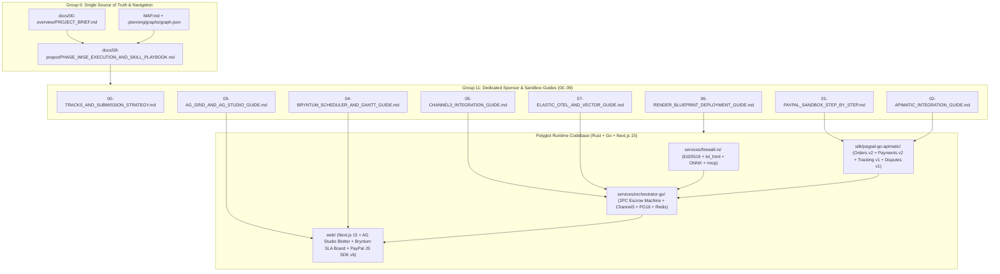

# MAP.md — Master Navigation Hub & O(1) Graphify Codebase Index

> **Single Entry Point for Judges, Developers, and Autonomous Coding Agents (`/gsd-*` & `/ralph-loop`)**
> Whenever you receive a prompt or task in this workspace (`g:\PAYPAL`), **consult Section 1 ("Where Do I Find...?") and Section 2 (Code & Symbol Index) first**. You never need to scan the entire repository.

---

## 1. "Where Do I Find...?" — Instant O(1) Task-to-File Lookup Table

| If Your Prompt / Task Is About... | Open This Exact File First | Secondary Reference |
| :--- | :--- | :--- |
| **Canonical Feature IDs (`F-01`..`F-14`), Entities (`E-01`..`E-10`), APIs (`API-01`..`API-16`), Models (`M-01`..`M-04`), Risks (`R-01`..`R-06`)** | [`docs/00-overview/PROJECT_BRIEF.md`](file:///g:/PAYPAL/docs/00-overview/PROJECT_BRIEF.md) | [`docs/01-product/PRD.md`](file:///g:/PAYPAL/docs/01-product/PRD.md) |
| **What Phase / Micro-Chunk (`TASK-01`..`TASK-16`) to execute next, which `/gsd-*` or `/ralph-loop` skill to invoke, or when a Human API Key Gate is needed** | [`docs/08-project/PHASE_WISE_EXECUTION_AND_SKILL_PLAYBOOK.md`](file:///g:/PAYPAL/docs/08-project/PHASE_WISE_EXECUTION_AND_SKILL_PLAYBOOK.md) | [`.agent/tasks.json`](file:///g:/PAYPAL/.agent/tasks.json) |
| **Which Hackathon Prize Tracks (`$36,500` EV across 8 prizes) we are submitting under & how to fill out the Devpost form** | [`docs/09-integrations-and-guides/00-TRACKS_AND_SUBMISSION_STRATEGY.md`](file:///g:/PAYPAL/docs/09-integrations-and-guides/00-TRACKS_AND_SUBMISSION_STRATEGY.md) | [`docs/00-overview/PITCH.md`](file:///g:/PAYPAL/docs/00-overview/PITCH.md) |
| **Setting up PayPal Developer Sandbox keys, Personal/Business accounts, Orders v2 `AUTHORIZE`, Shipment Tracking v1, Disputes v1, or JS SDK v6** | [`docs/09-integrations-and-guides/01-PAYPAL_SANDBOX_STEP_BY_STEP.md`](file:///g:/PAYPAL/docs/09-integrations-and-guides/01-PAYPAL_SANDBOX_STEP_BY_STEP.md) | [`sdk/paypal-go-apimatic/orders_v2.go`](file:///g:/PAYPAL/sdk/paypal-go-apimatic/orders_v2.go) |
| **Generating the typed Golang SDK & configuring the APIMatic Context Plugin in `.mcp.json`** | [`docs/09-integrations-and-guides/02-APIMATIC_INTEGRATION_GUIDE.md`](file:///g:/PAYPAL/docs/09-integrations-and-guides/02-APIMATIC_INTEGRATION_GUIDE.md) | [`.mcp.json`](file:///g:/PAYPAL/.mcp.json) |
| **Building the AG Grid Enterprise (`v33.1.0`) + AG Studio AI Copilot Live Escrow Blotter & Master-Detail Forensic Inspector** | [`docs/09-integrations-and-guides/03-AG_GRID_AND_AG_STUDIO_GUIDE.md`](file:///g:/PAYPAL/docs/09-integrations-and-guides/03-AG_GRID_AND_AG_STUDIO_GUIDE.md) | [`web/src/components/AgStudioBlotter.tsx`](file:///g:/PAYPAL/web/src/components/AgStudioBlotter.tsx) |
| **Building the Bryntum Scheduler Pro (`v6.1.4`) Two-Way SLA Board where dragging past deadline triggers PayPal `VOID`** | [`docs/09-integrations-and-guides/04-BRYNTUM_SCHEDULER_AND_GANTT_GUIDE.md`](file:///g:/PAYPAL/docs/09-integrations-and-guides/04-BRYNTUM_SCHEDULER_AND_GANTT_GUIDE.md) | [`web/src/components/BryntumSlaBoard.tsx`](file:///g:/PAYPAL/web/src/components/BryntumSlaBoard.tsx) |
| **Integrating Channel3 Merchant Reputation & SKU Price-Cap Oracle in Golang** | [`docs/09-integrations-and-guides/05-CHANNEL3_INTEGRATION_GUIDE.md`](file:///g:/PAYPAL/docs/09-integrations-and-guides/05-CHANNEL3_INTEGRATION_GUIDE.md) | [`services/orchestrator-go/internal/channel3/oracle.go`](file:///g:/PAYPAL/services/orchestrator-go/internal/channel3/oracle.go) |
| **Deploying the 5-service polyglot stack (`rust` + `go` + `node` + PG16 + Redis) to Render via `render.yaml`** | [`docs/09-integrations-and-guides/06-RENDER_BLUEPRINT_DEPLOYMENT_GUIDE.md`](file:///g:/PAYPAL/docs/09-integrations-and-guides/06-RENDER_BLUEPRINT_DEPLOYMENT_GUIDE.md) | [`render.yaml`](file:///g:/PAYPAL/render.yaml) |
| **Configuring Elastic Cloud OpenTelemetry traces & `elser_model_2` vector threat store** | [`docs/09-integrations-and-guides/07-ELASTIC_OTEL_AND_VECTOR_GUIDE.md`](file:///g:/PAYPAL/docs/09-integrations-and-guides/07-ELASTIC_OTEL_AND_VECTOR_GUIDE.md) | [`services/orchestrator-go/internal/telemetry/elastic_otel.go`](file:///g:/PAYPAL/services/orchestrator-go/internal/telemetry/elastic_otel.go) |
| **Running Postman MCP generator & Newman contract tests in CI** | [`docs/09-integrations-and-guides/08-POSTMAN_MCP_AND_COLLECTION_GUIDE.md`](file:///g:/PAYPAL/docs/09-integrations-and-guides/08-POSTMAN_MCP_AND_COLLECTION_GUIDE.md) | [`postman/Talos-Sandbox-MCP.postman_collection.json`](file:///g:/PAYPAL/postman/Talos-Sandbox-MCP.postman_collection.json) |
| **Connecting KERNEL headless browser sessions, Astropods adapters, or Zapier CFO Slack/Email webhooks** | [`docs/09-integrations-and-guides/09-KERNEL_ASTROPODS_ZAPIER_GUIDE.md`](file:///g:/PAYPAL/docs/09-integrations-and-guides/09-KERNEL_ASTROPODS_ZAPIER_GUIDE.md) | [`services/orchestrator-go/internal/kernel/browser.go`](file:///g:/PAYPAL/services/orchestrator-go/internal/kernel/browser.go) |
| **Implementing or debugging the Rust Ed25519 KYA Mandate & `lol_html` + `DeBERTa-v3` ONNX DOM Firewall** | [`services/firewall-rs/src/mandate.rs`](file:///g:/PAYPAL/services/firewall-rs/src/mandate.rs) | [`services/firewall-rs/src/sanitizer.rs`](file:///g:/PAYPAL/services/firewall-rs/src/sanitizer.rs) |
| **Implementing or debugging the Go 2PC Escrow State Machine & PostgreSQL hash-chained audit ledger** | [`services/orchestrator-go/internal/escrow/machine.go`](file:///g:/PAYPAL/services/orchestrator-go/internal/escrow/machine.go) | [`services/orchestrator-go/migrations/0001_init_schema.up.sql`](file:///g:/PAYPAL/services/orchestrator-go/migrations/0001_init_schema.up.sql) |
| **Delivering the `<2:45` 3-Act Demo Video or answering Judge Q&A** | [`docs/00-overview/PITCH.md`](file:///g:/PAYPAL/docs/00-overview/PITCH.md) | [`web/e2e/talos-3act-demo.spec.ts`](file:///g:/PAYPAL/web/e2e/talos-3act-demo.spec.ts) |

---

## 2. Reading Orders by Role

### A. Hackathon Judge — 3-Minute Fast Path
1. [`README.md`](file:///g:/PAYPAL/README.md) — 60-second executive overview, architecture diagram, and 90-second quickstart.
2. [`docs/00-overview/PITCH.md`](file:///g:/PAYPAL/docs/00-overview/PITCH.md) — The 3-Act Live Demo Script (`Act 1: Prompt Injection Blocked in 3.8ms`, `Act 2: Verified 2PC PayPal Escrow AUTHORIZE -> TRACKING -> CAPTURE`, `Act 3: Bryntum SLA Breach Drag -> Live PayPal VOID`).
3. [`docs/03-engineering/ARCHITECTURE.md`](file:///g:/PAYPAL/docs/03-engineering/ARCHITECTURE.md) — Polyglot Rust 1.85 + Go 1.24 + Next.js 15 C4 & sequence diagrams.
4. [`docs/09-integrations-and-guides/00-TRACKS_AND_SUBMISSION_STRATEGY.md`](file:///g:/PAYPAL/docs/09-integrations-and-guides/00-TRACKS_AND_SUBMISSION_STRATEGY.md) — How TALOS satisfies every overall and sponsor award rubric.

### B. Autonomous Coding Agent (`/gsd-*` & `/ralph-loop`) — Execution Path
1. [`CLAUDE.md`](file:///g:/PAYPAL/CLAUDE.md) & [`.planning/graphs/CODEBASE_INDEX.md`](file:///g:/PAYPAL/.planning/graphs/CODEBASE_INDEX.md) — Architectural invariants and symbol-to-file index.
2. [`docs/08-project/PHASE_WISE_EXECUTION_AND_SKILL_PLAYBOOK.md`](file:///g:/PAYPAL/docs/08-project/PHASE_WISE_EXECUTION_AND_SKILL_PLAYBOOK.md) — Exact phase-by-phase micro-chunk (`TASK-01`..`TASK-16`), skill invocations, and `[HUMAN ACTION REQUIRED]` credential checks.
3. [`api/openapi.yaml`](file:///g:/PAYPAL/api/openapi.yaml) & [`services/orchestrator-go/migrations/0001_init_schema.up.sql`](file:///g:/PAYPAL/services/orchestrator-go/migrations/0001_init_schema.up.sql) — Exact wire and database schemas.

---

## 3. Master Cross-Reference Dependency Graph (Mermaid)

---

## 4. Complete Annotated Directory Tree & File Catalog (`115+` Files)

### Root Governance, IaC & Entry Points
- [`README.md`](file:///g:/PAYPAL/README.md) — Public repository landing page, architecture, quickstart, and sponsor matrix.
- [`MAP.md`](file:///g:/PAYPAL/MAP.md) — This master navigation hub and O(1) lookup index.
- [`CLAUDE.md`](file:///g:/PAYPAL/CLAUDE.md) & [`AGENTS.md`](file:///g:/PAYPAL/AGENTS.md) — Operating instructions and strict coding guardrails for AI agents.
- [`LICENSE`](file:///g:/PAYPAL/LICENSE) — MIT Open-Source License at repository root (`R-05` Devpost Stage-1 requirement).
- [`render.yaml`](file:///g:/PAYPAL/render.yaml) — Native Render Blueprint deploying `firewall-rs`, `orchestrator-go`, `web`, PostgreSQL 16, and Redis.
- [`docker-compose.yml`](file:///g:/PAYPAL/docker-compose.yml) — Local 1-command stack (`postgres`, `redis`, `firewall-rs`, `orchestrator-go`, `web`).
- [`.env.example`](file:///g:/PAYPAL/.env.example) — Documented template for all PayPal Sandbox and Sponsor credentials.
- [`.mcp.json`](file:///g:/PAYPAL/.mcp.json) — MCP configuration wiring `talos-rust-firewall`, `paypal-official-mcp`, and `apimatic-context-plugin`.
- [`CONTRIBUTING.md`](file:///g:/PAYPAL/CONTRIBUTING.md), [`SECURITY.md`](file:///g:/PAYPAL/SECURITY.md), [`CODE_OF_CONDUCT.md`](file:///g:/PAYPAL/CODE_OF_CONDUCT.md), [`CHANGELOG.md`](file:///g:/PAYPAL/CHANGELOG.md).

### Group 0 — `docs/00-overview/` (4 Files)
- [`docs/00-overview/PROJECT_BRIEF.md`](file:///g:/PAYPAL/docs/00-overview/PROJECT_BRIEF.md) — Canonical Single Source of Truth (`F-01`..`F-14`, `P-01`..`P-04`, `E-01`..`E-10`, `API-01`..`API-16`, `M-01`..`M-04`, `R-01`..`R-06`).
- [`docs/00-overview/VISION.md`](file:///g:/PAYPAL/docs/00-overview/VISION.md) — First-principles thesis, North-Star metric (`Protected Agentic GMV`), and 1/5/10-year roadmap.
- [`docs/00-overview/PITCH.md`](file:///g:/PAYPAL/docs/00-overview/PITCH.md) — 30s Karp hook, `<2:45` 3-Act Jobs Demo Script, 8-click live demo runbook, and 26-question Judge Q&A bank.
- [`docs/00-overview/HACKATHON_PLAN.md`](file:///g:/PAYPAL/docs/00-overview/HACKATHON_PLAN.md) — 13-day / 8-phase execution schedule, cut-line matrix, and Day-12 feature freeze checklist.

### Group 1 — `docs/01-product/` (8 Files)
- [`docs/01-product/PRD.md`](file:///g:/PAYPAL/docs/01-product/PRD.md) — Full Product Requirements Document with Gherkin acceptance criteria.
- [`docs/01-product/PERSONAS.md`](file:///g:/PAYPAL/docs/01-product/PERSONAS.md) — Profiles for `P-01` Arjun Mehta, `P-02` Maya Lin, `P-03` Vikram Rao, and `P-04` Priya Nair.
- [`docs/01-product/USER_JOURNEYS.md`](file:///g:/PAYPAL/docs/01-product/USER_JOURNEYS.md) — Current vs. future state journeys, Mermaid sequence flows, and edge cases.
- [`docs/01-product/USER_STORIES.md`](file:///g:/PAYPAL/docs/01-product/USER_STORIES.md) — 16 stories (`US-01`..`US-16`) with `Given/When/Then` criteria mapped to `F-01`..`F-14`.
- [`docs/01-product/FEATURES.md`](file:///g:/PAYPAL/docs/01-product/FEATURES.md) — Feature matrix, MoSCoW priorities, sponsor dependencies, and feature flags.
- [`docs/01-product/ROADMAP.md`](file:///g:/PAYPAL/docs/01-product/ROADMAP.md) — MVP -> Day 30/60/90 -> 1-Year PayPal World + NPCI UPI roadmap.
- [`docs/01-product/METRICS.md`](file:///g:/PAYPAL/docs/01-product/METRICS.md) — North-Star metric tree, AARRR funnel, and OTel event taxonomy.
- [`docs/01-product/COMPETITIVE_ANALYSIS.md`](file:///g:/PAYPAL/docs/01-product/COMPETITIVE_ANALYSIS.md) — 8-competitor matrix, quadrant chart, and monopoly moat analysis.

### Group 2 — `docs/02-design/` (4 Files)
- [`docs/02-design/DESIGN_SYSTEM.md`](file:///g:/PAYPAL/docs/02-design/DESIGN_SYSTEM.md) — Obsidian glassmorphic dark-mode tokens, OKLCH palette, typography, and Bento grid rules.
- [`docs/02-design/UI_SPEC.md`](file:///g:/PAYPAL/docs/02-design/UI_SPEC.md) — ASCII wireframes & state specs for the 5 Command Center views.
- [`docs/02-design/ACCESSIBILITY.md`](file:///g:/PAYPAL/docs/02-design/ACCESSIBILITY.md) — WCAG 2.2 AA & India RPwD Act 2016 compliance, keyboard navigation, and Bryntum non-drag alternatives.
- [`docs/02-design/LOCALIZATION.md`](file:///g:/PAYPAL/docs/02-design/LOCALIZATION.md) — Multi-currency (`USD $`, `INR ₹`, `EUR €`, `GBP £`) & `en-US`/`en-IN`/`hi-IN` localization spec.

### Group 3 & 4 — `docs/03-engineering/` + `api/openapi.yaml` (20 Files)
- [`docs/03-engineering/ARCHITECTURE.md`](file:///g:/PAYPAL/docs/03-engineering/ARCHITECTURE.md) — C4 diagrams, 4-Act sequence diagrams, latency budgets, and failure modes.
- [`docs/03-engineering/TECH_STACK.md`](file:///g:/PAYPAL/docs/03-engineering/TECH_STACK.md) — Rust 1.85 + Go 1.24 + Next.js 15 version matrix and 10-sponsor integration rationale.
- [`docs/03-engineering/DATA_MODEL.md`](file:///g:/PAYPAL/docs/03-engineering/DATA_MODEL.md) — ER diagram, PostgreSQL 16 DDL for `E-01`..`E-09`, and Redis key patterns for `E-10`.
- [`docs/03-engineering/API_SPEC.md`](file:///g:/PAYPAL/docs/03-engineering/API_SPEC.md) — Full request/response examples and error codes for `API-01`..`API-16`.
- [`api/openapi.yaml`](file:///g:/PAYPAL/api/openapi.yaml) — Valid OpenAPI 3.1.0 specification.
- [`docs/03-engineering/INTEGRATIONS.md`](file:///g:/PAYPAL/docs/03-engineering/INTEGRATIONS.md) — Circuit breakers, timeouts, retries, and fallbacks for all 10 sponsors.
- [`docs/03-engineering/FRONTEND.md`](file:///g:/PAYPAL/docs/03-engineering/FRONTEND.md), [`docs/03-engineering/BACKEND.md`](file:///g:/PAYPAL/docs/03-engineering/BACKEND.md), [`docs/03-engineering/CODING_STANDARDS.md`](file:///g:/PAYPAL/docs/03-engineering/CODING_STANDARDS.md), [`docs/03-engineering/GIT_WORKFLOW.md`](file:///g:/PAYPAL/docs/03-engineering/GIT_WORKFLOW.md), [`docs/03-engineering/TESTING.md`](file:///g:/PAYPAL/docs/03-engineering/TESTING.md), [`docs/03-engineering/PERFORMANCE.md`](file:///g:/PAYPAL/docs/03-engineering/PERFORMANCE.md), [`docs/03-engineering/ENVIRONMENT_SETUP.md`](file:///g:/PAYPAL/docs/03-engineering/ENVIRONMENT_SETUP.md).
- ADRs: [`ADR-0000`](file:///g:/PAYPAL/docs/03-engineering/adr/ADR-0000-template.md), [`ADR-0001`](file:///g:/PAYPAL/docs/03-engineering/adr/ADR-0001-polyglot-rust-go-typescript-architecture.md), [`ADR-0002`](file:///g:/PAYPAL/docs/03-engineering/adr/ADR-0002-paypal-orders-v2-authorize-reversible-escrow.md), [`ADR-0003`](file:///g:/PAYPAL/docs/03-engineering/adr/ADR-0003-apimatic-context-plugin-and-golang-sdk-codegen.md), [`ADR-0004`](file:///g:/PAYPAL/docs/03-engineering/adr/ADR-0004-rust-lol-html-and-deberta-onnx-prompt-firewall.md), [`ADR-0005`](file:///g:/PAYPAL/docs/03-engineering/adr/ADR-0005-ag-grid-studio-and-bryntum-scheduler-command-center.md), [`ADR-0006`](file:///g:/PAYPAL/docs/03-engineering/adr/ADR-0006-render-native-polyglot-blueprint-deployment.md).

### Group 5 — `docs/04-ai/` (5 Files)
- [`docs/04-ai/MODELS.md`](file:///g:/PAYPAL/docs/04-ai/MODELS.md), [`docs/04-ai/PROMPTS.md`](file:///g:/PAYPAL/docs/04-ai/PROMPTS.md), [`docs/04-ai/AI_EVALS.md`](file:///g:/PAYPAL/docs/04-ai/AI_EVALS.md), [`docs/04-ai/DATA_PIPELINE.md`](file:///g:/PAYPAL/docs/04-ai/DATA_PIPELINE.md), [`docs/04-ai/RESPONSIBLE_AI.md`](file:///g:/PAYPAL/docs/04-ai/RESPONSIBLE_AI.md).

### Group 6 — `docs/05-ops/` + `.github/workflows/` (10 Files)
- [`docs/05-ops/CICD.md`](file:///g:/PAYPAL/docs/05-ops/CICD.md), [`docs/05-ops/INFRASTRUCTURE.md`](file:///g:/PAYPAL/docs/05-ops/INFRASTRUCTURE.md), [`docs/05-ops/DEPLOYMENT.md`](file:///g:/PAYPAL/docs/05-ops/DEPLOYMENT.md), [`docs/05-ops/OBSERVABILITY.md`](file:///g:/PAYPAL/docs/05-ops/OBSERVABILITY.md), [`docs/05-ops/RUNBOOK.md`](file:///g:/PAYPAL/docs/05-ops/RUNBOOK.md), [`docs/05-ops/COST.md`](file:///g:/PAYPAL/docs/05-ops/COST.md), [`docs/05-ops/SLA.md`](file:///g:/PAYPAL/docs/05-ops/SLA.md).
- Workflows: [`.github/workflows/ci-rust-go-web.yml`](file:///g:/PAYPAL/.github/workflows/ci-rust-go-web.yml), [`.github/workflows/security-and-eval.yml`](file:///g:/PAYPAL/.github/workflows/security-and-eval.yml), [`.github/workflows/deploy-render.yml`](file:///g:/PAYPAL/.github/workflows/deploy-render.yml).

### Group 7 — `docs/06-security-compliance/` (6 Files)
- [`docs/06-security-compliance/SECURITY_ARCHITECTURE.md`](file:///g:/PAYPAL/docs/06-security-compliance/SECURITY_ARCHITECTURE.md), [`docs/06-security-compliance/THREAT_MODEL.md`](file:///g:/PAYPAL/docs/06-security-compliance/THREAT_MODEL.md), [`docs/06-security-compliance/PRIVACY.md`](file:///g:/PAYPAL/docs/06-security-compliance/PRIVACY.md), [`docs/06-security-compliance/COMPLIANCE.md`](file:///g:/PAYPAL/docs/06-security-compliance/COMPLIANCE.md), [`docs/06-security-compliance/RISK_REGISTER.md`](file:///g:/PAYPAL/docs/06-security-compliance/RISK_REGISTER.md), [`docs/06-security-compliance/REGULATORY_SANDBOX.md`](file:///g:/PAYPAL/docs/06-security-compliance/REGULATORY_SANDBOX.md).

### Group 8 — `docs/07-business/` (6 Files)
- [`docs/07-business/BUSINESS_MODEL.md`](file:///g:/PAYPAL/docs/07-business/BUSINESS_MODEL.md), [`docs/07-business/GTM.md`](file:///g:/PAYPAL/docs/07-business/GTM.md), [`docs/07-business/FINANCIALS.md`](file:///g:/PAYPAL/docs/07-business/FINANCIALS.md), [`docs/07-business/IMPACT.md`](file:///g:/PAYPAL/docs/07-business/IMPACT.md), [`docs/07-business/MARKET_RESEARCH.md`](file:///g:/PAYPAL/docs/07-business/MARKET_RESEARCH.md), [`docs/07-business/FINANCIAL_GOVERNANCE.md`](file:///g:/PAYPAL/docs/07-business/FINANCIAL_GOVERNANCE.md).

### Group 9 — `docs/08-project/` (4 Files)
- [`docs/08-project/PHASE_WISE_EXECUTION_AND_SKILL_PLAYBOOK.md`](file:///g:/PAYPAL/docs/08-project/PHASE_WISE_EXECUTION_AND_SKILL_PLAYBOOK.md) — **Master 8-Phase / 16-Task Implementation & Skill Playbook**.
- [`docs/08-project/BACKLOG.md`](file:///g:/PAYPAL/docs/08-project/BACKLOG.md), [`docs/08-project/TEAM.md`](file:///g:/PAYPAL/docs/08-project/TEAM.md), [`docs/08-project/GLOSSARY.md`](file:///g:/PAYPAL/docs/08-project/GLOSSARY.md).

### Group 11 — `docs/09-integrations-and-guides/` (10 Dedicated Step-by-Step Sponsor & Sandbox Guides)
- [`00-TRACKS_AND_SUBMISSION_STRATEGY.md`](file:///g:/PAYPAL/docs/09-integrations-and-guides/00-TRACKS_AND_SUBMISSION_STRATEGY.md)
- [`01-PAYPAL_SANDBOX_STEP_BY_STEP.md`](file:///g:/PAYPAL/docs/09-integrations-and-guides/01-PAYPAL_SANDBOX_STEP_BY_STEP.md)
- [`02-APIMATIC_INTEGRATION_GUIDE.md`](file:///g:/PAYPAL/docs/09-integrations-and-guides/02-APIMATIC_INTEGRATION_GUIDE.md)
- [`03-AG_GRID_AND_AG_STUDIO_GUIDE.md`](file:///g:/PAYPAL/docs/09-integrations-and-guides/03-AG_GRID_AND_AG_STUDIO_GUIDE.md)
- [`04-BRYNTUM_SCHEDULER_AND_GANTT_GUIDE.md`](file:///g:/PAYPAL/docs/09-integrations-and-guides/04-BRYNTUM_SCHEDULER_AND_GANTT_GUIDE.md)
- [`05-CHANNEL3_INTEGRATION_GUIDE.md`](file:///g:/PAYPAL/docs/09-integrations-and-guides/05-CHANNEL3_INTEGRATION_GUIDE.md)
- [`06-RENDER_BLUEPRINT_DEPLOYMENT_GUIDE.md`](file:///g:/PAYPAL/docs/09-integrations-and-guides/06-RENDER_BLUEPRINT_DEPLOYMENT_GUIDE.md)
- [`07-ELASTIC_OTEL_AND_VECTOR_GUIDE.md`](file:///g:/PAYPAL/docs/09-integrations-and-guides/07-ELASTIC_OTEL_AND_VECTOR_GUIDE.md)
- [`08-POSTMAN_MCP_AND_COLLECTION_GUIDE.md`](file:///g:/PAYPAL/docs/09-integrations-and-guides/08-POSTMAN_MCP_AND_COLLECTION_GUIDE.md)
- [`09-KERNEL_ASTROPODS_ZAPIER_GUIDE.md`](file:///g:/PAYPAL/docs/09-integrations-and-guides/09-KERNEL_ASTROPODS_ZAPIER_GUIDE.md)

### Graphify, GSD & Ralph Loop Automation Directories (`.planning/` & `.agent/`)
- [`.planning/graphs/graph.json`](file:///g:/PAYPAL/.planning/graphs/graph.json), [`.planning/graphs/GRAPH_REPORT.md`](file:///g:/PAYPAL/.planning/graphs/GRAPH_REPORT.md), [`.planning/graphs/CODEBASE_INDEX.md`](file:///g:/PAYPAL/.planning/graphs/CODEBASE_INDEX.md).
- [`.planning/config.json`](file:///g:/PAYPAL/.planning/config.json), [`.planning/PROJECT.md`](file:///g:/PAYPAL/.planning/PROJECT.md), [`.planning/ROADMAP.md`](file:///g:/PAYPAL/.planning/ROADMAP.md), [`.planning/STATE.md`](file:///g:/PAYPAL/.planning/STATE.md).
- [`.agent/PROMPT.md`](file:///g:/PAYPAL/.agent/PROMPT.md), [`.agent/STEERING.md`](file:///g:/PAYPAL/.agent/STEERING.md), [`.agent/tasks.json`](file:///g:/PAYPAL/.agent/tasks.json), and [`.agent/tasks/TASK-01.json`](file:///g:/PAYPAL/.agent/tasks/TASK-01.json) .. [`TASK-16.json`](file:///g:/PAYPAL/.agent/tasks/TASK-16.json).
