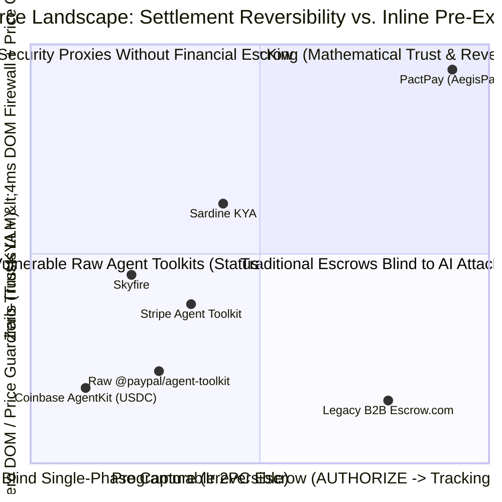

# Competitive Analysis & Monopoly Moat — PactPay (AegisPay)
> Project: PactPay (AegisPay) · Owner: Principal Architecture & Product Council · Status: Approved v1.0 · Last updated: 2026-11-01
> Related: [PROJECT_BRIEF](../00-overview/PROJECT_BRIEF.md) · [VISION](../00-overview/VISION.md) · [PRD](PRD.md) · [BUSINESS_MODEL](../07-business/BUSINESS_MODEL.md)

---

## 1. Landscape Overview: Why Existing Agentic Payment Tools Fail Enterprise Risk Audits

Between 2024 and 2026, payment processors and AI startups rushed to release **"Agent Payment Toolkits"**—wrapping existing REST APIs inside LLM function definitions (`@paypal/agent-toolkit`, `@stripe/agent-toolkit`, Coinbase AgentKit, Skyfire, Payman AI).

However, **every single incumbent tool treats the LLM as a trusted human user**:
1. They execute **single-phase irreversible settlement** (`intent: "CAPTURE"` or irreversible on-chain USDC transfers).
2. They perform **zero inline DOM prompt-injection sanitization** (`CVE-2026-22708`) before untrusted merchant HTML enters the LLM context window.
3. They lack an **independent 100M+ SKU fair-market price oracle** (`Channel3`) to stop merchants from price-gouging bots by `50%–100%`.
4. They provide **no two-way temporal SLA board** (`Bryntum Scheduler Pro`) or **live FinOps forensic blotter** (`AG Grid / AG Studio`) tied to carrier delivery tracking (`PayPal Shipment Tracking v1`) and automated dispute evidence submission (`PayPal Customer Disputes v1`).

---

## 2. Comprehensive Competitor Comparison Matrix (Global & India Ecosystem)

| Competitor / Solution | Category & Funding / Backing | Settlement Rail | Inline DOM Prompt-Injection Firewall (`<4ms`)? | Cryptographic KYA Mandate (`Ed25519` + RFC 9421)? | Independent Price-Gouging Oracle (100M+ SKUs)? | Reversible 2PC Escrow (`AUTHORIZE -> Tracking -> CAPTURE/VOID`)? | Temporal SLA Timeline & FinOps Blotter UI? | Pricing / Take Rate | Core Structural Weakness |
| :--- | :--- | :--- | :--- | :--- | :--- | :--- | :--- | :--- | :--- |
| **1. Raw `@paypal/agent-toolkit` (`mcp.paypal.com`)** | Official Open-Source Toolkit (`PayPal`, NASDAQ: `PYPL`) | PayPal (`Orders v2`, `Invoices`, `Tracking`, `Disputes`) | **No** (Trusts LLM context completely) | **No** (Static OAuth `client_id` / `secret`) | **No** | **No** (`create_order` defaults to immediate `CAPTURE`; `/provide-evidence` omitted) | **No** (Headless CLI / SDK only) | Free SDK (Standard PayPal merchant fees `2.99% + $0.49`) | Vulnerable to `CVE-2026-22708` DOM injection and blind overpayment; needs **PactPay** as its security & escrow control plane! |
| **2. Stripe Agent Toolkit (`@stripe/agent-toolkit` & ACP)** | Incumbent PSP (`Stripe`, `$70B+` Valuation) | Stripe Virtual Cards & PaymentIntents | **No** | Partial (Basic spend limits on virtual cards) | **No** (Card limit doesn't know if a `$90` cable should cost `$12`) | **No** (Virtual card charges settle via standard card rails without native carrier-tracking state gates) | **No** (Standard Stripe Dashboard) | `2.9% + $0.30` + `0.5%` Issuing / Agent fee | Virtual cards only cap total spend; they cannot detect a `$249` item gouged to `$295` under a `$300` card limit, nor auto-void via a Gantt SLA board. |
| **3. Coinbase AgentKit (`CDP`)** | Crypto Agent Wallet (`Coinbase`, NASDAQ: `COIN`) | Base / Solana On-Chain USDC & Smart Wallets | **No** | Partial (Smart contract allowlists) | **No** | **No — 100% Irreversible!** On-chain crypto transfers cannot be voided once broadcast. | **No** | Gas + `0.5%–1.0%` swap/onramp fees | **Fatal for B2B Procurement**: CFOs (`P-01`) and FinOps auditors (`P-04`) refuse irreversible crypto transfers with zero buyer protection or chargeback recourse. |
| **4. Skyfire (`skyfire.xyz`)** | AI Payment Network (`$9.5M` Seed — a16z CSX, Coinbase Ventures) | USDC-backed API micropayment balances | **No** | Partial (`KYA` API JWT tokens for API-to-API calls) | **No** | **No** (Built for sub-cent API data calls, not physical/B2B escrow with carrier tracking) | **No** | `2.0%–3.0%` platform fee | Focused on micro-API monetization (`$0.001` web scrapes), not physical/SaaS commerce on mainstream PayPal/fiat rails. |
| **5. Payman AI (`paymanai.com`)** | AI-to-Human Task Payouts (`$3M+` Pre-Seed) | ACH / USDC / Stripe Payouts | **No** | Basic policy rules | **No** | **No** (Built for agents paying gig humans, not B2B e-commerce escrow) | Basic approval queue | SaaS subscription + payout fee | Lacks DOM security firewall, Channel3 SKU price oracle, and PayPal Orders v2 / Disputes integration. |
| **6. Sardine AI / Visa Intelligent Commerce** | Enterprise Risk & Card Network (`Sardine $70M+` Series B / `Visa`) | Card Network Tokens & Risk Scores | **No** (Scores device/IP telemetry, not merchant HTML prompt injections) | Delegated card tokens | **No** (No SKU-level cross-merchant catalog lookup) | **No** (Relies on legacy 45-day card chargeback arbitration after funds are captured) | Legacy risk tables | Enterprise custom (`$50k+/yr`) | Closed card-network black box; takes weeks to deploy and offers zero open MCP server or two-way SLA timeline control. |
| **7. Indian PSP Wrappers (`Razorpay / Cashfree MCP Prototypes`)** | India Domestic PSPs (`YC / Peak XV`) | UPI One-Time / Autopay & Cards (`₹ INR`) | **No** | UPI Mandate (`₹15,000` RBI AFA threshold) | **No** | Partial (UPI block/debit exists for IPOs/hotels, not programmable B2B agent tracking escrow) | **No** | `2.0%` domestic / `3.0%+` cross-border | Lack global 200-market buyer/seller protection, **Channel3** 100M+ SKU price oracle, and sub-2ms Rust DOM sanitization. |
| **PactPay (`AegisPay` — Ours)** | **0-to-1 Category Creator** (Zero-Trust Agentic Firewall + 2PC PayPal Escrow Referee) | **PayPal Sandbox & ACS (`Orders v2 AUTHORIZE/CAPTURE/VOID`, `Tracking v1`, `Disputes v1`, `JS SDK v6`)** | **YES — `<3.8ms` Rust `lol_html` + INT8 `DeBERTa-v3` ONNX (`F-02`)** | **YES — `Ed25519` + RFC 9421 Signatures (`<1ms`, `F-01`)** | **YES — Channel3 100M+ SKU Median & Auto-Reroute (`F-04`)** | **YES — Deterministic Go 2PC State Machine via APIMatic Go SDK (`F-05`, `F-06`, `F-10`)** | **YES — AG Grid / AG Studio (`F-08`) + Bryntum Scheduler Pro (`F-07`)** | `25 bps` (`0.25%`) SaaS fee + `$499/mo` (`₹41.9k`) Enterprise | **Complements & supercharges PayPal's native stack rather than competing with it.** |

---

## 3. Strategic Positioning Matrix (`2x2` Quadrant)

---

## 4. Our Unfair Monopoly Moat (Peter Thiel + Warren Buffett Analysis)

Why can't a generic wrapper startup or a traditional WAF replicate PactPay quickly?

### 4.1 Moat #1: Polyglot Systems Architecture (`Rust + Go + APIMatic`) at the Protocol Boundary
- Most AI startups write everything in Python or Node.js and rely on calling a secondary LLM (`GPT-4o-mini`) to check for prompt injection—which adds `1,500ms` of latency, costs money on every page view, and is still vulnerable to jailbreaks.
- PactPay's `services/firewall-rs` combines Cloudflare's **`lol_html` streaming HTML parser** (`0.4ms`), NFKC Unicode tag stripping (`R-02`), and an in-memory **INT8 quantized `DeBERTa-v3` ONNX model (`M-01`, `3.4ms`)** inside an official **Rust MCP server (`rmcp`)**. Replicating this wire-speed security kernel requires deep systems engineering across Rust, ONNX Runtime, and RFC 9421 cryptography.

### 4.2 Moat #2: Cross-Merchant Fair-Price Graph + Federated Threat Flywheel (`Channel3 + Elastic`)
- A payment card limit (`$300`) is **price-blind**: it happily approves a `$290` purchase for a `$25` HDMI cable.
- By fusing **Channel3's** 100M+ SKU pricing graph (`F-04`) with **Elastic's** vector threat index (`F-12`, `M-04`), every transaction evaluated by PactPay enriches a proprietary dataset mapping **merchant domains -> historical price spreads + DOM prompt-injection risk scores**. Every new B2B buyer (`P-01`) makes the price and threat oracle smarter for all other buyers.

### 4.3 Moat #3: Native Symbiosis with PayPal's Unique Three-Pillar Settlement Stack
- Stripe and crypto rails do not natively link **29-day Authorization Holds (`Orders v2`)**, **Carrier Shipment Tracking (`Tracking v1`)**, and **Automated Dispute Evidence (`Disputes v1`)** under a single global consumer/merchant identity graph (`430M+` accounts).
- PactPay is purpose-built via **APIMatic (`sdk/paypal-go-apimatic`)** to orchestrate those exact three PayPal primitives alongside **AG Studio** and **Bryntum Scheduler Pro**—making PactPay the natural acquisition or strategic partnership target for **PayPal Agentic Commerce Services (ACS)**.
