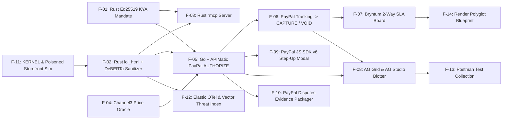

# Feature Matrix & Flag Catalog (`F-01` .. `F-14`) — PactPay (AegisPay)
> Project: PactPay (AegisPay) · Owner: Principal Architecture & Product Council · Status: Approved v1.0 · Last updated: 2026-11-01
> Related: [PROJECT_BRIEF](../00-overview/PROJECT_BRIEF.md) · [PRD](PRD.md) · [USER_STORIES](USER_STORIES.md) · [ROADMAP](ROADMAP.md) · [ARCHITECTURE](../03-engineering/ARCHITECTURE.md)

---

## 1. Master Feature Matrix (`F-01` .. `F-14`)

| ID | Feature Name | Core Technical Description | Primary Personas | MoSCoW | MVP (Hackathon) Status | Internal Dependencies | External / Sponsor Dependencies | Owner Service |
| :--- | :--- | :--- | :--- | :--- | :--- | :--- | :--- | :--- |
| **`F-01`** | **Cryptographic KYA Mandate Signer & Verifier** | `Ed25519` (`ed25519-dalek`) signing & `<1ms` verification of human spending mandates (`max_amount_cents`, `currency`, `allowed_categories`, `max_spread_bps`, `sla_hours`, `expires_at`) + RFC 9421 HTTP Message Signatures (`E-03`). | `P-01`, `P-02`, `P-04` | **Must** | **100% Live in MVP** (`API-01`, `API-02`) | PostgreSQL `kya_mandates` (`E-03`) | `ed25519-dalek`, `ring` | `services/firewall-rs` (Rust 1.85) |
| **`F-02`** | **Wire-Speed DOM Prompt-Injection Sanitizer** | Streaming HTML sanitizer (`lol_html` + NFKC normalizer + `aho-corasick`) + local INT8 `DeBERTa-v3` ONNX classifier (`M-01`) stripping hidden CSS/HTML prompt injections (`CVE-2026-22708`) in `<4ms` with forensic diff (`E-04`). | `P-02`, `P-04` | **Must** | **100% Live in MVP** (`API-03`) | `F-01`, `E-04`, `M-01` | Cloudflare `lol_html`, ONNX Runtime (`ort`) | `services/firewall-rs` (Rust 1.85) |
| **`F-03`** | **Rust Zero-Trust MCP Server (`rmcp`)** | Official `modelcontextprotocol/rust-sdk` (`rmcp`) exposing `pactpay_issue_mandate`, `pactpay_verify_mandate`, `pactpay_sanitize_dom`, and `pactpay_evaluate_checkout` over `stdio` and `HTTP/SSE`. | `P-02` | **Must** | **100% Live in MVP** | `F-01`, `F-02` | `rmcp` (Official Rust MCP SDK) | `services/firewall-rs` (Rust 1.85) |
| **`F-04`** | **Channel3 Fair-Market Price & SKU Authenticity Oracle** | Concurrent Go goroutine querying **Channel3 API (`trychannel3.com`)** across 100M+ SKUs to compute fair-market median price & basis-point spread (`E-05`); blocks price gouging (`>15%` median) and auto-reroutes to verified suppliers. | `P-01`, `P-03` | **Must** | **100% Live in MVP** (`API-06`) | `F-01`, `E-05` | **Channel3 API & MCP** (`trychannel3.com`) | `services/orchestrator-go` (Go 1.24) |
| **`F-05`** | **APIMatic-Powered PayPal Sandbox `Orders v2 AUTHORIZE` Engine** | Uses **APIMatic Context Plugin** + custom **APIMatic-generated Go SDK (`sdk/paypal-go-apimatic`)** + `@paypal/paypal-server-sdk` to lock 29-day PayPal Sandbox `Orders v2` (`intent: "AUTHORIZE"`) holds (`E-06`) with Redis `IdempotencyLock` (`E-10`). | `P-01`, `P-03` | **Must** | **100% Live in MVP** (`API-05`, `API-07`) | `F-01`, `F-02`, `F-04`, `E-06`, `E-10` | **PayPal Sandbox** (`Orders v2`) + **APIMatic** | `services/orchestrator-go` + `sdk/paypal-go-apimatic` |
| **`F-06`** | **Carrier Tracking SLA Monitor & Auto-`CAPTURE` / Auto-`VOID` Referee** | Integrates **PayPal Shipment Tracking v1** (`@paypal/agent-toolkit` `create_tracking` / `/v1/shipping/trackers-batch`). Auto-executes `authorizationsCapture` (`API-09`) on verified on-time delivery or `authorizationsVoid` (`API-10`) on SLA breach. | `P-01`, `P-03` | **Must** | **100% Live in MVP** (`API-08`..`API-10`, `API-14`) | `F-05`, `E-06`, `E-07`, `E-09` | **PayPal Shipment Tracking v1** + **Authorizations v2** | `services/orchestrator-go` (Go 1.24) |
| **`F-07`** | **Bryntum Scheduler Pro & Gantt Two-Way Payment SLA Board** | Interactive **Bryntum Scheduler Pro (`v6.1.x`)** timeline mapping 29-day PayPal authorization holds, 48h delivery SLAs, and downstream task dependencies (`E-07`). Dragging/expiring an SLA bar fires a live PayPal Sandbox `VOID` (`API-10`). | `P-01` | **Must** | **100% Live in MVP** (`API-13`, `API-15`) | `F-05`, `F-06`, `E-07` | **Bryntum Scheduler Pro & Gantt** (`@bryntum/schedulerpro-react`) | `web/` (Next.js 15 / TypeScript) |
| **`F-08`** | **AG Grid Enterprise & AG Studio Live Escrow Command Blotter** | Real-time streaming transaction blotter (`applyTransactionAsync`, `enableCellChangeFlash`), Master-Detail forensic drawer (DOM diff, `Ed25519` sig, Channel3 **AG Charts** spread), and embedded **AG Studio** AI copilot (`M-03`). | `P-01`, `P-04` | **Must** | **100% Live in MVP** (`API-12`, `API-15`) | `F-01`..`F-06`, `M-03` | **AG Grid Enterprise + AG Studio + AG Charts (`v33.1.0`)** | `web/` (Next.js 15 / TypeScript) |
| **`F-09`** | **PayPal JS SDK v6 Human-in-the-Loop Step-Up Co-Sign Modal** | Pauses agent orders exceeding autonomous mandate limits (`>$300`) and renders an interactive **PayPal JS SDK v6 (`@paypal/react-paypal-js`)** co-sign approval modal for the human principal. | `P-01`, `P-02` | **Must** | **100% Live in MVP** (`API-16`) | `F-01`, `F-05`, `E-06` | **PayPal JS SDK v6** (`@paypal/react-paypal-js`) | `web/` (Next.js 15 / TypeScript) |
| **`F-10`** | **Autonomous PayPal Disputes Evidence Packager** | Queries `/v1/customer/disputes` (`@paypal/agent-toolkit` `list_disputes`, `get_dispute`) and submits `Ed25519` mandate + **Channel3** SKU proof + **KERNEL** screenshot to `/v1/customer/disputes/{id}/provide-evidence` (`E-08`). | `P-03`, `P-04` | **Should** | **100% Live in MVP** (`API-11`) | `F-01`, `F-04`, `F-05`, `E-08`, `M-02` | **PayPal Customer Disputes v1** + **APIMatic Go SDK** | `services/orchestrator-go` (Go 1.24) |
| **`F-11`** | **KERNEL Cloud Browser & Poisoned Storefront Red-Team Simulator** | Connects to **KERNEL (`onkernel.com`)** disposable cloud browser sessions + includes an interactive 1-click **"Poisoned Merchant Simulator"** in `web/` so judges can trigger live DOM prompt-injection and price-gouging attacks. | `P-02`, Judges | **Must** | **100% Live in MVP** (`PoisonedStoreSim.tsx`) | `F-02`, `F-04` | **KERNEL (`onkernel.com`)** | `services/orchestrator-go` + `web/` |
| **`F-12`** | **Elastic Cloud OpenTelemetry APM & Vector Threat Index** | Exports distributed W3C OTel spans from Rust (`tracing-opentelemetry`) and Go (`go.opentelemetry.io/otel`) to **Elastic Cloud**, and indexes stripped prompt-injection embeddings (`M-04`) in Elasticsearch. | `P-04` | **Should** | **100% Live in MVP** | `F-02`, `F-05`, `M-04` | **Elastic Cloud (`v8.17` APM & Vector Store)** | `services/firewall-rs` + `services/orchestrator-go` |
| **`F-13`** | **Postman MCP Collection & 1-Click Judge Test Harness** | Complete `postman/PactPay-Sandbox-MCP.postman_collection.json` + environment file + `"Run in Postman"` badge in `README.md` testing every Rust MCP tool, Go endpoint, and PayPal Sandbox transition. | `P-02`, Judges | **Must** | **100% Live in MVP** | `API-01`..`API-16` | **Postman v11 & MCP Client** | `postman/` |
| **`F-14`** | **Render Native Polyglot Blueprint (`render.yaml`)** | 1-click declarative `render.yaml` provisioning `pactpay-firewall-rs` (`runtime: rust`), `pactpay-orchestrator-go` (`runtime: go`), `pactpay-console-web` (`runtime: node`), Render PostgreSQL 16, and Render Valkey. | `P-02`, Judges | **Must** | **100% Live in MVP** | `F-01`..`F-12` | **Render Cloud (`render.com`)** | `render.yaml` |

---

## 2. Feature Dependency Graph

---

## 3. Runtime Feature Flags & Circuit-Breaker Toggles

All runtime feature flags are configurable via environment variables (`.env.example`) and HTTP headers (`X-PactPay-Feature-*`) so judges, developers, and CI pipelines can test deterministic edge cases without redeploying:

| Flag Name (Env Var) | Default (`MVP`) | Service | Purpose & Fallback Behavior (`R-01`, `R-04`) |
| :--- | :--- | :--- | :--- |
| `FF_ONNX_CLASSIFIER_ENABLED` | `true` | `firewall-rs` | Enables INT8 `DeBERTa-v3` ONNX (`M-01`) inference alongside `lol_html`. If set to `false` (or compiled without `--features onnx` per `R-04`), falls back to the `<0.5ms` deterministic 140-pattern `lol_html` + `aho-corasick` rule engine. |
| `FF_UNICODE_TAG_SANITIZER` | `true` | `firewall-rs` | Normalizes NFKC Unicode and strips `U+E0000..U+E007F` invisible tag blocks and inline base64 payloads (`R-02`). |
| `FF_PAYPAL_SANDBOX_MODE` | `hybrid` (`live` with auto-replay fallback) | `orchestrator-go` | Controls PayPal Sandbox execution (`live`, `hybrid`, `deterministic-replay`). In `hybrid` mode (`R-01`), live calls go to `api-m.sandbox.paypal.com` and automatically fall back to signed recorded Sandbox payloads if Sandbox latency exceeds `2,800ms` or returns `5xx`. |
| `FF_CHANNEL3_AUTO_REROUTE` | `true` | `orchestrator-go` | When `true`, any merchant quote exceeding `KyaMandate.max_spread_bps` (`F-04`) is automatically rerouted to the lowest-priced verified **Channel3** merchant instead of terminating the workflow. |
| `FF_BRYNTUM_TWO_WAY_VOID` | `true` | `web/` + `orchestrator-go` | Enables live two-way binding (`API-13`) where dragging/expiring an SLA task bar on **Bryntum Scheduler Pro** (`F-07`) triggers `POST /v2/payments/authorizations/{id}/void` (`API-10`). |
| `FF_AG_STUDIO_COPILOT` | `true` | `web/` | Enables the **AG Studio** natural-language AI copilot (`M-03`) inside `AgStudioBlotter.tsx` (`F-08`), with instant fallback to deterministic AG Grid preset pivot buttons (`Fraud View`, `Escrow View`, `Channel3 Spread View`). |
| `FF_STEP_UP_JS_SDK_V6` | `true` | `web/` | Renders the interactive **PayPal JS SDK v6 (`@paypal/react-paypal-js`)** step-up approval modal (`F-09`) whenever an order exceeds `KyaMandate.max_amount_cents`. |
| `FF_ELASTIC_OTEL_EXPORT` | `true` | `firewall-rs` + `orchestrator-go` | Exports OpenTelemetry traces and vector threat embeddings (`F-12`) to Elastic Cloud when `ELASTIC_APM_SERVER_URL` is set, and always mirrors recent spans to `/api/v1/escrow/blotter` so the UI trace viewer works even without external Elastic credentials. |
