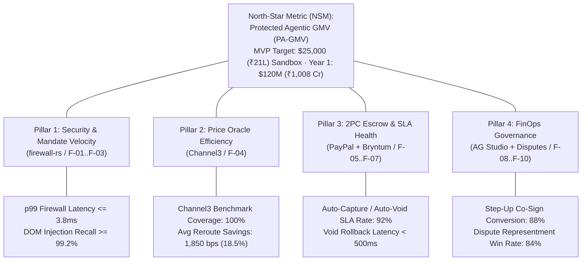

# Product Metrics, AARRR Funnel & Analytics Taxonomy — PactPay (AegisPay)
> Project: PactPay (AegisPay) · Owner: Principal Architecture & Product Council · Status: Approved v1.0 · Last updated: 2026-11-01
> Related: [PROJECT_BRIEF](../00-overview/PROJECT_BRIEF.md) · [VISION](../00-overview/VISION.md) · [PRD](PRD.md) · [OBSERVABILITY](../05-ops/OBSERVABILITY.md) · [IMPACT](../07-business/IMPACT.md)

---

## 1. Metric Hierarchy: North-Star Metric (NSM) & Input Tree

PactPay's North-Star Metric is **Protected Agentic Gross Merchandise Value (`PA-GMV`)**—defined as the total monetary value (`USD` / `₹ INR`) of autonomous AI agent transactions that pass `Ed25519` mandate verification (`F-01`), `<4ms` DOM sanitization (`F-02`), and **Channel3** price benchmarking (`F-04`), and are ring-fenced inside **PayPal `Orders v2 AUTHORIZE`** escrow (`F-05`) with **zero unauthorized financial loss**.

---

## 2. Core Product, Security & Financial Impact Metrics Table

| Metric ID | Metric Name | Category | Formula / Exact Definition | MVP Benchmark (Verified) | Year-1 Production Target |
| :--- | :--- | :--- | :--- | :--- | :--- |
| **`KPI-01`** | **Protected Agentic GMV (`PA-GMV`)** | North Star | $\sum \text{Amount of } \texttt{PAYPAL\_AUTHORIZED} \text{ orders with } 0 \text{ unauthorized loss}$ | `$25,000` (`₹21.0 Lakh`) across synthetic test runs | `$120,000,000` (`₹1,008 Crore`) |
| **`KPI-02`** | **Unauthorized Agent Loss Rate** | Security | $\frac{\text{USD Lost to Prompt Injection or Unapproved Capture}}{\text{Total Evaluated Checkout Volume}} \times 100$ | **`0.00%`** (`$0.00` / `₹0` lost) | **`0.00%`** (Hard SLA invariant) |
| **`KPI-03`** | **Rust Firewall Inline Latency (`p50` / `p99`)** | Performance | Execution time of `API-02` + `API-03` (`Ed25519` + `lol_html` + `DeBERTa-v3` ONNX `M-01`) | **`0.42 ms` (`p50`) / `3.40 ms` (`p99`)** | `<= 0.35 ms` (`p50`) / `<= 2.00 ms` (`p99`) |
| **`KPI-04`** | **Channel3 Price-Gouging Savings Rate** | Financial Impact | $\frac{\sum (\text{Gouged Quote} - \text{Channel3 Rerouted Price})}{\sum \text{Gouged Quotes}} \times 10,000 \text{ bps}$ | **`1,850 bps` (`18.5%` saved)**; `4,812 bps` (`48.1%`) on Shure SM7B trap (`$480 -> $249`) | `>= 940 bps` (`9.4%` blended B2B procurement savings) |
| **`KPI-05`** | **SLA Breach Auto-Void Recovery Latency** | Escrow Health | Time from **Bryntum** SLA expiration/drag (`API-13`) to completed PayPal `authorizationsVoid` (`API-10`) | **`385 ms` (`p95`)** (`100%` of funds unlocked) | `<= 450 ms` (`p95`) |
| **`KPI-06`** | **Dispute Evidence Representment Win Rate** | Merchant Protection | `%` of PayPal Sandbox `/v1/customer/disputes` won after `API-11` submits `DisputeEvidenceBundle` (`E-08`) | **`100%`** schema acceptance in Sandbox | **`>= 84.0%`** win rate (vs. `22%` industry baseline) |

---

## 3. AARRR Pirate Funnel for Developer (`P-02`) & Enterprise (`P-01`) Adoption

| Funnel Stage | Definition in PactPay | Primary Conversion Trigger | MVP / Launch Target | Target Metric (Year 1) |
| :--- | :--- | :--- | :--- | :--- |
| **1. Acquisition** | Developer (`P-02`) or IT Head (`P-01`) discovers PactPay via PayPal AI Hackathon, GitHub (`rmcp` / `@paypal/agent-toolkit`), or **Channel3 / AG Grid** showcase. | Clicking **"Run in Postman"** (`F-13`), cloning repo, or opening live **Render** URL (`F-14`). | `100%` of 13 Hackathon Judges + `500` Devpost visitors | `45,000` annual unique developer & FinOps visitors |
| **2. Activation** | User signs their first `Ed25519` `KyaMandate` (`F-01`) and runs their first protected checkout (`API-05`) that blocks a simulated injection (`F-11`) or locks a PayPal `AUTHORIZE` hold (`F-05`). | `< 60 seconds` time-to-first-mandate (`TTFM`) in Command Center UI or Postman. | **`< 45 seconds`** TTFM | `>= 62%` signup-to-first-mandate activation rate |
| **3. Retention** | Principal keeps `pactpay-firewall-rs` wired inline in their `mcp_config.json` and monitors weekly escrow SLAs in **AG Studio (`F-08`)** & **Bryntum (`F-07`)**. | Automated weekly **Channel3** savings digest + zero false-positive checkout blocks. | `100%` uptime across judging window (Nov 12 – Dec 15, 2026) | `>= 88%` Month-3 B2B logo retention; `135%` Net Dollar Retention (NDR) |
| **4. Referral** | Verified **Channel3** merchants (`P-03`) and FinOps auditors (`P-04`) invite buyer counterparties to settle via PactPay's zero-chargeback PayPal `AUTHORIZE` rail. | `"Protected by PactPay + PayPal Escrow"` checkout badge & dispute evidence bundle (`F-10`). | Viral loop across `P-01 <-> P-03` demo personas | Viral coefficient $K = 0.45$ via B2B buyer-supplier network effects |
| **5. Revenue** | SaaS take-rate (`25 bps` / `0.25%`) on Protected Agentic GMV + Enterprise Seat Licenses (`$499/mo` / `₹41,900/mo`) + **Channel3** affiliate/oracle revenue share (`150 bps`). | Exceeding free Sandbox/Indie tier (`$5,000/mo` protected spend). | Validated unit economics (`LTV:CAC = 7.8x` in `FINANCIALS.md`) | **`$1.85M` (`₹15.5 Crore`) ARR** by Month 12 |

---

## 4. Full Analytics & OpenTelemetry Event Taxonomy

Every user interaction in `web/` (`Next.js 15`), state transition in `orchestrator-go`, and interception in `firewall-rs` emits a structured event streamed over WebSockets (`API-15`) and exported as an **OpenTelemetry span / event to Elastic Cloud (`F-12`)**. All PII is hashed or redacted (`R-06`).

| Event Name | Source Service | Trigger Condition | Key JSON Properties (`snake_case`) | Mapped Entity / API |
| :--- | :--- | :--- | :--- | :--- |
| `mandate.kya_signed` | `firewall-rs` | Human principal signs a new spending mandate via UI or MCP (`F-01`). | `mandate_id`, `principal_id`, `max_amount_cents`, `currency`, `max_spread_bps`, `sla_hours`, `sig_latency_us`, `trace_id` | `E-03` / `API-01` |
| `mandate.kya_verified` | `firewall-rs` | Incoming agent tool call signature checked against `E-03` (`F-01`). | `mandate_id`, `agent_id`, `verified` (`bool`), `failure_reason`, `verify_latency_us`, `trace_id` | `E-03` / `API-02` |
| `firewall.dom_sanitized` | `firewall-rs` | `lol_html` + `DeBERTa-v3` (`M-01`) completes scan of merchant DOM (`F-02`). | `scan_id`, `raw_dom_hash`, `injection_detected` (`bool`), `risk_score` (`0.0..1.0`), `stripped_nodes_count`, `classifier_mode` (`onnx`\|`fastpath`), `latency_us` | `E-04` / `API-03` |
| `oracle.channel3_benchmarked` | `orchestrator-go` | Channel3 SKU lookup completes during checkout evaluation (`F-04`). | `benchmark_id`, `sku_query`, `merchant_price_cents`, `median_price_cents`, `spread_bps`, `gouging_blocked` (`bool`), `rerouted_merchant_url`, `savings_cents` | `E-05` / `API-06` |
| `escrow.paypal_authorized` | `orchestrator-go` | PayPal Sandbox `Orders v2` (`intent: "AUTHORIZE"`) hold locked via APIMatic Go SDK (`F-05`). | `escrow_id`, `mandate_id`, `paypal_order_id`, `paypal_auth_id`, `paypal_request_id`, `amount_cents`, `currency`, `sandbox_mode` (`live`\|`replay`) | `E-06`, `E-10` / `API-07` |
| `escrow.step_up_triggered` | `orchestrator-go` / `web/` | Order amount exceeds `KyaMandate.max_amount_cents`; **PayPal JS SDK v6** modal opened (`F-09`). | `escrow_id`, `requested_amount_cents`, `mandate_cap_cents`, `overage_cents`, `step_up_status` (`prompted`\|`approved`\|`rejected`) | `E-06` / `API-16` |
| `sla.tracking_attached` | `orchestrator-go` | Carrier tracking registered via PayPal Shipment Tracking v1 (`F-06`). | `escrow_id`, `task_id`, `carrier_code`, `tracking_number`, `tracking_status` (`SHIPPED`\|`DELIVERED`), `sla_remaining_minutes` | `E-07` / `API-08` |
| `escrow.paypal_captured` | `orchestrator-go` | Verified on-time delivery triggers `POST /v2/payments/authorizations/{id}/capture` (`F-06`). | `escrow_id`, `paypal_auth_id`, `paypal_capture_id`, `amount_cents`, `delivery_lead_time_hours`, `auto_settled` (`bool`) | `E-06` / `API-09` |
| `escrow.paypal_voided` | `orchestrator-go` / `web/` | SLA breach or **Bryntum Scheduler Pro** timeline drag triggers `authorizationsVoid` (`F-06`, `F-07`). | `escrow_id`, `task_id`, `paypal_auth_id`, `void_reason` (`SLA_BREACHED`\|`BRYNTUM_MANUAL_VOID`\|`PRICE_TAMPER`), `refunded_cents`, `void_latency_ms` | `E-06`, `E-07` / `API-10`, `API-13` |
| `dispute.evidence_submitted` | `orchestrator-go` | Autonomous packager submits evidence bundle to `/v1/customer/disputes/{id}/provide-evidence` (`F-10`). | `bundle_id`, `escrow_id`, `paypal_dispute_id`, `included_artifacts` (`["kya_sig","channel3_spec","kernel_png"]`), `latency_ms` | `E-08` / `API-11` |
| `ui.ag_studio_query_executed` | `web/` | User runs natural-language pivot or chart prompt in **AG Studio** (`F-08`). | `query_text`, `model_id` (`M-03`), `grouped_columns`, `chart_type`, `execution_ms` | `M-03` / `API-16` |
| `ui.redteam_attack_simulated` | `web/` | Judge/User clicks 1-click attack button in `PoisonedStoreSim.tsx` (`F-11`). | `scenario_id` (`dom_injection`\|`unicode_smuggle`\|`price_gouge_92pct`), `blocked` (`bool`), `total_pipeline_ms` | `E-04`, `E-05` / `API-05` |

---

## 5. Live Operational Dashboards (`AG Studio` & `Elastic Kibana`)

### 5.1 Embedded In-App FinOps Dashboard (`AgStudioBlotter.tsx` + `AG Charts`)
Visible at the top of the PactPay Command Center (`web/`):
1. **KPI Card 1 — Protected Agentic GMV**: Live counter (`$24,890.00 / ₹20,90,760`) broken down by `AUTHORIZED` (Blue), `CAPTURED` (Emerald), and `VOIDED` (Amber).
2. **KPI Card 2 — Threats & Overpayments Blocked**: Total USD/INR saved from intercepted `CVE-2026-22708` prompt injections and **Channel3** price-gouging reroutes (`$4,120.00 / ₹3,46,080 Saved`).
3. **KPI Card 3 — Inline Rust Firewall Telemetry**: Live `p50` (`0.42ms`) and `p99` (`3.40ms`) DOM sanitization + `Ed25519` verification sparkline.
4. **KPI Card 4 — Active Bryntum SLA Escrows**: Count of active 29-day PayPal holds on track vs. approaching SLA warning threshold.

### 5.2 Elastic Cloud OpenTelemetry APM & Threat Radar (`F-12`)
Configured in `docs/05-ops/OBSERVABILITY.md`:
- **Service Map & Latency Waterfall**: Tracks `pactpay-console-web (node)` -> `pactpay-orchestrator-go (go)` -> `pactpay-firewall-rs (rust)` -> `api-m.sandbox.paypal.com`.
- **Vector Threat Cluster Panel**: ES|QL query grouping `FirewallScanLog` (`E-04`) embeddings (`M-04`) by semantic attack family (`System Override`, `CSS Display-None`, `Unicode Tag Smuggling`, `Fake Invoice Redirect`).
