# Product Roadmap & Partnership Horizon — PactPay (AegisPay)
> Project: PactPay (AegisPay) · Owner: Principal Architecture & Product Council · Status: Approved v1.0 · Last updated: 2026-11-01
> Related: [PROJECT_BRIEF](../00-overview/PROJECT_BRIEF.md) · [VISION](../00-overview/VISION.md) · [PRD](PRD.md) · [FEATURES](FEATURES.md) · [GTM](../07-business/GTM.md)

---

## 1. Visual Horizon Roadmap (Hackathon MVP -> Day 30 / 60 / 90 -> 6 Months -> Year 1)

```mermaid
flowchart LR
    subgraph H0["Phase 0: Hackathon MVP<br/>(Oct 1 – Nov 12, 2026)"]
        M0A["Rust 1.85 Firewall (rmcp + lol_html + Ed25519)<br/>F-01, F-02, F-03"]
        M0B["Go 1.24 2PC Orchestrator + APIMatic Go SDK<br/>+ Channel3 Oracle (F-04, F-05, F-06, F-10)"]
        M0C["Next.js 15 Command Center (AG Studio +<br/>Bryntum Scheduler Pro + PayPal JS SDK v6)<br/>F-07..F-09, F-11..F-14"]
    end

    subgraph H1["Phase 1: Day 30–90 Pilot<br/>(Dec 2026 – Feb 2027)"]
        M1A["Day 30: Crates.io & Docker Hub Release<br/>+ WebAuthn / Apple Passkey Enclave Signing"]
        M1B["Day 60: Live PayPal Production ACS +<br/>DHL / FedEx / Delhivery Carrier Webhooks"]
        M1C["Day 90: PayPal World + NPCI UPI Cross-Border<br/>& RBI PA-CB / eFIRA Exporter Compliance"]
    end

    subgraph H2["Phase 2: 6-Month Scale<br/>(Mar – May 2027)"]
        M2A["Multimodal OCR Prompt-Injection Scanner<br/>& Federated Elastic Threat Graph"]
        M2B["AG Grid Server-Side Viewport (10M+ Rows)<br/>& Bryntum 100-Task Critical-Path Auto-Replan"]
    end

    subgraph H3["Phase 3: 1-Year Enterprise<br/>(Jun – Nov 2027)"]
        M3A["Corporate IdP Delegation Trees (Okta / Entra)<br/>& SAP Ariba / Coupa / NetSuite Connectors"]
        M3B["$120M (₹1,008 Cr) Annual Protected Agentic GMV<br/>Across 250 B2B Enterprises & 15k Developers"]
    end

    H0 --> H1 --> H2 --> H3
```

---

## 2. Detailed Milestone Breakdown

### Phase 0: Hackathon MVP (Completed for Nov 12, 2026 Submission)
- **Objective**: Deliver a 100% functional, end-to-end verifiable polyglot prototype running live on **Render** (`F-14`) and **PayPal Sandbox** (`api-m.sandbox.paypal.com`) that proves autonomous AI commerce can be mathematically bounded and 100% reversible.
- **Delivered Capabilities (`F-01` .. `F-14`)**:
  - `services/firewall-rs` (`Rust 1.85`): `Ed25519` + RFC 9421 mandate signing & `<1ms` verification (`F-01`), `lol_html` + INT8 `DeBERTa-v3` ONNX (`M-01`) DOM prompt-injection sanitizer (`<4ms`, `F-02`), and official `rmcp` MCP server (`F-03`).
  - `services/orchestrator-go` (`Go 1.24`) + `sdk/paypal-go-apimatic`: Parallel `errgroup` checkout evaluator (`API-05`), **Channel3** 100M+ SKU price-gouging oracle (`F-04`), **APIMatic-generated Go SDK** for **PayPal Sandbox `Orders v2 AUTHORIZE`** (`F-05`), **Shipment Tracking v1** auto-`CAPTURE` / auto-`VOID` referee (`F-06`), and **Customer Disputes v1** `/provide-evidence` packager (`F-10`).
  - `web/` (`Next.js 15` / `React 19`): Unified Dark-Mode Command Center hosting **AG Grid Enterprise + AG Studio + AG Charts (`v33.1.0`, `F-08`)**, **Bryntum Scheduler Pro (`v6.1.x`, `F-07`)**, **PayPal JS SDK v6 (`F-09`)** step-up co-sign modal, and **KERNEL / Poisoned Storefront Red-Team Simulator (`F-11`)**.
  - DevOps & Verification: **Elastic Cloud** OpenTelemetry APM & Vector Threat Index (`F-12`), **Postman MCP Collection (`F-13`)**, and 5-resource **Render Blueprint (`render.yaml`, `F-14`)**.

---

### Phase 1: 30 / 60 / 90-Day Post-Hackathon Launch Plan

| Milestone Window | Engineering Deliverables | Target Pilots & Design Partners | Measurable KPIs |
| :--- | :--- | :--- | :--- |
| **Day 30 (Dec 2026)**: *Open-Source Developer Launch & Passkey Signing* | - Publish `pactpay-firewall` to `crates.io`, `npm` (`@pactpay/mcp-proxy`), and Docker Hub. - Upgrade `F-01` (`Ed25519`) to support hardware-backed **WebAuthn / Apple TouchID / Android Passkeys**. - Ship GitHub Actions Newman contract gate using `F-13` Postman collection. | **500 Indie AI Developers (`P-02`)** building with Claude Desktop, Cursor, and `@paypal/agent-toolkit`. | - `1,500+` GitHub Stars - `500` active MCP proxy installs - `< 2.0ms` p99 Rust firewall latency |
| **Day 60 (Jan 2027)**: *Production PayPal ACS & Live Carrier Webhooks* | - Transition `F-05` & `F-06` from PayPal Sandbox to live **PayPal Agentic Commerce Services (ACS)** production credentials. - Add direct webhook ingestion for **FedEx, UPS, DHL, and Delhivery (India)** alongside PayPal Shipment Tracking v1. - Release Slack & Microsoft Teams interactive step-up approval cards wrapping `F-09`. | **10 Mid-Market SaaS Procurement Teams (`P-01`)** (Bengaluru & SF corridor) + **25 Verified Channel3 Merchants (`P-03`)**. | - `$1.5M` (`₹12.6 Cr`) Protected Agentic GMV - `0.00%` unauthorized agent spend loss - `>= 14%` avg procurement savings via Channel3 |
| **Day 90 (Feb 2027)**: *PayPal World (NPCI UPI) & India Exporter Compliance* | - Integrate **PayPal World + NPCI UPI Delegated Circle** rails for domestic and cross-border Indian (`₹ INR`) settlements. - Automate **RBI PA-CB** purpose code tagging (`P0802` / `P0103`) and instant **eFIRA** certificate attachment inside **AG Studio (`F-08`)** for Indian MSME exporters (`P-03`, `R-06`). | **50 Indian B2B Electronics & IT Hardware Exporters (`P-03`)** selling to US/EU corporate AI agents. | - `$6.0M` (`₹50.4 Cr`) cumulative PA-GMV - `< 0.05%` post-capture chargeback rate - SOC 2 Type I audit readiness |

---

### Phase 2: 6-Month Expansion (May 2027) — Multimodal Shield & Supply-Chain Autonomy
1. **Multimodal Visual Prompt-Injection Firewall (`F-02 v1`)**:
   - Extend `services/firewall-rs` with an INT8 quantized vision-language OCR sanitizer to detect adversarial text hidden inside merchant product JPEG/WebP images (steganographic/typographic attacks).
2. **Federated Elastic Threat Intelligence Network (`F-12 v1`)**:
   - Real-time zero-day prompt-injection signature sharing across all PactPay nodes via **Elastic Cloud (`M-04`)**—when a poisoned storefront attacks Customer A's agent, Customer B's agent blocks that merchant domain globally within `200ms`.
3. **Enterprise Scale AG Studio & Bryntum Critical-Path Engine (`F-07 v1`, `F-08 v1`)**:
   - Upgrade **AG Grid Enterprise** to the Server-Side Row Model (`SSRM`) supporting `10M+` historical audit rows for Big-4 FinOps auditors (`P-04`).
   - Upgrade **Bryntum Scheduler Pro & Gantt** to orchestrate 100+ chained multi-supplier bills of materials (BOM), automatically re-planning critical paths and splitting PayPal multi-party authorizations when a sub-tier supplier slips.

---

### Phase 3: 1-Year Enterprise Horizon (November 2027) — Global KYA Clearinghouse
1. **Corporate IdP Delegation Graphs (`F-01 v2`)**:
   - Native SCIM/OIDC integration with **Okta, Microsoft Entra ID, and Google Workspace** allowing CFOs to delegate hierarchical `Ed25519` spending budgets down to department heads and specialized AI agent swarms.
2. **ERP & Procurement Suite Connectors**:
   - Turnkey plugins for **SAP Ariba, Coupa, Oracle NetSuite, and Zoho Books (India)** so every PayPal `AUTHORIZE -> CAPTURE / VOID` lifecycle event reconciles automatically into the general ledger.
3. **Year-1 Commercial Milestone**:
   - **$120M (`₹1,008 Crore`) in Annual Protected Agentic GMV** across **250 B2B enterprises** and **15,000 developer accounts**, establishing PactPay as the de facto security and escrow standard for PayPal Agentic Commerce.

---

## 3. Strategic Ecosystem & Sponsor Partnerships

| Partner Organization | Strategic Co-Sell & Technical Integration | Mutual Value Created |
| :--- | :--- | :--- |
| **PayPal (`Agentic Commerce Services & PayPal World`)** | Position PactPay as the official open-source & enterprise **KYA Security + Reversible Escrow Reference Architecture** for `@paypal/agent-toolkit` and `mcp.paypal.com`. | Eliminates CFO fear of `intent: "CAPTURE"`, driving high-ticket B2B procurement volume onto PayPal `Orders v2`, `Tracking v1`, and `JS SDK v6`. |
| **AG Grid (`AG Grid Enterprise & AG Studio`)** | Showcase PactPay as the flagship fintech reference app for **AG Studio** ("AI-assisted FinOps blotter & Master-Detail forensics"). | Converts enterprise FinOps teams (`P-04`) into multi-seat **AG Grid Enterprise + AG Studio** licensees. |
| **Bryntum (`Scheduler Pro & Gantt`)** | Co-market PactPay's **Two-Way Payment-Bound Timeline** pattern where project management bars directly control financial escrow holds. | Expands Bryntum from pure project scheduling into transactional FinOps and supply-chain escrow governance. |
| **APIMatic (`SDK & Context Plugin Platform`)** | Publish `sdk/paypal-go-apimatic` and the **APIMatic PayPal Context Plugin** workflow as a blueprint for zero-hallucination polyglot agent SDKs. | Demonstrates how APIMatic bridges language gaps (Golang) and complex endpoints (`/provide-evidence`) for AI agents. |
| **Channel3 (`trychannel3.com`)** | Embed Channel3 as the mandatory **Fair-Market Price Oracle** on every PactPay B2B checkout evaluation (`F-04`). | Drives high-converting, pre-authorized PayPal checkout volume directly to verified Channel3 merchants (`P-03`) + shared affiliate/oracle revenue. |
| **Render (`render.com`) & Elastic (`elastic.co`)** | Distribute PactPay's 1-click **`render.yaml` Blueprint** (`F-14`) pre-wired with **Elastic Cloud OpenTelemetry APM (`F-12`)**. | Every enterprise deploying a private PactPay instance provisions managed Rust, Go, Node, Postgres, and Valkey services on Render + Elastic APM. |
