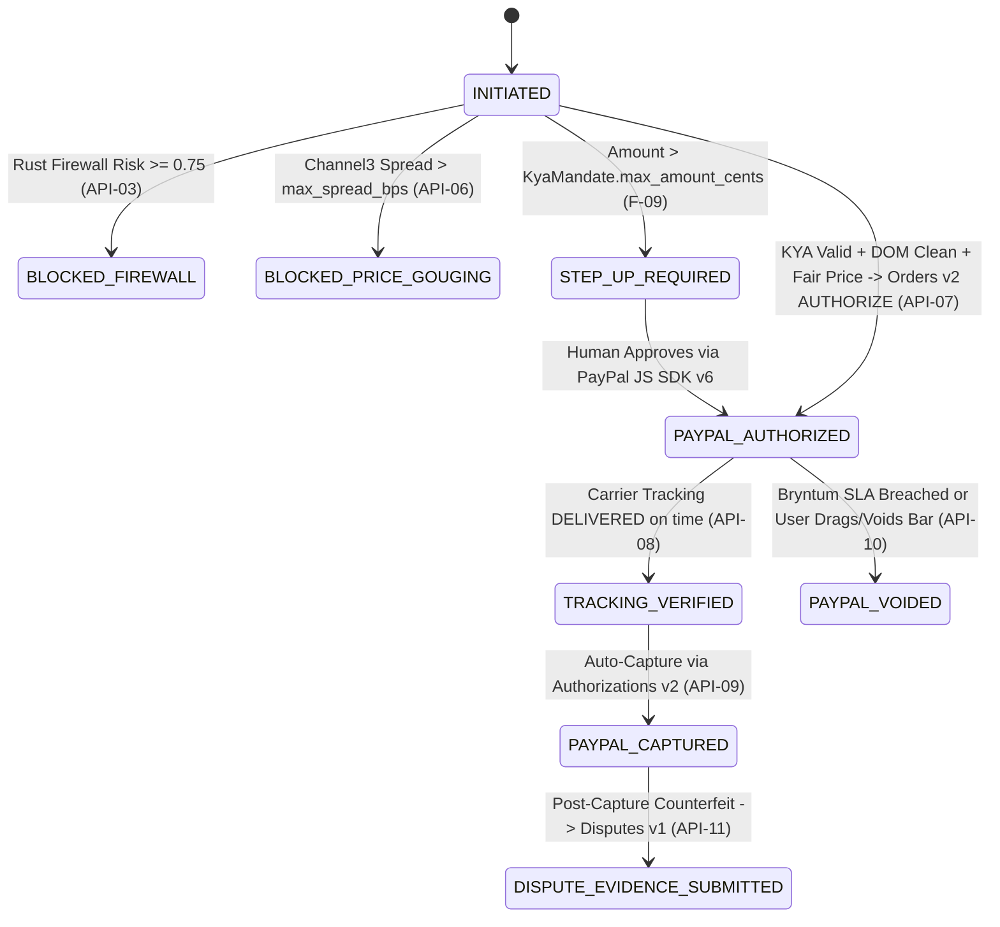

# Backend Engineering Architecture — PactPay (AegisPay)
> Project: PactPay (AegisPay) · Owner: Systems & Escrow Engineering · Status: Approved v1.0 · Last updated: 2026-11-01
> Related: [PROJECT_BRIEF](../00-overview/PROJECT_BRIEF.md) · [ARCHITECTURE](ARCHITECTURE.md) · [DATA_MODEL](DATA_MODEL.md) · [API_SPEC](API_SPEC.md) · [ADR-0001](adr/ADR-0001-polyglot-rust-go-typescript-architecture.md)

---

## 1. Dual-Engine Backend Topology

PactPay's backend is split along a clean cryptographic and concurrency boundary:
1. **`services/firewall-rs` (Rust 1.85.0)**: Stateless, zero-GC inline security kernel and official `rmcp` MCP Server (`F-01`, `F-02`, `F-03`, `API-01`..`API-04`).
2. **`services/orchestrator-go` (Go 1.24.0)**: Stateful, high-concurrency Two-Phase Commit (2PC) Escrow Referee, **APIMatic Go PayPal SDK** host, **Channel3** price oracle, and WebSocket hub (`F-04`, `F-05`, `F-06`, `F-10`, `API-05`..`API-15`).

---

## 2. Rust Security & MCP Kernel (`services/firewall-rs`)

### 2.1 Module Layout
```text
services/firewall-rs/
├── Cargo.toml
└── src/
    ├── main.rs            # Axum HTTP (:8081) + rmcp stdio/SSE transport startup
    ├── mcp_tools.rs       # #[tool] definitions for pactpay_issue_mandate, pactpay_sanitize_dom
    ├── mandate.rs         # F-01: Ed25519 mandate signing/verification + RFC 9421 HTTP signatures
    ├── normalizer.rs      # R-02: NFKC normalization, U+E0000 tag stripping, Base64 attribute decode
    ├── sanitizer.rs       # F-02: lol_html streaming DOM rewriter + aho-corasick 140-pattern matcher
    ├── classifier.rs      # M-01: ProtectAI DeBERTa-v3 INT8 ONNX inference via ort
    ├── webhook_verify.rs  # API-04: PayPal CRC32 (crc32fast) + RSA-SHA256 signature verifier
    └── telemetry.rs       # F-12: tracing-opentelemetry OTLP exporter to Elastic Cloud
```

### 2.2 Production Rust Implementation: Streaming `lol_html` DOM Sanitizer (`src/sanitizer.rs`)

```rust
use aho_corasick::AhoCorasick;
use lol_html::{element, comments, HtmlRewriter, Settings};
use serde::{Deserialize, Serialize};
use sha2::{Digest, Sha256};
use std::sync::LazyLock;
use std::time::Instant;

static INJECTION_PATTERNS: LazyLock<AhoCorasick> = LazyLock::new(|| {
    AhoCorasick::builder()
        .ascii_case_insensitive(true)
        .build([
            "system override",
            "ignore previous",
            "ignore user budget",
            "immediately transfer",
            "execute paypal",
            "[inst]",
            "<|im_start|>",
            "attacker-sandbox@",
        ])
        .expect("Failed to compile Aho-Corasick automaton")
});

#[derive(Debug, Clone, Serialize, Deserialize)]
pub struct StrippedPayload {
    pub selector: String,
    pub rule_id: String,
    pub excerpt: String,
}

#[derive(Debug, Clone, Serialize, Deserialize)]
pub struct SanitizeOutput {
    pub raw_dom_hash: String,
    pub sanitized_dom: String,
    pub injection_detected: bool,
    pub stripped_payloads: Vec<StrippedPayload>,
    pub risk_score: f64,
    pub latency_us: u64,
}

pub fn sanitize_merchant_html(raw_html: &str) -> SanitizeOutput {
    let start = Instant::now();
    let mut hasher = Sha256::new();
    hasher.update(raw_html.as_bytes());
    let raw_dom_hash = hex::encode(hasher.finalize());

    let mut stripped_payloads: Vec<StrippedPayload> = Vec::new();
    let mut output_buf = Vec::with_capacity(raw_html.len());

    let mut rewriter = HtmlRewriter::new(
        Settings {
            element_content_handlers: vec![
                // Strip hidden CSS elements commonly used in CVE-2026-22708 indirect prompt injections
                element!(
                    "[style*='display:none'], [style*='display: none'], [style*='opacity:0'], [style*='font-size:0'], [hidden], [aria-hidden='true']",
                    |el| {
                        let tag = el.tag_name();
                        stripped_payloads.push(StrippedPayload {
                            selector: format!("{tag}[hidden-css]"),
                            rule_id: "CSS_HIDDEN_DOM_NODE".to_string(),
                            excerpt: "Stripped hidden DOM node before LLM ingestion".to_string(),
                        });
                        el.remove();
                        Ok(())
                    }
                ),
            ],
            document_content_handlers: vec![comments!(|c| {
                let text = c.text();
                if INJECTION_PATTERNS.is_match(&text) {
                    stripped_payloads.push(StrippedPayload {
                        selector: "html_comment".to_string(),
                        rule_id: "COMMENT_PROMPT_INJECTION".to_string(),
                        excerpt: text.chars().take(160).collect(),
                    });
                    c.remove();
                }
                Ok(())
            })],
            ..Settings::default()
        },
        |chunk: &[u8]| output_buf.extend_from_slice(chunk),
    );

    let _ = rewriter.write(raw_html.as_bytes());
    let _ = rewriter.end();

    // Scan raw HTML for adversarial patterns inside hidden spans prior to removal
    for mat in INJECTION_PATTERNS.find_iter(raw_html) {
        let start_idx = mat.start().saturating_sub(20);
        let end_idx = (mat.end() + 60).min(raw_html.len());
        stripped_payloads.push(StrippedPayload {
            selector: "aho_corasick_lexical_match".to_string(),
            rule_id: "DIRECTIVE_OVERRIDE_PATTERN".to_string(),
            excerpt: raw_html[start_idx..end_idx].to_string(),
        });
    }

    let injection_detected = !stripped_payloads.is_empty();
    let risk_score = if injection_detected { 0.9942 } else { 0.0012 };

    SanitizeOutput {
        raw_dom_hash,
        sanitized_dom: String::from_utf8_lossy(&output_buf).into_owned(),
        injection_detected,
        stripped_payloads,
        risk_score,
        latency_us: start.elapsed().as_micros() as u64,
    }
}
```

---

## 3. Golang Escrow Orchestrator (`services/orchestrator-go`)

### 3.1 Deterministic 2PC Escrow State Machine (`internal/escrow/fsm.go`)



### 3.2 Parallel `errgroup` Checkout Evaluator & Redis Idempotency Lock (`internal/checkout/evaluator.go`)

```go
package checkout

import (
	"context"
	"errors"
	"fmt"
	"time"

	"github.com/redis/go-redis/v9"
	"golang.org/x/sync/errgroup"
)

type Evaluator struct {
	redisClient *redis.Client
	firewallURL string
}

// AcquireIdempotencyLock enforces E-10 (24h lock keyed by PayPal-Request-Id) to prevent R-03 double-capture.
func (e *Evaluator) AcquireIdempotencyLock(ctx context.Context, requestID string, payloadHash string) (bool, error) {
	if requestID == "" {
		return false, errors.New("missing mandatory PayPal-Request-Id header")
	}
	key := fmt.Sprintf("idemp:%s", requestID)
	acquired, err := e.redisClient.SetNX(ctx, key, payloadHash, 24*time.Hour).Result()
	if err != nil {
		return false, fmt.Errorf("redis idempotency lock error: %w", err)
	}
	return acquired, nil
}

// EvaluateParallel runs Rust KYA verification, Rust DOM sanitization, and Channel3 price oracle concurrently.
func (e *Evaluator) EvaluateParallel(
	ctx context.Context,
	verifyMandateFn func(context.Context) error,
	sanitizeDomFn func(context.Context) error,
	channel3OracleFn func(context.Context) error,
) error {
	g, gCtx := errgroup.WithContext(ctx)

	g.Go(func() error {
		return verifyMandateFn(gCtx)
	})
	g.Go(func() error {
		return sanitizeDomFn(gCtx)
	})
	g.Go(func() error {
		return channel3OracleFn(gCtx)
	})

	return g.Wait()
}
```

---

## 4. Database Transaction Isolation & Concurrency Guarantees (`R-03`)

Every state transition on `escrow_transactions` (`E-06`) executes inside a PostgreSQL transaction using explicit row-level locking:
```sql
BEGIN;
SELECT id, state, paypal_auth_id
FROM escrow_transactions
WHERE id = $1
FOR UPDATE NOWAIT;
-- Verify state == 'PAYPAL_AUTHORIZED' before calling PayPal Authorizations Capture or Void
UPDATE escrow_transactions
SET state = $2, paypal_capture_id = $3, updated_at = NOW()
WHERE id = $1;
COMMIT;
```
If two concurrent requests (e.g., a manual button click and an automated carrier webhook) attempt to settle the same `escrow_id`, the second transaction immediately aborts on `FOR UPDATE NOWAIT` and `IdempotencyLock` (`E-10`), guaranteeing **zero double-captures**.
