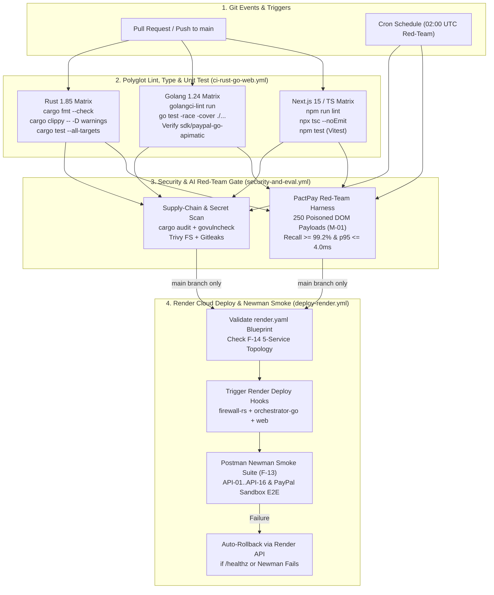

# CI/CD Pipeline Architecture — PactPay (AegisPay)
> Project: PactPay (AegisPay) · Owner: Principal DevSecOps & Platform Council · Status: Approved v1.0 · Last updated: 2026-11-01
> Related: [PROJECT_BRIEF](../00-overview/PROJECT_BRIEF.md) · [INFRASTRUCTURE](INFRASTRUCTURE.md) · [DEPLOYMENT](DEPLOYMENT.md) · [AI_EVALS](../04-ai/AI_EVALS.md) · [TESTING](../03-engineering/TESTING.md)

---

## 1. Executive Summary & Pipeline Philosophy

PactPay operates a **zero-trust, polyglot Continuous Integration and Continuous Deployment (CI/CD) pipeline** engineered for three concurrent language runtimes—**Rust 1.85 (`services/firewall-rs`)**, **Golang 1.24 (`services/orchestrator-go` + `sdk/paypal-go-apimatic`)**, and **Next.js 15 / TypeScript (`web/`)**—alongside automated red-team AI prompt-injection evaluations (`M-01`, `M-02`) and declarative multi-service cloud deployments via **Render Blueprints (`F-14`)** and **Postman/Newman contract verification (`F-13`)**.

### Core Pipeline Invariants
1. **No Unverified Code Reaches PayPal Sandbox**: Every pull request must pass deterministic Rust `clippy`/`cargo test`, Go `-race` concurrency detectors, TypeScript strict type-checking, and APIMatic SDK schema validation before merge.
2. **Continuous AI Red-Team Gate (`F-02`, `M-01`)**: Any change to `services/firewall-rs/src/sanitizer.rs` or system prompts automatically triggers the 250-sample adversarial DOM prompt-injection benchmark (`CVE-2026-22708` corpus). Builds fail if recall drops below `99.2%` or p95 latency exceeds `4.0ms`.
3. **Stage-1 Devpost Compliance Gate (`R-05`)**: Every workflow run verifies that `/LICENSE` (MIT) and `/README.md` exist at the repository root and that zero plaintext credentials exist in git history via Gitleaks.

---

## 2. End-to-End CI/CD Architecture Diagram



---

## 3. Pipeline Stages & Quality Gates

| Stage | Workflow File | Target Services / Models | Hard Pass Criteria | Timeout |
| :--- | :--- | :--- | :--- | :--- |
| **Stage 1A: Rust Kernel CI** | `.github/workflows/ci-rust-go-web.yml` | `services/firewall-rs` (`F-01`, `F-02`, `F-03`, `M-01`) | `0` warnings in `clippy`, `100%` pass on `Ed25519` (`API-01`, `API-02`), `lol_html` (`API-03`), and `CRC32` (`API-04`) unit tests. | `6 min` |
| **Stage 1B: Go Orchestrator CI** | `.github/workflows/ci-rust-go-web.yml` | `services/orchestrator-go`, `sdk/paypal-go-apimatic` (`F-04`..`F-06`, `F-10`) | `0` data races under `go test -race`, `golangci-lint` clean, 2PC state-machine idempotency (`E-06`, `E-10`) verified. | `5 min` |
| **Stage 1C: Web Command Center CI** | `.github/workflows/ci-rust-go-web.yml` | `web/` (`F-07`, `F-08`, `F-09`, `F-11`) | Strict TypeScript (`tsc --noEmit`), AG Grid / Bryntum / PayPal JS SDK v6 component tests pass, production build succeeds. | `5 min` |
| **Stage 2A: DevSecOps & License Gate** | `.github/workflows/security-and-eval.yml` | Entire Monorepo (`R-02`, `R-05`) | MIT `LICENSE` present (`R-05`), `0` leaked secrets in Gitleaks, `0` critical CVEs in `cargo audit`, `govulncheck`, and Trivy. | `4 min` |
| **Stage 2B: AI Prompt-Injection Eval** | `.github/workflows/security-and-eval.yml` | `services/firewall-rs` (`M-01`, `E-04`) | Prompt-injection block rate `>= 99.2%`, false-positive rate on benign merchant HTML `<= 0.5%`, p95 scan latency `< 4.0ms`. | `5 min` |
| **Stage 3: Render Deploy & Newman E2E** | `.github/workflows/deploy-render.yml` | Render Cloud (`F-13`, `F-14`) | All 3 compute services pass `/healthz` within `90s`; Postman collection (`PactPay-Sandbox-MCP.postman_collection.json`) passes 100% of assertions. | `8 min` |

---

## 4. Complete GitHub Actions Workflows (Inline Reference)

All three production workflows live in `.github/workflows/` and are committed directly to the repository:

### 4.1 Polyglot CI Workflow (`.github/workflows/ci-rust-go-web.yml`)
Runs concurrently across Rust 1.85, Go 1.24, and Node 22 on every push and pull request. Uses `Swatinem/rust-cache@v2` and `actions/setup-go@v5` caching to keep warm build times under 95 seconds (mitigating `R-04`).

```yaml
# Summary of .github/workflows/ci-rust-go-web.yml
name: "PactPay Polyglot CI (Rust + Go + Web)"
on:
  push:
    branches: [main, develop]
  pull_request:
    branches: [main]
jobs:
  license-and-structure-gate: # Enforces R-05 (MIT LICENSE at root)
  rust-firewall-ci:           # cargo fmt, clippy, cargo test on services/firewall-rs
  go-orchestrator-ci:         # golangci-lint, go test -race on services/orchestrator-go & sdk/paypal-go-apimatic
  web-command-center-ci:      # eslint, tsc --noEmit, vitest, next build on web/
```

### 4.2 Security Audit & AI Red-Team Evaluation (`.github/workflows/security-and-eval.yml`)
Executes static vulnerability analysis (`cargo-audit`, `govulncheck`, `gitleaks`, `trivy`) and runs the Rust DOM sanitizer (`API-03`) against our synthetic poisoned storefront benchmark to verify `M-01` (`deberta-v3-base-prompt-injection-v2` + `lol_html` rules).

### 4.3 Render Blueprint Deployment & Newman Smoke Gate (`.github/workflows/deploy-render.yml`)
Validates `render.yaml` (`F-14`), triggers sequential Render deploy hooks for `pactpay-firewall-rs`, `pactpay-orchestrator-go`, and `pactpay-console-web`, polls `/healthz`, and runs `newman run postman/PactPay-Sandbox-MCP.postman_collection.json` (`F-13`) against the live deployment.

---

## 5. Environment Promotion Matrix (MVP vs. v1 Production)

| Environment | Branch / Trigger | Hosting Target | PayPal Environment | Channel3 & KERNEL Mode | Purpose |
| :--- | :--- | :--- | :--- | :--- | :--- |
| **Local Dev (`dev`)** | `docker compose up --build` | Local Docker Engine | `api-m.sandbox.paypal.com` (+ Replay Fallback `R-01`) | Live API with local Redis cache | Rapid iteration & offline-resilient judge testing |
| **PR Preview (`staging`)** | Pull Request to `main` | Render PR Preview Environments (`pullRequestPreviewsEnabled: true`) | `api-m.sandbox.paypal.com` | Live Sandbox Keys | Isolated E2E verification before merging to `main` |
| **Hackathon Prod (`main`)** | Push to `main` | Render Blueprint Cluster (`Oregon / Singapore`) | `api-m.sandbox.paypal.com` (Official Rules §4 & §6) | Live API + Pre-warmed Demo Cache | Primary live URL evaluated by the 13 hackathon judges |
| **Enterprise v1 (`prod`)** | Signed Git Tag `v1.x.x` | Multi-Region Render Pro (Mumbai `ap-south-1` + Oregon `us-west-2`) | `api-m.paypal.com` (Live Licensed Production) | Dedicated Enterprise SLA Tiers | Post-hackathon commercial B2B deployment |

---

## 6. Secrets Management & Zero-Leakage Protocol

1. **GitHub Actions Encrypted Secrets**:
   - `PAYPAL_SANDBOX_CLIENT_ID` & `PAYPAL_SANDBOX_CLIENT_SECRET`: Injected only during integration smoke tests; never echoed in logs.
   - `RENDER_API_KEY`, `RENDER_DEPLOY_HOOK_RUST`, `RENDER_DEPLOY_HOOK_GO`, `RENDER_DEPLOY_HOOK_WEB`: Scoped strictly to the `production` GitHub Actions environment requiring branch protection on `main`.
   - `CHANNEL3_API_KEY`, `KERNEL_API_KEY`, `ELASTIC_APM_SECRET_TOKEN`: Stored in Render Environment Groups (`pactpay-shared-secrets`) with `sync: false` in `render.yaml`.
2. **Pre-Commit & CI Secret Scanning**:
   - `gitleaks/gitleaks-action@v2` scans full commit diffs on every PR.
   - `Ed25519` signing keys (`E-02`, `E-03`) in CI use ephemeral test keypairs generated on the fly (`ed25519-dalek` CSPRNG) rather than static committed PEM files.

---

## 7. Automated Rollback Strategy

If the post-deploy Newman smoke test (`F-13`) or `/healthz` readiness probe fails in `.github/workflows/deploy-render.yml`:
1. **Immediate Traffic Drain**: Render's zero-downtime health check (`healthCheckPath: /healthz`) prevents unhealthy container instances from receiving traffic and keeps the previous healthy deployment active.
2. **Programmatic Rollback Trigger**: The `deploy-render.yml` failure step invokes the Render REST API (`POST https://api.render.com/v1/services/{serviceId}/rollback`) to revert `pactpay-firewall-rs`, `pactpay-orchestrator-go`, and `pactpay-console-web` to the last known good commit SHA within `<30 seconds`.
3. **Database Migration Safety**: All PostgreSQL migrations (`E-01`..`E-09`) follow an **expand-and-contract (backward-compatible)** pattern so rolling back application containers never breaks against the active schema.
