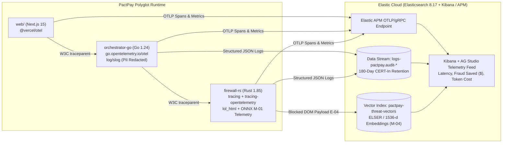

# Observability, Telemetry & Audit Logging — PactPay (AegisPay)
> Project: PactPay (AegisPay) · Owner: Principal SRE & Observability Council (Targeting Judge #11: Carly Richmond, Elastic) · Status: Approved v1.0 · Last updated: 2026-11-01
> Related: [PROJECT_BRIEF](../00-overview/PROJECT_BRIEF.md) · [INFRASTRUCTURE](INFRASTRUCTURE.md) · [RUNBOOK](RUNBOOK.md) · [PRIVACY](../06-security-compliance/PRIVACY.md) · [MODELS](../04-ai/MODELS.md)

---

## 1. Observability Architecture & Elastic Cloud Integration (`F-12`)

PactPay treats observability not as an afterthought, but as a **first-class compliance and security feature (`F-12`)** tailored for **Priya Nair (`P-04`, Enterprise FinOps & Compliance Auditor)** and **Judge #11 (Carly Richmond, Principal Developer Advocate at Elastic)**.

Every autonomous purchase evaluation (`API-05`) propagates a W3C `traceparent` header across **Next.js 15 (`web/`) → Golang Orchestrator (`services/orchestrator-go`) → Rust Firewall (`services/firewall-rs`) → External APIs (`PayPal Sandbox`, `Channel3`, `KERNEL`)**, exporting unified **OpenTelemetry (OTel)** traces, structured PII-redacted JSON logs, and vector-embedded prompt-injection threat logs (`M-04`, `E-04`) to **Elastic Cloud (`Elasticsearch 8.17` + `Elastic APM`)**.



---

## 2. Structured Logging & Automatic PII Redaction (`DPDP Act 2023` & `R-06`)

Both `services/firewall-rs` (via Rust `tracing_subscriber::fmt::json()`) and `services/orchestrator-go` (via Go 1.24 `log/slog.NewJSONHandler`) enforce a strict **Zero-PII Structured Logging Schema**.

### 2.1 Mandatory Log Fields
Every log line across Rust and Go emits:
```json
{
  "timestamp": "2026-11-01T15:04:12.418Z",
  "level": "WARN",
  "service.name": "pactpay-firewall-rs",
  "service.version": "1.0.0",
  "trace.id": "4bf92f3577b34da6a3ce929d0e0e4736",
  "span.id": "00f067aa0ba902b7",
  "event.action": "dom_prompt_injection_blocked",
  "mandate_id": "mnd_01JBM9X8K2P4",
  "agent_id": "agt_claude_desktop_01",
  "risk_score": 0.984,
  "latency_us": 2840,
  "stripped_vectors": ["css_display_none", "html_comment_override"],
  "buyer_email_masked": "b***@personal.example.com",
  "pii_redacted": true
}
```

### 2.2 PII Redaction Rules (Enforced in Code Before Serialization)
| Sensitive Field / Pattern | Redaction Rule | Legal Driver |
| :--- | :--- | :--- |
| Email Addresses (`buyer`, `merchant`) | Mask local-part (`a***@domain.com`) or SHA-256 salted hash | India DPDP Act 2023 §8 & GDPR Art. 32 |
| `Authorization` / `PayPal-Auth-Assertion` headers | Replaced with `"[REDACTED_BEARER_TOKEN]"` | PCI-DSS v4.0 Req 3.4 |
| `Ed25519` Private Keys | Never logged or transmitted outside client signer memory | Cryptographic Non-Repudiation (`F-01`) |
| Shipping Street Address / Phone (`E-07`) | Stripped to `country_code` + `postal_code_prefix` in logs | DPDP Data Minimization |

---

## 3. OpenTelemetry Distributed Trace Spans (`API-05` Checkout Pipeline)

When an AI agent invokes `POST /api/v1/checkout/evaluate` (`API-05`), a single root trace captures the entire multi-service execution tree:

| Span Name | Service | Target p50 | Target p95 | Key Span Attributes |
| :--- | :--- | :--- | :--- | :--- |
| `POST /api/v1/checkout/evaluate` | `orchestrator-go` | `185 ms` | `420 ms` | `pactpay.mandate_id`, `pactpay.decision` (`AUTHORIZED`, `REROUTED`, `BLOCKED`) |
| `firewall.verify_kya_mandate` | `firewall-rs` | `0.3 ms` | `0.8 ms` | `kya.ed25519_valid`, `kya.rfc9421_valid`, `kya.max_amount_cents` |
| `firewall.sanitize_merchant_dom` | `firewall-rs` | `1.9 ms` | `3.4 ms` | `dom.bytes_in`, `dom.injections_found`, `onnx.m01_score` |
| `channel3.fetch_sku_benchmark` | `orchestrator-go` | `85 ms` | `145 ms` | `channel3.sku`, `channel3.median_cents`, `channel3.spread_bps` |
| `redis.acquire_idempotency_lock` | `orchestrator-go` | `0.5 ms` | `1.5 ms` | `redis.key` (`idemp:{paypal_request_id}`), `redis.lock_acquired` |
| `paypal.orders_v2.authorize` | `orchestrator-go` (`APIMatic SDK`) | `140 ms` | `310 ms` | `paypal.order_id`, `paypal.auth_id`, `paypal.intent` (`AUTHORIZE`), `paypal.fallback_used` |

---

## 4. Prometheus & OpenTelemetry Metrics Catalog

Exposed on `/metrics` (internal VPC port) and scraped by Elastic OTel Collector:

1. **Security & Firewall Metrics (`services/firewall-rs`)**:
   - `pactpay_firewall_dom_scan_duration_microseconds` (Histogram: buckets `250, 500, 1000, 2000, 4000, 8000`)
   - `pactpay_firewall_prompt_injections_blocked_total` (Counter labels: `attack_type` = `display_none | opacity_zero | unicode_tag | base64_attr | comment_override`)
   - `pactpay_kya_mandate_verifications_total` (Counter labels: `result` = `valid | expired | signature_invalid | budget_exceeded`)
2. **Escrow & Financial Metrics (`services/orchestrator-go`)**:
   - `pactpay_escrow_transitions_total` (Counter labels: `from_state`, `to_state` in `AUTHORIZED | CAPTURED | VOIDED | DISPUTED`)
   - `pactpay_channel3_overpayment_saved_cents_total` (Counter: cumulative buyer dollars saved by blocking price-gouging `>1500 bps`)
   - `pactpay_paypal_sandbox_request_duration_ms` (Histogram labels: `endpoint` = `orders_create | auth_capture | auth_void | trackers_batch | disputes_evidence`, `status_code`)
   - `pactpay_idempotency_duplicate_blocks_total` (Counter: duplicate `PayPal-Request-Id` retries prevented by `E-10` Redis locks, mitigating `R-03`)

---

## 5. AI & LLM Observability (`M-01`..`M-04`)

| Model ID | Tracked Telemetry Dimensions | Quality / Drift Guardrail | Cost Guardrail |
| :--- | :--- | :--- | :--- |
| **`M-01` (`DeBERTa-v3` ONNX)** | Inference latency (`us`), confidence logit distribution, agreement rate with `lol_html` regex rules | Alert if `lol_html` blocks a payload where `M-01` confidence `< 0.65` (queued for Elastic vector review) | `$0.00` (100% local CPU in Rust) |
| **`M-02` (`Claude 3.7` / `GPT-4o`)** | Input/output tokens, APIMatic Context Plugin schema validation pass rate, tool-call latency (`ms`) | Alert if APIMatic schema validation rejects `>1%` of LLM-generated PayPal payloads | Hard per-request cap of `4,096` tokens (`$0.03` max/call) |
| **`M-03` (`AG Studio Copilot`)** | NL query latency (`ms`), valid AG Grid JSON state generation rate | Automatic fallback to deterministic preset grid views if latency `>2,000ms` | Cached NL-to-Grid AST in Redis for repeated queries |
| **`M-04` (`Elastic ELSER / Embeddings`)** | Indexing latency (`ms`), cosine similarity cluster density of new prompt-injection vectors | Flags novel adversarial clusters (`similarity < 0.72` to known rules) for security review | Rate-limited to blocked DOM payloads (`E-04`) only |

---

## 6. Alerting Matrix & Thresholds

| Alert ID | Condition / Expression | Severity | Window | Automated / Human Action |
| :--- | :--- | :--- | :--- | :--- |
| **`ALT-01`** | `p95(pactpay_firewall_dom_scan_duration_microseconds) > 4000` (`4.0ms`) | **SEV-2 (High)** | `3 min` | Auto-switch `FF_RUST_ONNX_CLASSIFIER=false` to engage `<0.5ms` `lol_html` deterministic fast-path (`R-04`). |
| **`ALT-02`** | `rate(pactpay_paypal_sandbox_5xx_total[2m]) > 0.10` (`>10%` error rate) | **SEV-1 (Critical)** | `2 min` | Auto-enable `FF_PAYPAL_SANDBOX_REPLAY_FALLBACK=true` (`R-01`) and notify on-call channel. |
| **`ALT-03`** | `pactpay_idempotency_lock_errors_total > 0` (Valkey/Redis unreachable) | **SEV-1 (Critical)** | `1 min` | Fail-safe fallback to PostgreSQL `SELECT ... FOR UPDATE` unique constraint on `paypal_request_id` (`R-03`). |
| **`ALT-04`** | `rate(pactpay_kya_mandate_verifications_total{result="signature_invalid"}[5m]) > 20` | **SEV-2 (Security)** | `5 min` | Suspend offending `agent_id` (`E-02` status -> `QUARANTINED`) and trigger CERT-In incident triage workflow. |

---

## 7. CERT-In 180-Day Log Retention & NTP Synchronization (`R-06`)

In compliance with the **Indian Computer Emergency Response Team (CERT-In) Directions of 28 April 2022**:
1. **180-Day Immutable Retention**: All security, mandate verification (`E-03`), DOM firewall (`E-04`), escrow state transition (`E-06`), and webhook verification (`E-09`) logs are retained in append-only Elastic Cloud data streams backed by WORM (Write-Once-Read-Many) snapshots for **180 days**.
2. **Stratum-1 NTP Clock Synchronization**: All Render Linux containers synchronize system clocks via `chronyd` against Google/Cloudflare Stratum-1 NTP servers paired with NIC.in (`samay1.nic.in` / `samay2.nic.in`) offset monitoring, ensuring RFC 9421 signature timestamps and audit logs have `<5ms` clock drift.
