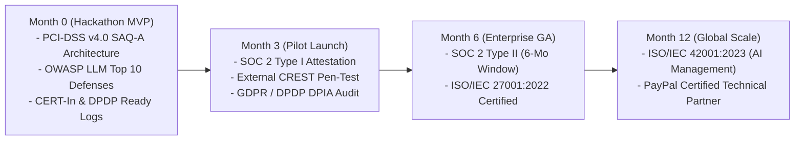

# Regulatory & Legal Compliance Matrix — PactPay (AegisPay)
> Project: PactPay (AegisPay) · Owner: Chief Legal & Regulatory Counsel (Harvey Specter + R.S. Sharma Bench) · Status: Approved v1.0 · Last updated: 2026-11-01
> Related: [PROJECT_BRIEF](../00-overview/PROJECT_BRIEF.md) · [PRIVACY](PRIVACY.md) · [REGULATORY_SANDBOX](REGULATORY_SANDBOX.md) · [SECURITY_ARCHITECTURE](SECURITY_ARCHITECTURE.md)

---

## 1. The Legal Masterstroke: Non-Custodial Cryptographic Control Plane

> **Harvey Specter & R.S. Sharma Verdict**: *"The fastest way to kill a fintech startup is to accidentally become an unlicensed money transmitter or payment aggregator holding customer funds. PactPay sidesteps this completely: **PactPay never takes custody of a single cent or rupee.** All buyer funds remain ring-fenced inside **PayPal's licensed `Orders v2 AUTHORIZE` ledger**. PactPay acts strictly as an out-of-band cryptographic policy verifier (`firewall-rs`) and API instruction orchestrator (`orchestrator-go`) operating via delegated OAuth 2.0 / MCP permissions."*

---

## 2. Comprehensive Regulatory Compliance Matrix (US, EU & India)

Per the War-Room Law & Compliance Checklist, every applicable regulation is mapped below across **Applicability · Legal Requirement · MVP (Hackathon) Compliance · v1 (Production) Requirement · Owner**:

| Jurisdiction & Regulation | Applies? | Core Legal Requirement | How PactPay Complies in MVP (Hackathon) | What Is Needed for v1 (Commercial Production) | Owner |
| :--- | :--- | :--- | :--- | :--- | :--- |
| **PayPal AI Hackathon Official Rules (§4 & §6)** | **Yes (Mandatory)** | All payment flows must execute in the free **PayPal Sandbox (`api-m.sandbox.paypal.com`)**; never ask judges for real bank/card credentials; open-source `LICENSE` visible in GitHub (`R-05`). | 100% wired to pre-funded PayPal Sandbox Buyer & Merchant accounts + 1-click Postman test suite (`F-13`) + root MIT `LICENSE` committed in Commit #1. | Transition `PAYPAL_ENVIRONMENT=live` for onboarded commercial merchants via PayPal Partner Referrals API. | Release Lead |
| **US Regulation E (EFTA — 12 CFR Part 1005)** | **Yes (US Buyers)** | Protects consumers from "unauthorized electronic fund transfers" (`§1005.2(m)`). Requires verifiable proof of consumer authorization and error resolution for disputed agentic debits. | Every agent transaction requires an `Ed25519` signed `KyaMandate` (`F-01`, `E-03`) defining exact ceiling, category, and expiry, plus **PayPal JS SDK v6 (`F-09`)** human co-signing for orders `>$300` and automatic Dispute Evidence packaging (`F-10`). | Integrate hardware WebAuthn/FIDO2 passkey binding to satisfy Reg E electronic signature evidentiary standards in banking arbitration. | Security & Legal Lead |
| **EU PSD2 / PSD3 & Strong Customer Authentication (SCA)** | **Yes (EU Buyers)** | Mandates dynamic linking (cryptographic binding of amount and payee) and Strong Customer Authentication (SCA) with exemptions only for low-value or trusted corporate delegates. | `KyaMandate` (`E-03`) cryptographically binds `max_amount_cents` and merchant category via `Ed25519`; orders exceeding SCA thresholds trigger **PayPal JS SDK v6 (`F-09`)** 3DS2/biometric step-up. | Register as a Technical Service Provider (TSP) supporting delegated SCA attestation headers with PayPal Europe. | Security Lead |
| **PCI-DSS v4.0 (SAQ-A Non-Custodial Scope)** | **Yes (Global)** | Any entity handling, transmitting, or storing Primary Account Numbers (PAN) or SAD must undergo full PCI-DSS Level 1 audit; Req 6.4.3 requires client-side script integrity. | **Zero Card Data Scope**: PactPay never touches PAN/CVV. All checkout UI uses **PayPal JS SDK v6 (`@paypal/react-paypal-js`)** hosted iframes and backend calls use opaque PayPal `ORDER-ID` / `AUTHORIZATION-ID` tokens. | Annual **PCI-DSS v4.0 SAQ-A** self-assessment attestation and Subresource Integrity (SRI) / CSP headers on Next.js checkout pages. | CISO |
| **India RBI Payment Aggregator & PA-Cross Border (PA-CB) Directions (2020 / Oct 2023)** | **Yes (India B2B `P-01`, `P-03`, `R-06`)** | Entities pooling or settling merchant funds require RBI PA/PA-CB authorization and nodal/escrow accounts with scheduled commercial banks; pure technology orchestration layers (TSP) do not hold funds. | PactPay operates strictly as a **Technical Service Provider (TSP)** on top of **PayPal's licensed PA-CB infrastructure**. Funds sit 100% in PayPal's `Orders v2 AUTHORIZE` hold—never in a PactPay bank account. | Formal TSP integration agreement with PayPal India / licensed AD Category-I banks; automatic OPGSP/PA-CB invoice purpose-code tagging (`P0103` / `P1004`). | India Legal Counsel |
| **India RBI Digital Lending Directions (2025 Consolidation)** | **Conditional** | Applies only if extending credit/BNPL; requires Key Fact Statement (KFS) and direct disbursal between regulated entity (RE) and borrower/merchant without third-party pass-through. | Not triggered in MVP (PactPay orchestrates funded buyer balances / corporate cards via PayPal Sandbox without underwriting credit). | If enabling PayPal Pay Later / B2B Working Capital in v1, display RBI-compliant Key Fact Statement (KFS) inside `PayPalStepUpModal.tsx`. | Product Lead |
| **India DPDP Act, 2023 & DPDP Rules, 2025 (`R-06`)** | **Yes (India Users)** | Itemized notice (§5), verifiable consent (§6), security safeguards (§8), breach notification to DPBI, and Data Principal rights (§11–§14). | Standalone DPDP Consent Notice, 1-click Mandate Revocation Kill-Switch, JSON Data Export, Account Erasure endpoint, and automatic PII redaction in Rust/Go logs (`OBSERVABILITY.md`). | Appoint dedicated India Data Protection Officer (DPO) and deploy primary PostgreSQL 16 + Elastic nodes in Mumbai (`ap-south-1`). | DPO |
| **India CERT-In Directions (28 April 2022)** | **Yes (India Infra)** | Mandatory 6-hour cyber incident reporting, 180-day security log retention within India, and NTP clock synchronization (`samay1.nic.in`). | Structured OTel audit logs (`E-04`, `E-09`) with 180-day ILM policy in Elastic Cloud (`F-12`), Stratum-1 NTP sync, and documented 6-hour incident playbook (`RUNBOOK.md`). | Mirror Elastic WORM audit snapshots to AWS Mumbai (`ap-south-1`) S3 Object Lock bucket. | SRE Lead |
| **India Consumer Protection Act, 2019 & CCPA Guidelines on Dark Patterns, 2023** | **Yes (Commerce)** | Prohibits drip pricing, bait-and-switch, disguised ads, and false urgency in e-commerce. | PactPay is an **anti-dark-pattern enforcement engine**: **Channel3 (`F-04`)** blocks merchant drip-pricing/price-gouging (`>15%` over median) and **Rust `lol_html` (`F-02`)** strips manipulative hidden DOM instructions. | Publish quarterly Merchant Fairness & Dark-Pattern Interception Transparency Reports for enterprise buyers. | Product Lead |
| **EU AI Act (Regulation 2024/1689) & MeitY IndiaAI Governance Guidelines** | **Yes (AI Systems)** | Categorizes AI by risk tier; requires transparency, human oversight (Art. 14), accuracy/robustness against adversarial attacks (Art. 15), and audit logging. | Classified as **Limited/Low-Risk Defensive Security AI** (does not perform credit scoring or biometric categorization). Provides deterministic human-in-the-loop step-up (`F-09`) and full DOM diff explainability in **AG Grid (`F-08`)**. | Complete voluntary **ISO/IEC 42001** AI Management System certification and publish model cards (`MODELS.md`). | AI Lead |
| **US FinCEN BSA / AML & India PMLA 2002 / FEMA 1999** | **Yes (Financial)** | Prevents money laundering, sanctioned-entity payments, and unauthorized cross-border capital account flows. | PayPal Sandbox performs native OFAC/sanctions screening on `Orders v2`; PactPay additionally enforces per-mandate spending caps (`max_amount_cents`), merchant category allowlists (`E-03`), and velocity rate limits. | Integrate merchant KYB verification badge checks from **Channel3 (`F-04`)** and PayPal Commerce Platform Partner status API. | Compliance Lead |

---

## 3. Enterprise Security & AI Certifications Roadmap

To onboard Fortune 500 and regulated mid-market FinOps teams (`P-04` Priya Nair), PactPay executes a 12-month certification roadmap:

---

## 4. Ethics & Human-Centric Safeguards Verification (Mike Ross Checklist)

1. **Does the AI ever make an irreversible financial decision without human authorization?**
   - **No.** Every transaction is bounded by a human-signed `Ed25519` mandate (`F-01`), ring-fenced inside a reversible PayPal `Orders v2 AUTHORIZE` hold (`F-05`), and subject to a human step-up co-sign via **PayPal JS SDK v6 (`F-09`)** whenever it exceeds the autonomous cap.
2. **Does PactPay protect small verified merchants (`P-03` Vikram Rao) as well as buyers (`P-01`, `P-02`)?**
   - **Yes.** Honest merchants suffer from fraudulent friendly-fraud chargebacks and slow B2B net-60 invoice payouts. PactPay gives verified merchants an instant **PayPal `AUTHORIZE` proof-of-funds guarantee** before they ship a single box, and triggers automatic **0-second `CAPTURE` settlement (`F-06`)** the moment carrier tracking confirms delivery.
3. **Is the system accessible and transparent to non-cryptographers?**
   - **Yes.** Complex cryptographic signatures (`Ed25519`), DOM diffs (`lol_html`), and price spreads (`Channel3`) are translated into plain-English visual badges and natural-language queries inside **AG Studio (`F-08`)** and **Bryntum Scheduler Pro (`F-07`)**.
