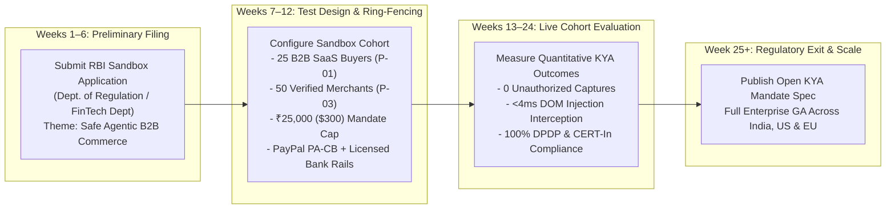

# Regulatory Sandbox & Production Licensing Strategy — PactPay (AegisPay)
> Project: PactPay (AegisPay) · Owner: Principal Fintech Regulatory & Sandbox Counsel · Status: Approved v1.0 · Last updated: 2026-11-01
> Related: [PROJECT_BRIEF](../00-overview/PROJECT_BRIEF.md) · [COMPLIANCE](COMPLIANCE.md) · [PRIVACY](PRIVACY.md) · [ROADMAP](../01-product/ROADMAP.md)

---

## 1. Dual-Track Sandbox Strategy: PayPal Developer Sandbox (MVP) → Regulated Fintech Sandbox (v1)

PactPay operates on a crystal-clear two-stage regulatory trajectory:
1. **Stage 1 — Hackathon MVP (`100%` PayPal Developer Sandbox Compliance)**:
   - Strictly adheres to **PayPal AI Hackathon Official Rules §4 & §6**: all orders, authorization holds (`intent: "AUTHORIZE"`), carrier tracking attachments, captures, voids, and dispute evidence submissions execute exclusively inside the **PayPal Developer Sandbox (`https://api-m.sandbox.paypal.com`)**.
   - Zero real money moves, and judges never enter personal bank accounts, credit cards, or live credentials.
2. **Stage 2 — Commercial Rollout (`Non-Custodial TSP` + `RBI Regulatory Sandbox` / `FCA & FinCEN Innovation Frameworks`)**:
   - Because PactPay is a **non-custodial cryptographic control plane** where funds never leave PayPal's licensed ledger (`Orders v2 AUTHORIZE`), PactPay launches commercially as a **Technical Service Provider (TSP)** while participating in the **Reserve Bank of India (RBI) Regulatory Sandbox** (Theme: *Programmable & Autonomous B2B Escrow Payments*) to establish industry-wide Know-Your-Agent (KYA) standards.

---

## 2. Stage 1: PayPal Developer Sandbox Architecture (`MVP`)

### 2.1 Pre-Configured Sandbox Accounts (`Zero Judge Friction`)
PactPay ships pre-wired with two isolated PayPal Developer Sandbox accounts so any judge clicking through our Render live URL (`F-14`) or Postman Collection (`F-13`) can inspect live transactions immediately:

| Account Role | Sandbox Account Email | Pre-Funded Sandbox Balance | Used By Endpoints |
| :--- | :--- | :--- | :--- |
| **Buyer Principal (`P-01` / `P-02`)** | `buyer-pactpay@personal.example.com` | `$25,000.00 USD` (Virtual Sandbox Balance) | `API-05`, `API-07` (`Orders v2 AUTHORIZE`), `API-11` (`Disputes v1`) |
| **Verified Merchant (`P-03`)** | `merchant-pactpay@business.example.com` | `$10,000.00 USD` (Virtual Sandbox Balance) | `API-08` (`Shipment Tracking v1`), `API-09` (`CAPTURE`), `API-10` (`VOID`) |

### 2.2 PayPal Sandbox Negative Testing & Simulation Headers
To allow judges and CI tests to deterministically verify edge cases inside `api-m.sandbox.paypal.com`, `orchestrator-go` supports PayPal's official **`PayPal-Mock-Response`** negative-testing header in test mode:
- **Simulate Insufficient Buyer Funds**: `PayPal-Mock-Response: {"mock_application_codes": "INSTRUMENT_declined"}` → Verifies PactPay cleanly aborts the escrow and updates **AG Grid** status to `DECLINED_BY_ISSUER`.
- **Simulate Authorization Expired**: `PayPal-Mock-Response: {"mock_application_codes": "AUTHORIZATION_EXPIRED"}` → Verifies **Bryntum Scheduler Pro** flags the expired 29-day window and triggers re-authorization workflow.
- **Simulate Dispute Created (`F-10`)**: Triggers Sandbox `CUSTOMER.DISPUTE.CREATED` webhook (`API-14`) → Verifies PactPay automatically packages the `Ed25519` mandate + Channel3 SKU benchmark + KERNEL screenshot (`E-08`) and submits to `POST /v1/customer/disputes/{id}/provide-evidence` (`API-11`).

---

## 3. Stage 2: RBI Regulatory Sandbox & Global Innovation Hub Alignment (`v1 Production`)

When transitioning from the PayPal Developer Sandbox to commercial B2B procurement in India (`P-01` Arjun Mehta, `P-03` Vikram Rao) and globally, PactPay aligns with the **RBI Enabling Framework for Regulatory Sandbox (Updated February 2024)**:

### 3.1 RBI Regulatory Sandbox Cohort Parameters
| Sandbox Parameter | Proposed PactPay Cohort Design |
| :--- | :--- |
| **Target Cohort Size** | `25` Mid-Market B2B Enterprise Buyers (`P-01`) and `50` KYB-Verified Electronics/IT Suppliers (`P-03`). |
| **Transaction Cap During Cohort** | Maximum `₹25,000` (`~$300 USD`) per autonomous `Ed25519` mandate; any order `> ₹25,000` requires mandatory human step-up authentication (`F-09`). |
| **Custody & Settlement Partner** | **PayPal India (PA-CB)** for cross-border B2B SaaS/hardware procurement and an RBI-licensed Payment Aggregator / Scheduled Commercial Bank for domestic INR escrow holds. |
| **Consumer Protection & Indemnity** | `100%` of cohort funds remain in reversible `AUTHORIZE` holds until carrier delivery is verified (`F-06`), backed by a `₹10,00,000` (`~$12,000`) sandbox indemnity reserve. |
| **Exit Criteria & Success Metrics** | `0` successful indirect prompt-injection captures (`F-02`), `0` duplicate settlements (`R-03`), and `>85%` reduction in manual B2B procurement dispute resolution time (`F-10`). |

---

## 4. US FinCEN & EU EBA Innovation Hub Alignment

1. **United States (FinCEN Innovation Hours & OCC Responsible AI Framework)**:
   - PactPay qualifies under the **FinCEN Software Provider / Non-Custodial Control Plane Exemption** (`31 CFR § 1010.100(ff)(5)(ii)`) because PactPay never accepts or transmits currency or funds on behalf of another person—it strictly verifies cryptographic `Ed25519` policies and transmits authenticated API calls to the user's own PayPal account.
2. **European Union (EBA / PSD3 Delegated Authentication Sandbox)**:
   - PactPay's combination of **RFC 9421 HTTP Message Signatures** + **`Ed25519` `KyaMandate` dynamic linking** (`amount_cents` + `allowed_categories` + `max_spread_bps`) provides the reference blueprint for **Delegated Agentic Strong Customer Authentication (SCA)** under upcoming PSD3 technical standards.
