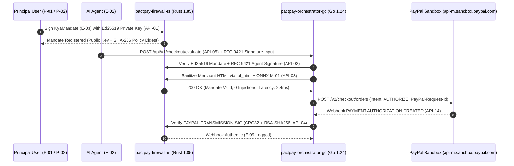

# Zero-Trust Security Architecture — PactPay (AegisPay)
> Project: PactPay (AegisPay) · Owner: Chief Information Security Officer (Bruce Schneier + Max Levchin Bench) · Status: Approved v1.0 · Last updated: 2026-11-01
> Related: [PROJECT_BRIEF](../00-overview/PROJECT_BRIEF.md) · [THREAT_MODEL](THREAT_MODEL.md) · [PRIVACY](PRIVACY.md) · [COMPLIANCE](COMPLIANCE.md) · [ARCHITECTURE](../03-engineering/ARCHITECTURE.md)

---

## 1. Zero-Trust Design Philosophy: Why Stochastic LLMs Never Touch Credentials

Traditional agent toolkits (`@paypal/agent-toolkit`, Stripe Agent Toolkit) inject live OAuth bearer tokens or API secrets directly into the AI agent's execution environment. If an untrusted web page injects a hidden instruction (`CVE-2026-22708`), the LLM calls `create_order` or `pay_invoice` with full authority.

**PactPay enforces strict architectural privilege separation**:
1. **Air-Gapped Credential Custody**: AI agents (`E-02`) hold **zero** PayPal API credentials. They hold only an unprivileged MCP client token and must submit every checkout candidate to `pactpay-firewall-rs` (`F-03`, `API-02`, `API-03`).
2. **Deterministic Rust Verification Before Money Movement**: `services/firewall-rs` (`Rust 1.85`) verifies the human principal's cryptographic `Ed25519` spending mandate (`F-01`) and sanitizes the merchant DOM via `lol_html` + `DeBERTa-v3` ONNX (`F-02`, `M-01`) in `<4ms` before `services/orchestrator-go` (`Go 1.24`) ever invokes the PayPal Sandbox `Orders v2 AUTHORIZE` endpoint (`F-05`).
3. **Reversible Two-Phase Commit (2PC) Escrow**: Even after passing every security and fair-price gate, PactPay places an `intent: "AUTHORIZE"` hold (`API-07`)—never an immediate `CAPTURE`—until carrier delivery SLA verification (`F-06`) succeeds.

---

## 2. Cryptographic Architecture (`Ed25519`, `RFC 9421`, `CRC32 + RSA`)



### 2.1 `Ed25519` Know-Your-Agent (KYA) Mandate Signatures (`F-01`, `E-03`)
Implemented in `services/firewall-rs/src/mandate.rs` using `ed25519-dalek v2.1` and `ring v0.17`:
- **Canonical Serialization**: Before signing, the mandate payload (`principal_id`, `agent_id`, `max_amount_cents`, `currency`, `allowed_categories`, `max_spread_bps`, `sla_hours`, `nonce`, `expires_at`) is serialized using **RFC 8785 JSON Canonicalization Scheme (JCS)** so key ordering differences never cause signature malleability.
- **Constant-Time Verification**: `verifying_key.verify_strict(&canonical_bytes, &signature)` runs in `<120 microseconds` in constant time, preventing timing side-channel attacks and rejecting small-order public key torsion points.

### 2.2 RFC 9421 HTTP Message Signatures (Web Bot Auth)
Every tool call or HTTP request from a registered `AgentIdentity` (`E-02`) includes RFC 9421 headers:
```http
Signature-Input: sig1=("@method" "@target-uri" "content-digest" "x-pactpay-mandate-id");created=1762008000;keyid="agt_key_01JBM";alg="ed25519"
Signature: sig1=:Base64EncodedEd25519Signature:
Content-Digest: sha-256=:Base64EncodedSHA256BodyHash:
```
`firewall-rs` rejects any request whose `created` timestamp drifts by `> 60 seconds` from NTP time or whose `nonce` already exists in Valkey (`E-10`), neutralizing replay attacks.

### 2.3 PayPal Webhook `CRC32` + `RSA-SHA256` Signature Verification (`API-04`, `E-09`)
Instead of trusting unverified JSON posted to `/api/v1/webhooks/paypal` (`API-14`), `firewall-rs` (`webhook_verify.rs`) performs local cryptographic verification in `<1.5ms`:
1. Computes the IEEE 802.3 `CRC32` checksum (`crc32fast` crate in Rust) of the raw HTTP request body in decimal.
2. Constructs the validation string: `<transmissionId>|<timeStamp>|<webhookId>|<crc32Decimal>`.
3. Verifies the `PAYPAL-TRANSMISSION-SIG` header against PayPal's cached X.509 certificate (`PAYPAL-CERT-URL`, validated to belong strictly to `*.paypal.com`) using `ring::signature::RSA_PKCS1_2048_8192_SHA256`.

---

## 3. Authentication, Authorization & Encryption Standards

| Security Layer | Standard / Implementation | Scope |
| :--- | :--- | :--- |
| **Human Authentication (`E-01`)** | OAuth 2.0 / OIDC + WebAuthn Passkey / PayPal JS SDK v6 (`F-09`) step-up co-sign for orders `>$300` | Next.js Command Center (`web/`) & Go Orchestrator |
| **Agent Authentication (`E-02`)** | RFC 9421 `Ed25519` HTTP Message Signatures + Scoped MCP Session Token | `pactpay-firewall-rs` (`rmcp`) & `API-05` |
| **Authorization Model (ABAC)** | Attribute-Based Access Control evaluated per mandate (`E-03`): checks `amount_cents`, `category`, `spread_bps`, `sla_hours`, and `expires_at` | `services/firewall-rs` (`API-02`) |
| **Encryption in Transit** | TLS 1.3 (`TLS_AES_256_GCM_SHA384`) at Render Edge; isolated Render Private VPC Mesh between Go and Rust | All external and internal network hops |
| **Encryption at Rest** | AES-256-GCM volume encryption on Render PostgreSQL 16 (`E-01`..`E-09`), Valkey (`E-10`), and Elastic Cloud (`F-12`) | All stateful databases and log indices |
| **Application-Level Secret Envelope** | PayPal Sandbox OAuth tokens encrypted in memory and Redis using `ChaCha20-Poly1305` (`ring`) | `services/orchestrator-go` |

---

## 4. OWASP Top 10 (2021/2025) Mitigation Matrix

| OWASP Web Risk | PactPay Architectural Mitigation |
| :--- | :--- |
| **A01: Broken Access Control** | Default-deny ABAC in `firewall-rs`; every escrow action verifies `principal_id` ownership and `Ed25519` signature (`API-02`). |
| **A02: Cryptographic Failures** | Zero custom crypto; strict use of `ed25519-dalek`, `ring`, TLS 1.3, and AES-256-GCM at rest. |
| **A03: Injection (SQL / HTML / Command)** | 100% parameterized queries in Go (`pgx/v5`), zero shell invocations, and streaming HTML sanitization in Rust (`lol_html`). |
| **A04: Insecure Design** | Two-Phase Commit (`AUTHORIZE -> Tracking -> CAPTURE/VOID`) ensures no single failure can irreversibly drain buyer funds. |
| **A05: Security Misconfiguration** | Strict CSP headers in Next.js 15, non-root distroless container users, and Trivy scanning in `.github/workflows/security-and-eval.yml`. |
| **A06: Vulnerable & Outdated Components** | Automated `cargo audit` (Rust), `govulncheck` (Go), and `npm audit` on every PR and nightly cron. |
| **A07: Identification & Auth Failures** | RFC 9421 cryptographic agent identity (`E-02`) + PayPal JS SDK v6 (`F-09`) human step-up on high-value checkouts. |
| **A08: Software & Data Integrity Failures** | Cryptographic verification of PayPal webhooks (`CRC32` + `RSA-SHA256`, `API-04`) and pinned GitHub Actions SHAs. |
| **A09: Security Logging & Monitoring Failures** | Immutable PII-redacted JSON audit trail (`E-04`, `E-09`) exported via OpenTelemetry to Elastic Cloud (`F-12`) for 180 days. |
| **A10: Server-Side Request Forgery (SSRF)** | External merchant URLs are inspected strictly inside isolated **KERNEL (`onkernel.com`)** cloud browser sandboxes (`F-11`), blocking RFC 1918 private IPs (`10.0.0.0/8`, `169.254.169.254`). |

---

## 5. OWASP Top 10 for LLM & Agentic Applications (2025) Mitigation Matrix

| OWASP LLM 2025 ID | Agentic Vulnerability | How PactPay Eliminates It |
| :--- | :--- | :--- |
| **LLM01:2025 Prompt Injection** | Indirect CSS/HTML prompt injection (`CVE-2026-22708`) in merchant DOMs (`<span style="display:none">`). | **Rust `lol_html` + `DeBERTa-v3` INT8 ONNX (`F-02`, `M-01`)** strips hidden styles, HTML comments, Unicode tag blocks (`U+E0000`, `R-02`), and base64 attributes in `<4ms` before the LLM sees the page. |
| **LLM02:2025 Sensitive Information Disclosure** | LLM leaking PayPal API keys or buyer PII into external tool calls. | **Zero-Credential Agent Sandbox**: The LLM never has access to PayPal client secrets or buyer card data; PII is masked before entering LLM context. |
| **LLM03:2025 Supply Chain Vulnerabilities** | Poisoned MCP server packages or tampered ONNX weights. | Official `modelcontextprotocol/rust-sdk` (`rmcp`) + SHA-256 checksum verification of `deberta-v3` ONNX model weights at startup. |
| **LLM04:2025 Data and Model Poisoning** | Merchant spoofing fake low prices to trick agent ranking. | Independent **Channel3 API (`F-04`)** cross-merchant oracle validates SKU price medians across 100M+ verified catalog items. |
| **LLM05:2025 Improper Output Handling** | Hallucinated or malformed JSON fields passed to PayPal `Orders v2` API. | **APIMatic Context Plugin + APIMatic-Generated Go SDK (`F-05`)** enforces compile-time Go struct validation and OpenAPI schema compliance. |
| **LLM06:2025 Excessive Agency** | Autonomous agent spending `$5,000` when the user intended `$50`. | Hard cryptographic `KyaMandate` (`F-01`) ceiling (`max_amount_cents`) enforced in Rust + **PayPal JS SDK v6 (`F-09`)** human step-up modal. |
| **LLM07:2025 System Prompt Leakage** | Adversarial page extracting internal procurement instructions. | Merchant DOMs are sanitized into structured data schemas (`title`, `sku`, `price_cents`) before reaching `M-02`. |
| **LLM08:2025 Vector and Embedding Weaknesses** | Adversarial collision in threat similarity search (`M-04`). | Vector index (`F-12`) is advisory for FinOps analytics (`P-04`); primary blocking is deterministic in Rust (`lol_html` + `M-01`). |
| **LLM09:2025 Misinformation / Hallucination** | Agent fabricating a carrier tracking number to release escrow early. | Escrow `CAPTURE` (`API-09`) can only be triggered by a cryptographically verified PayPal Webhook (`API-14`) or direct Shipment Tracking API query (`F-06`). |
| **LLM10:2025 Unbounded Consumption (Denial of Wallet)** | Infinite agent loop draining LLM tokens and PayPal authorizations. | Token bucket rate limiter (`10 req/min` per `agent_id`) in Valkey + hard per-mandate single-use `IdempotencyLock` (`E-10`, `R-03`). |
