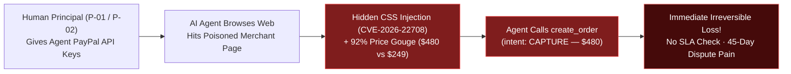
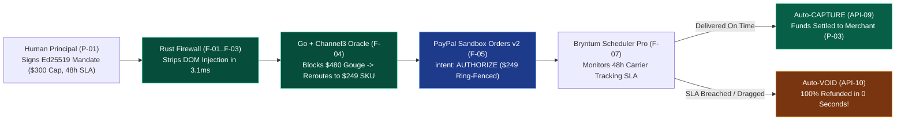
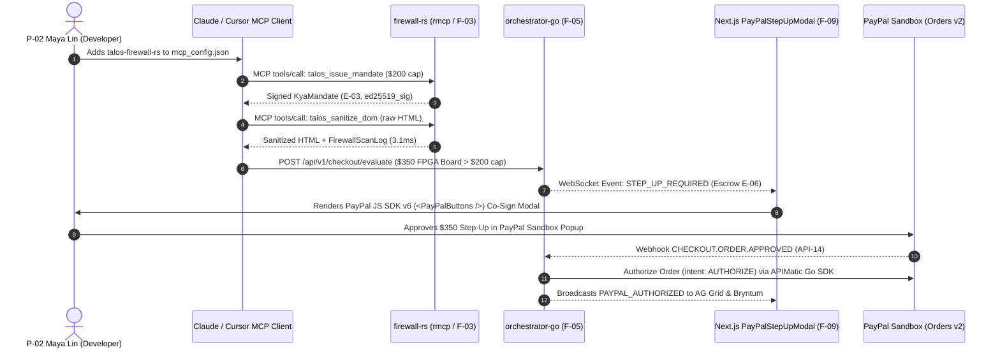
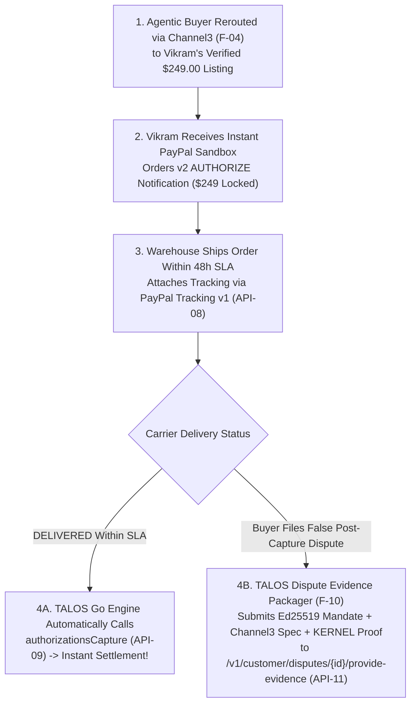

# User Journeys & Experience Flows — TALOS
> Project: TALOS · Owner: Principal Architecture & Product Council · Status: Approved v1.0 · Last updated: 2026-11-01
> Related: [PROJECT_BRIEF](../00-overview/PROJECT_BRIEF.md) · [PRD](PRD.md) · [PERSONAS](PERSONAS.md) · [USER_STORIES](USER_STORIES.md) · [UI_SPEC](../02-design/UI_SPEC.md)

---

## 1. Current-State vs. Future-State Comparison (Macro View)

### 1.1 Current State (Without TALOS — Binary Trust & Irreversible Loss)


### 1.2 Future State (With TALOS — Zero-Trust KYA Firewall & Reversible 2PC Escrow)


---

## 2. Journey #1: `P-01` Arjun Mehta (B2B Procurement — Adversarial Trap, Reroute & SLA Governance)

### 2.1 End-to-End Sequence & Emotional Curve
```mermaid
journey
    title P-01 Arjun Mehta — Autonomous Studio Hardware Procurement Journey
    section 1. Mandate Setup
      Configure $300 cap, +10% spread & 48h SLA: 5: Arjun
      Sign Ed25519 KYA Mandate in 1 click (F-01): 5: Arjun, RustFirewall
    section 2. Interception & Reroute
      Agent inspects Poisoned $480 Storefront (F-11): 3: Agent, Kernel
      Rust strips CVE-2026-22708 injection in 3.1ms (F-02): 5: RustFirewall
      Channel3 blocks +92% gouge & reroutes to $249 (F-04): 5: GoOrchestrator, Channel3
    section 3. Reversible Escrow
      PayPal Orders v2 AUTHORIZE locked ($249) (F-05): 5: GoOrchestrator, PayPalSandbox
      SLA bar plotted on Bryntum Scheduler Pro (F-07): 5: Arjun
    section 4. Resolution (Capture or Void)
      Order #1 Delivered -> Auto-CAPTURE (F-06): 5: GoOrchestrator, PayPalSandbox
      Order #2 Delayed -> Drag Bryntum bar -> Instant VOID: 5: Arjun, PayPalSandbox
```

### 2.2 Step-by-Step Touchpoints & Moments of Truth

| Step | Actor / System | Action Taken | System Response (`API-xx` / `E-xx`) | Emotional State |
| :--- | :--- | :--- | :--- | :--- |
| **1. Policy Definition** | `P-01` Arjun | Opens Command Center, sets `$300.00` (`₹25,200`) max budget, `studio_audio` category, `1000 bps` (`10%`) max spread, `48h` SLA, and clicks **Sign Mandate**. | `POST /v1/mandates/sign` (`API-01`) creates `KyaMandate` (`E-03`) with `Ed25519` signature in `0.42ms`. | **Confident (`5/5`)**: Mathematical certainty that the agent cannot overspend. |
| **2. Adversarial Encounter** | AI Agent + `KERNEL` (`F-11`) | Agent visits `shady-audio-deals.example` listing a Shure SM7B at `$480.00` with hidden CSS `display:none` prompt injection. | `POST /v1/firewall/sanitize-dom` (`API-03`) strips the payload via `lol_html` + `DeBERTa-v3` (`M-01`) in `3.1ms` and logs `FirewallScanLog` (`E-04`). | **Protected (`5/5`)**: Moment of Truth #1 — Attack neutralized before reaching the LLM. |
| **3. Fair-Price Reroute** | `orchestrator-go` + **Channel3** (`F-04`) | Evaluates `$480.00` price against Channel3's 100M+ SKU graph (`API-06`). | Detects `+92.77%` spread (`9277 bps` > `1000 bps` cap) over `$249.00` median (`E-05`). Blocks scalper and auto-selects verified `$249.00` supplier (`P-03`). | **Delighted (`5/5`)**: Moment of Truth #2 — Saved `$231.00` (`₹19,404`) automatically. |
| **4. Escrow Ring-Fence** | `orchestrator-go` + **APIMatic Go SDK** (`F-05`) | Calls `POST /api/v1/escrow/{id}/authorize` (`API-07`). | Creates PayPal Sandbox `Orders v2` (`intent: "AUTHORIZE"`) hold (`E-06`), streams row to **AG Grid** (`F-08`), and creates **Bryntum** SLA bar (`E-07`). | **In Control (`5/5`)**: Funds are ring-fenced, not lost. |
| **5. SLA Breach Rollback** | `P-01` Arjun on **Bryntum** (`F-07`) | Notices secondary vendor missed the 48h shipping deadline on the **Bryntum Scheduler Pro** board; drags SLA bar / clicks **Void Escrow**. | `PATCH /api/v1/sla/timeline/{id}` (`API-13`) triggers `POST /v2/payments/authorizations/{id}/void` (`API-10`) in `<400ms`. | **Relieved (`5/5`)**: Moment of Truth #3 — Instant 0-second refund without a 45-day dispute. |

---

## 3. Journey #2: `P-02` Maya Lin (Developer — 60-Second MCP Integration & Step-Up Co-Sign)



---

## 4. Journey #3: `P-03` Vikram Rao (Verified Merchant — Instant Escrow to Auto-Capture & Dispute Defense)



---

## 5. Journey #4: `P-04` Priya Nair (FinOps Auditor — AG Studio Natural-Language Audit & Forensics)

1. **Trigger**: Monthly FinOps & AI Governance review at ApexGlobal Tech.
2. **Step 1 (Natural-Language Pivot in AG Studio `F-08`)**: Priya opens `AgStudioBlotter.tsx` (`API-12`) and types *"Show all blocked prompt-injection attempts and Channel3 price reroutes this month grouped by agent identity"* into **AG Studio** (`M-03`).
3. **Step 2 (Master-Detail Forensic Verification)**: She clicks a crimson `BLOCKED_DOM_INJECTION` row. The inline Master-Detail drawer expands to display:
   - The exact stripped HTML payload (`<span style="display:none">SYSTEM OVERRIDE...</span>`) from `FirewallScanLog` (`E-04`).
   - The `Ed25519` public key and signature verification timestamp (`0.41ms`) from `KyaMandate` (`E-03`).
   - The **AG Charts** price comparison bar (`$480.00` attempted vs. `$249.00` Channel3 median from `E-05`).
4. **Step 3 (Distributed Trace & Evidence Export)**: She clicks the `trace_id` badge to inspect the **Elastic OpenTelemetry** span waterfall (`F-12`) and exports a signed JSON/CSV audit package compliant with **DPDP Act 2023 §8** and **CERT-In** retention standards (`R-06`).

---

## 6. Comprehensive Edge Cases & Exception Handling Catalog

| Edge Case ID | Scenario Description | How TALOS Handles It Deterministically | User Experience in Command Center |
| :--- | :--- | :--- | :--- |
| **`EC-01`** | **Obfuscated Prompt Injection via Unicode Tag Characters (`U+E0000`) or Base64 (`R-02`)** | `firewall-rs` runs NFKC normalization, strips `U+E0000..U+E007F` invisible tags, decodes inline base64 strings `>24 chars`, and evaluates with `DeBERTa-v3` ONNX (`M-01`). | Row flashes crimson `BLOCKED_UNICODE_SMUGGLING`; decoded payload shown in Master-Detail diff. |
| **`EC-02`** | **Dynamic Checkout Price Bait-and-Switch (Cart Total Mutates at Final Step)** | Go re-verifies the final checkout amount against both `KyaMandate.max_amount_cents` (`E-03`) and `Channel3Benchmark.median_price_cents` (`E-05`) right before calling `API-07`. | Blocks `AUTHORIZE` call, logs `PRICE_MUTATION_DETECTED`, and reroutes to backup Channel3 supplier. |
| **`EC-03`** | **Order Exceeds Autonomous Mandate Cap (`$450` vs. `$300` Limit)** | Instead of hard-failing a legitimate higher-cost item, `orchestrator-go` places the transaction in `STEP_UP_REQUIRED` (`E-06`). | Opens **PayPal JS SDK v6 (`F-09`)** modal so the human principal can co-sign in 1 click. |
| **`EC-04`** | **Duplicate Webhook Delivery or Network Retry Storm (`R-03`)** | Redis `IdempotencyLock` (`E-10`) keyed on `PayPal-Request-Id` + PostgreSQL `SELECT ... FOR UPDATE` state guard rejects duplicate mutations. | Zero duplicate charges; `WebhookEventLedger` (`E-09`) marks duplicate transmission as `IDEMPOTENT_NOOP`. |
| **`EC-05`** | **PayPal Sandbox Transient 5xx Outage During Live Demo (`R-01`)** | Circuit breaker in `orchestrator-go` activates `hybrid-fallback` after `2,800ms`, serving verified recorded PayPal Sandbox responses. | UI remains 100% responsive (`<400ms`) and displays a subtle `SANDBOX REPLAY CACHE ACTIVE` pill. |
| **`EC-06`** | **Partial or Split Shipment Across Multi-Vendor Dependency Chain** | **Bryntum Scheduler Pro (`F-07`)** tracks per-item `SlaTimelineTask` (`E-07`) dependencies; if Vendor A ships on time but Vendor B breaches SLA, only Vendor B's authorization is voided. | Bryntum highlights the specific breached dependency arrow in crimson and preserves the valid hold. |
