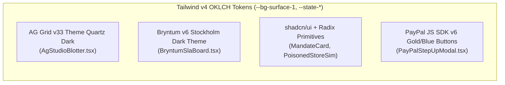

# Design System & Visual Language — TALOS
> Project: TALOS · Owner: Principal Design & Frontend Council · Status: Approved v1.0 · Last updated: 2026-11-01
> Related: [PROJECT_BRIEF](../00-overview/PROJECT_BRIEF.md) · [UI_SPEC](UI_SPEC.md) · [ACCESSIBILITY](ACCESSIBILITY.md) · [LOCALIZATION](LOCALIZATION.md) · [FRONTEND](../03-engineering/FRONTEND.md)

---

## 1. Design Philosophy: Institutional Precision Meets Apple Restraint (Jony Ive Principles)

> **Tie-Breaker #2 (`Design — 20%`) Mandate**: In the PayPal AI Hackathon, 7 of the 13 judges evaluate visual polish, accessibility, and interactive depth across **AG Grid / AG Studio (`Sylwia Vargas`)**, **Bryntum Scheduler Pro (`Mats Bryntse`)**, and **PayPal JS SDK v6 (`Jo Franchetti`)**. TALOS avoids generic "AI SaaS purple gradients" and instead implements **Obsidian Institutional Glassmorphism**—inspired by Bloomberg Terminal, Stripe Radar, Palantir Foundry, and Apple macOS Sequoia dark materials.

### Five Core Design Principles
1. **Semantic Density Without Clutter**: Financial operators (`P-01`) and auditors (`P-04`) need to see mandate signatures, DOM firewall latency, Channel3 basis-point spreads, and PayPal Sandbox IDs in a single viewport without scrolling across 6 pages.
2. **Two-Channel Risk Communication**: Never rely on color alone. Every transaction state pairs a high-contrast **OKLCH semantic hue** with an explicit **Lucide geometric icon** and **monospaced status pill** (`[SHIELD-CHECK] AUTHORIZED`, `[OCTAGON-X] BLOCKED_INJECTION`, `[ROTATE-CCW] VOIDED`).
3. **Cryptographic Legibility (`JetBrains Mono`)**: Every `Ed25519` signature, `PayPal-Request-Id`, `ORDER-ID`, `AUTHORIZATION-ID`, currency figure (`$249.00` / `₹20,916`), and microsecond latency (`3.10 ms`) uses tabular monospaced numerals (`font-variant-numeric: tabular-nums`) so columns align to the pixel in **AG Grid**.
4. **Physical Two-Way Direct Manipulation**: Dragging an SLA bar on **Bryntum Scheduler Pro** (`F-07`) feels tactile and immediate (`60 FPS`), with live visual feedback showing downstream task locking and instant PayPal Sandbox `VOID` settlement.
5. **Progressive Forensic Disclosure**: The main blotter stays clean; clicking any row expands an inline **AG Grid Master-Detail forensic drawer** (`F-08`) with syntax-highlighted DOM diffs and **AG Charts** price distributions.

---

## 2. Color Tokens (OKLCH + Hex Fallbacks — Dark Obsidian Primary & High-Contrast Light Mode)

Configured in `web/src/app/globals.css` using **Tailwind CSS v4** (`@theme`) and mapped directly onto `--ag-*` (AG Grid v33 Theming API) and `--b-*` (Bryntum Scheduler Pro v6 CSS variables).

### 2.1 Surface & Structural Tokens

| Token Name | CSS Variable | Dark Mode (Default Command Center) | Light Mode (High-Contrast Audit Print) | Contrast vs. Primary Text | Usage |
| :--- | :--- | :--- | :--- | :--- | :--- |
| **Canvas Background** | `--bg-canvas` | `oklch(0.13 0.015 255)` (`#070B14`) | `oklch(0.98 0.005 255)` (`#F8FAFC`) | `16.8:1` | Root viewport background |
| **Elevated Surface 1** | `--bg-surface-1` | `oklch(0.17 0.018 255)` (`#0F172A`) | `oklch(1.00 0.000 0)` (`#FFFFFF`) | `14.2:1` | AG Grid & Bryntum container cards |
| **Elevated Surface 2** | `--bg-surface-2` | `oklch(0.21 0.022 255)` (`#1E293B`) | `oklch(0.95 0.008 255)` (`#F1F5F9`) | `11.5:1` | Master-Detail drawer, hover rows, modals |
| **Glass Overlay** | `--bg-glass` | `rgba(15, 23, 42, 0.78)` + `blur(16px)` | `rgba(255, 255, 255, 0.88)` + `blur(16px)` | `13.4:1` | Sticky header & PayPal JS SDK v6 modal |
| **Border Subtle** | `--border-subtle` | `oklch(0.28 0.020 255)` (`#334155`) | `oklch(0.88 0.012 255)` (`#E2E8F0`) | `3.2:1` (UI) | Hairline `1px` grid & card dividers |
| **Text Primary** | `--text-primary` | `oklch(0.97 0.005 255)` (`#F8FAFC`) | `oklch(0.15 0.018 255)` (`#0F172A`) | — | Primary headings, amounts, SKU titles |
| **Text Secondary** | `--text-secondary` | `oklch(0.74 0.015 255)` (`#94A3B8`) | `oklch(0.42 0.018 255)` (`#475569`) | `7.4:1` (AAA) | Column headers, timestamps, labels |

### 2.2 Semantic Financial & Security State Tokens

| State / Meaning | Token Prefix | Badge Fill (Dark) | Text / Icon Accent (Dark) | Contrast Ratio | Where Used in TALOS |
| :--- | :--- | :--- | :--- | :--- | :--- |
| **PayPal Brand / Escrow Authorized** | `--state-paypal` | `rgba(0, 112, 243, 0.16)` | `oklch(0.72 0.16 250)` (`#38BDF8`) | `8.2:1` (AAA) | `PAYPAL_AUTHORIZED` badge (`E-06`), active 29-day hold bars in Bryntum (`F-07`). |
| **Captured / Verified Safe** | `--state-emerald` | `rgba(16, 185, 129, 0.16)` | `oklch(0.78 0.17 160)` (`#34D399`) | `9.1:1` (AAA) | `PAYPAL_CAPTURED` (`API-09`), valid `Ed25519` KYA signature (`F-01`), Channel3 fair price. |
| **SLA Warning / Voided / Step-Up** | `--state-amber` | `rgba(245, 158, 11, 0.16)` | `oklch(0.82 0.16 80)` (`#FBBF24`) | `10.4:1` (AAA) | `PAYPAL_VOIDED` (`API-10`), `STEP_UP_REQUIRED` (`F-09`), Bryntum `<6h` SLA warning. |
| **Blocked / Prompt Injection / Gouge** | `--state-crimson` | `rgba(239, 68, 68, 0.18)` | `oklch(0.74 0.19 25)` (`#F87171`) | `7.6:1` (AAA) | `BLOCKED_DOM_INJECTION` (`F-02`), `BLOCKED_PRICE_GOUGING` (`>15%` Channel3 spread `F-04`). |
| **AG Studio Copilot / Elastic Trace** | `--state-indigo` | `rgba(99, 102, 241, 0.16)` | `oklch(0.76 0.15 280)` (`#818CF8`) | `7.9:1` (AAA) | **AG Studio** AI prompt bar (`M-03`) & **Elastic** OTel trace badges (`F-12`). |

---

## 3. Typography & Multi-Script Font Stack (With Indic `Noto Sans` Support)

| Role | Font Family (`next/font/google`) | Weights | CSS Utility / Rules | Purpose |
| :--- | :--- | :--- | :--- | :--- |
| **UI & Analytics Sans** | `'Inter'`, `'Noto Sans'`, `'Noto Sans Devanagari'`, `system-ui`, `sans-serif` | `400`, `500`, `600`, `700` | `font-sans tracking-tight` | Navigation, KPI titles, AG Grid text columns, Bryntum task titles, Hindi (`हिन्दी`) & ₹ labels. |
| **Cryptographic & Financial Mono** | `'JetBrains Mono'`, `ui-monospace`, `monospace` | `400`, `500`, `600` | `font-mono tabular-nums` | Currency values (`$249.00` / `₹20,916`), `Ed25519` hex hashes, PayPal IDs (`2A491...`), latencies (`3.10 ms`), DOM diff code. |

### Type Scale (`rem` / `px`)
- **`display-kpi`**: `1.75rem` (`28px`) / Line-height `2.125rem` (`34px`) / `600` SemiBold `tabular-nums` — Top KPI metric values (`$24,890.00`).
- **`heading-panel`**: `1.00rem` (`16px`) / Line-height `1.50rem` (`24px`) / `600` SemiBold — Panel headers (`AG Studio Live Escrow Blotter`, `Bryntum 2-Way SLA Board`).
- **`body-grid`**: `0.8125rem` (`13px`) / Line-height `1.25rem` (`20px`) / `400–500` — Standard AG Grid & Bryntum row density for high-information financial views.
- **`code-micro`**: `0.75rem` (`12px`) / Line-height `1.125rem` (`18px`) / `500` `JetBrains Mono` — Cryptographic badges, `trace_id` pills, and stripped HTML diffs.

---

## 4. Layout Grid, Spacing & Viewport Architecture

- **Base Spacing Unit**: `4px` (`0.25rem`) grid system (`gap-3` = `12px`, `p-4` = `16px`).
- **Command Center 12-Column Bento Workspace (`1440px+` Desktop & Responsive `768px` Tablet)**:
  - **Top Header Bar (`56px` fixed height)**: Brand identity, live health telemetry pills (`RUST FIREWALL: 0.4ms`, `GO ORCHESTRATOR: ONLINE`, `PAYPAL SANDBOX: LIVE`), Currency/Locale switcher (`USD $` / `INR ₹` / `EN` / `HI`), and 1-click **"Poisoned Storefront Simulator (`F-11`)"** drawer toggle.
  - **Row 1 — 4 Executive KPI Cards (`88px` height, `col-span-3` each)**: Protected Agentic GMV, Threats & Gouging Saved, Rust Firewall Latency Sparkline, Active Bryntum Escrows.
  - **Row 2 — Left Drawer (`col-span-4`) & Main Blotter (`col-span-8`)**:
    - Left (`col-span-4`): **KYA Mandate Signer (`F-01`)** + **Poisoned Storefront Red-Team Trigger (`F-11`)**.
    - Right (`col-span-8`): **AG Grid Enterprise + AG Studio Live Escrow Command Blotter (`F-08`)** with expandable Master-Detail forensic drawer.
  - **Row 3 — Full-Width Temporal Controller (`col-span-12`, `340px` height)**: **Bryntum Scheduler Pro & Gantt Two-Way Payment SLA Board (`F-07`)** synchronized in real time with Row 2.

---

## 5. Component Catalog & Sponsor Theme Customization

| Component Name | File Path | Underlying Library | Key Visual & Interactive Customizations |
| :--- | :--- | :--- | :--- |
| **`AgStudioBlotter`** | `web/src/components/AgStudioBlotter.tsx` | `ag-grid-react`, `ag-grid-enterprise`, `ag-charts-react` (`v33.1.0`) | Uses `themeQuartz.withParams({ backgroundColor: '#0F172A', accentColor: '#38BDF8', fontFamily: 'Inter' })`; custom cell renderers for `StatusBadgeCell`, `Channel3SpreadCell` (with inline sparkbar), `LatencyMonoCell`, and `MasterDetailForensicPanel`. Includes top **AG Studio** AI prompt bar (`M-03`). |
| **`BryntumSlaBoard`** | `web/src/components/BryntumSlaBoard.tsx` | `@bryntum/schedulerpro-react` (`v6.1.x`) | Custom task bar renderer showing dual progress zones: solid **PayPal Blue** (`AUTHORIZED`), striped **Amber** (`SLA Countdown`), and **Crimson Lock Icon** on blocked dependent milestones. Context menu & drag-end listener wired to `API-13` -> `API-10` (`VOID`). |
| **`PayPalStepUpModal`** | `web/src/components/PayPalStepUpModal.tsx` | `@paypal/react-paypal-js` (`PayPal JS SDK v6`) + Radix Dialog | Glassmorphic modal displaying the exact mandate overage (`Requested: $450.00` vs. `Mandate Cap: $300.00 [+$150.00]`), Channel3 fair-price verification badge, and official `<PayPalButtons style={{ shape: 'rect', color: 'gold', layout: 'vertical' }} />`. |
| **`KyaMandateSigner`** | `web/src/components/KyaMandateSigner.tsx` | `shadcn/ui` + `lucide-react` | Interactive policy sliders (`Max Spend`, `Max Channel3 Spread bps`, `Delivery SLA Hours`) + live `Ed25519` public key fingerprint and RFC 9421 signature preview (`F-01`). |
| **`PoisonedStoreSim`** | `web/src/components/PoisonedStoreSim.tsx` | `shadcn/ui` + `KERNEL` (`F-11`) | Split-pane red-team simulator showing the "Visual Merchant Storefront" alongside the raw "Poisoned HTML Source (`display:none` override)" with 1-click preset attack buttons for judges. |
| **`DisputeEvidenceDrawer`** | `web/src/components/DisputeEvidenceDrawer.tsx` | `shadcn/ui` Sheet | Displays the 3-part tamper-evident representment bundle (`E-08`: `Ed25519` Mandate + Channel3 SKU JSON + KERNEL Screenshot) with 1-click submission to `/v1/customer/disputes/{id}/provide-evidence` (`F-10`). |

---

## 6. Motion, Micro-Interactions & Voice/Tone Guidelines

### 6.1 Motion & Real-Time Feedback (`prefers-reduced-motion` Safe)
- **WebSocket Cell Flash (`AG Grid`)**: When a row transitions from `PAYPAL_AUTHORIZED` -> `PAYPAL_CAPTURED` or `PAYPAL_VOIDED`, `enableCellChangeFlash: true` triggers a `500ms` semantic emerald or amber pulse (`cellFlashDuration: 500`, `cellFadeDuration: 1000`).
- **Firewall Interception Pulse**: When `firewall-rs` blocks a `CVE-2026-22708` prompt injection (`F-02`), the top `Threats Blocked` KPI counter increments with a `180ms` spring animation (`cubic-bezier(0.22, 1, 0.36, 1)`).
- **Reduced Motion**: When `@media (prefers-reduced-motion: reduce)` is active, all continuous pulses and slide transitions collapse to instant `0ms` opacity state swaps.

### 6.2 Voice & Tone (Institutional, Deterministic, Auditable)
- **Do Use Precise Cryptographic & Financial Terminology**:
  - Good: `"BLOCKED in 3.1ms — Hidden DOM prompt injection stripped (lol_html + DeBERTa-v3 risk: 0.96). Rerouted via Channel3 ($249.00 median, -48.1% vs. poisoned quote)."`
  - Bad: `"Oops! Looks like that website tried a sneaky trick on your AI buddy!"`
- **Every Action Label States Its Exact Financial Consequence**:
  - Buttons read: `"Authorize $249.00 PayPal Escrow"`, `"Capture $249.00 (Tracking Verified)"`, `"Void Authorization & Release $219.00"`, `"Submit Dispute Evidence Bundle"`.
