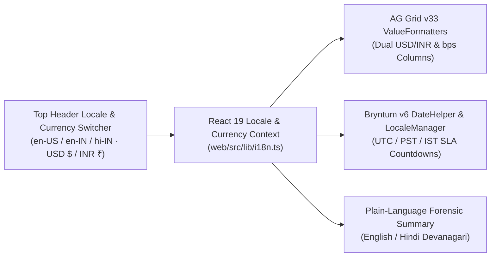

# Localization, Multi-Currency & Indic i18n Specification — TALOS
> Project: TALOS · Owner: Principal Design & Frontend Council · Status: Approved v1.0 · Last updated: 2026-11-01
> Related: [PROJECT_BRIEF](../00-overview/PROJECT_BRIEF.md) · [DESIGN_SYSTEM](DESIGN_SYSTEM.md) · [UI_SPEC](UI_SPEC.md) · [ACCESSIBILITY](ACCESSIBILITY.md) · [INTEGRATIONS](../03-engineering/INTEGRATIONS.md)

---

## 1. Localization Strategy & Priority Locales

Because TALOS operates across the **US/Global PayPal Sandbox ecosystem** (`USD $`, `EUR €`, `GBP £`) and the **India Cross-Border B2B & MSME Corridor (`INR ₹` via PayPal World)** (`P-01` Arjun in Bengaluru/SF, `P-03` Vikram in Mumbai, `P-04` Priya in Chennai), localization is a first-class architectural primitive across `web/`, `orchestrator-go`, and `firewall-rs`.

| Tier | Locale Code | Language & Script | Primary Target Personas | Currency & Number System | Status |
| :--- | :--- | :--- | :--- | :--- | :--- |
| **Tier 1 (Default)** | `en-US` | English (United States — Latin) | Global Judges, `P-02` Maya Lin, US/SF `P-01` | `USD ($)` · Standard Western thousands (`$24,890.00`) | **100% Live in MVP** |
| **Tier 1 (India B2B)** | `en-IN` | English (India — Latin) | `P-01` Arjun (Bengaluru), `P-04` Priya (Chennai) | `INR (₹)` + `USD ($)` dual display · Indian Lakh/Crore grouping (`₹20,90,760.00`) | **100% Live in MVP** |
| **Tier 1 (Indic UI)** | `hi-IN` | Hindi (`हिन्दी` — Devanagari) | `P-03` Vikram's warehouse ops & Indian MSME sellers | `INR (₹)` · `Noto Sans Devanagari` · Bhashini / IndicTrans2 plain-language summaries | **100% Live in MVP** |
| **Tier 2 (v1 Pilot)** | `de-DE`, `es-ES`, `kn-IN`, `ta-IN` | German, Spanish, Kannada (`कन्नड`), Tamil (`தமிழ்`) | EU PSD2 merchants (`Marco Podien` angle) & South India SaaS ops | `EUR (€)` / `INR (₹)` | **Day-60 v1 Scope** |

---

## 2. i18n Architecture (`next-intl` + Deterministic Currency & Timezone Engine)

### 2.1 Zero-Reload Locale & Currency Switching in `web/`
In the top-right header of the TALOS Command Center (`UI_SPEC.md`), users and judges can toggle:
1. **Display Currency Mode**:
   - `USD ($)` Primary with `INR (₹)` subtitle (Default for US Devpost judging).
   - `INR (₹)` Primary with Indian `en-IN` Lakh/Crore formatting (`₹20,916` for `$249.00` at deterministic reference rate `1 USD = ₹84.00 INR`) and `USD ($)` subtitle (for PayPal Sandbox settlement).
   - `EUR (€)` / `GBP (£)` for European cross-border simulations.
2. **UI Language Mode (`EN` / `HI हिन्दी`)**:
   - Instant client-side dictionary swap powered by strongly-typed translation catalogs (`web/src/messages/en.json` and `web/src/messages/hi.json`).

---

## 3. Multi-Currency & Indian Number Formatting Specification (`USD $` vs. `INR ₹`)

> **Crucial FinOps Rule**: All internal calculations in `services/firewall-rs` (`Rust`) and `services/orchestrator-go` (`Go`) use **64-bit integer minor units (`amount_cents` / `amount_paise`, `i64` / `int64`)** and **integer basis points (`spread_bps`, where `100 bps = 1.00%`)**—never IEEE 754 floating-point numbers (`f32`/`f64`)—eliminating rounding drift!

| Value Type | Internal Representation (`E-03`, `E-06`) | `en-US` Formatted Output | `en-IN` / `hi-IN` Formatted Output | Formatter Implementation |
| :--- | :--- | :--- | :--- | :--- |
| **Single Item Escrow (`Shure SM7B`)** | `amount_cents = 24900`, `currency = "USD"` | **`$249.00`** (`₹20,916`) | **`₹20,916.00`** (`$249.00 USD`) | `new Intl.NumberFormat('en-IN', { style: 'currency', currency: 'INR' })` |
| **Mandate Cap (`P-01` Budget)** | `max_amount_cents = 30000` | **`$300.00`** (`₹25,200`) | **`₹25,200.00`** (`$300.00 USD`) | Tabular monospaced (`JetBrains Mono`) |
| **Total Protected GMV KPI** | `2489000` cents (`$24,890.00`) | **`$24,890.00`** | **`₹20,90,760.00`** (`₹20.91 Lakh`) | Custom compact Lakh/Crore helper for KPI cards |
| **Channel3 Price Spread** | `spread_bps = 9277` | **`+92.77%` (`+9,277 bps`)** | **`+92.77%` (`+9,277 bps`)** | Explicit `+` / `-` sign prefix for accessibility |

---

## 4. Indic Script Typography & Bhashini / IndicTrans2 Workflow

### 4.1 Devanagari & Indic Script Rendering Safeguards
- **Font Stack**: `'Inter'`, `'Noto Sans'`, `'Noto Sans Devanagari'` loaded with `display: swap`.
- **Line-Height & Vertical Metrics**: Devanagari matras (vowel signs above and below the headline/shirorekha, such as `ि`, `ी`, `ु`, `ू`, `ै`, `ौ`) get clipped if CSS `line-height` is too tight (`<1.2`). TALOS enforces `line-height: 1.5` (`leading-normal`) on all localized text badges and table cells when `locale === 'hi-IN'` so zero glyphs are clipped inside **AG Grid** or **Bryntum**.
- **Numerals**: Even when the UI language is switched to Hindi (`hi-IN`), cryptographic hashes, `ORDER-ID` strings, and tabular financial amounts retain **standard Western Arabic numerals (`0-9`)** in `JetBrains Mono` per institutional Indian banking/RBI conventions.

### 4.2 Side-by-Side Translation Glossary (`en.json` <-> `hi.json`)

| UI Key | English (`en-US` / `en-IN`) | Hindi (`hi-IN` — Devanagari) | Context |
| :--- | :--- | :--- | :--- |
| `header.tagline` | `Zero-Trust Agentic Commerce Firewall & Reversible PayPal Escrow Referee` | `ज़ीरो-ट्रस्ट एजेंटिक कॉमर्स फ़ायरवॉल और रिवर्सेबल PayPal एस्क्रो रेफ़री` | Top application sub-header |
| `kpi.protected_gmv` | `Protected Agentic GMV` | `सुरक्षित एजेंटिक कुल लेनदेन (GMV)` | KPI Card #1 |
| `kpi.fraud_saved` | `Threats & Overpayments Blocked` | `रोकी गई धोखाधड़ी और अधिक भुगतान की बचत` | KPI Card #2 |
| `mandate.sign_btn` | `Sign Ed25519 KYA Mandate` | `Ed25519 KYA जनादेश (Mandate) पर हस्ताक्षर करें` | `KyaMandateSigner.tsx` (`F-01`) |
| `status.authorized` | `AUTHORIZED (29-Day Escrow Hold)` | `अधिकृत (29-दिन एस्क्रो होल्ड)` | AG Grid & Bryntum badge (`F-05`) |
| `status.captured` | `CAPTURED (Delivery Verified)` | `भुगतान पूर्ण (डिलीवरी सत्यापित)` | AG Grid & Bryntum badge (`F-06`) |
| `status.voided` | `VOIDED (100% Refunded on SLA Breach)` | `रद्द / वापस (SLA उल्लंघन पर 100% रिफंड)` | AG Grid & Bryntum badge (`F-06`) |
| `status.blocked_inj` | `BLOCKED: DOM Prompt Injection + Price Gouge` | `अवरुद्ध: छिपा हुआ DOM प्रॉम्प्ट इंजेक्शन + मूल्य वृद्धि` | AG Grid forensic row (`F-02`, `F-04`) |
| `stepup.title` | `Human Step-Up Co-Sign Required (PayPal JS SDK v6)` | `मानवीय सह-हस्ताक्षर आवश्यक (PayPal JS SDK v6)` | `PayPalStepUpModal.tsx` (`F-09`) |

### 4.3 Bhashini (`ULCA`) / IndicTrans2 Integration for Merchant & Auditor Summaries
- In `v1 (Production)` and our local translation pipeline, plain-language forensic explanations (`"Why was this transaction blocked or rerouted?"`) and dispute evidence summaries (`F-10`) can be dynamically translated across 12 scheduled Indian languages via **MeitY Bhashini (`bhashini.gov.in` ULCA Pipeline API)** with an instant offline dictionary fallback in `web/src/lib/i18n.ts` so zero external API latency affects the live demo.

---

## 5. Timezone-Aware SLA Countdowns (`UTC` / `PST` / `IST`)

Because **Bryntum Scheduler Pro (`F-07`)** governs time-critical 48-hour shipping SLAs and 29-day PayPal Authorization expiration windows across global teams:
1. **Canonical Storage**: All timestamps in PostgreSQL (`E-03`, `E-06`, `E-07`) and JSON API payloads (`API-01`..`API-16`) are stored and transmitted strictly in **ISO 8601 UTC (`YYYY-MM-DDTHH:mm:ss.sssZ`)**.
2. **Dual-Timezone Tooltip on Bryntum SLA Bars**:
   - Hovering or focusing any task bar on **Bryntum Scheduler Pro** displays the SLA deadline in three synchronized zones so both US judges (`PST`) and Indian operations teams (`IST`) have instant clarity:
     - `SLA Deadline (Relative)`: **`18h 42m remaining`**
     - `US Pacific (PST)`: **`Nov 03, 2026 @ 12:00 PM PST`**
     - `India Standard (IST)`: **`Nov 04, 2026 @ 01:30 AM IST`**
     - `UTC Canonical`: **`2026-11-03T20:00:00Z`**
