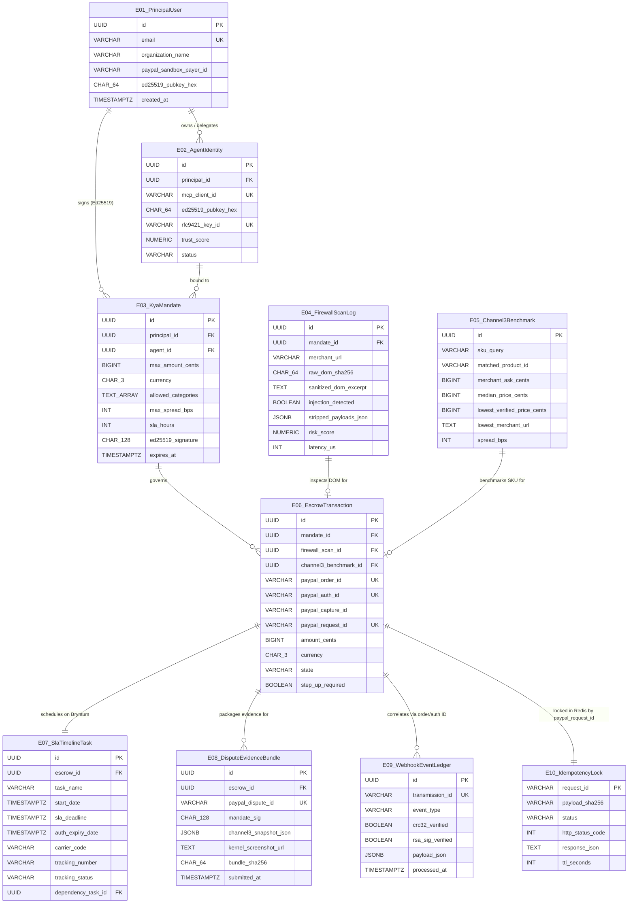

# Data Model & Persistence Schema — TALOS
> Project: TALOS · Owner: Data & Ledger Engineering · Status: Approved v1.0 · Last updated: 2026-11-01
> Related: [PROJECT_BRIEF](../00-overview/PROJECT_BRIEF.md) · [ARCHITECTURE](ARCHITECTURE.md) · [API_SPEC](API_SPEC.md) · [PRIVACY](../06-security-compliance/PRIVACY.md)

---

## 1. Data Architecture Overview

TALOS persists state across three specialized storage engines:
1. **PostgreSQL 16 (`talos-postgres`)**: Primary ACID system of record for Entities **`E-01` through `E-09`**. All state transitions on `escrow_transactions` (`E-06`) execute inside `READ COMMITTED` / `SELECT ... FOR UPDATE` transactions to prevent double-capture race conditions (`R-03`).
2. **Redis / Valkey 7.2 (`talos-valkey`)**: Hosts Entity **`E-10` (`IdempotencyLock`)** using atomic `SET idemp:{request_id} {hash} NX EX 86400` operations, plus transient WebSocket pub/sub channels (`ws:events:escrow`).
3. **Elastic Cloud (`Elasticsearch 8.17`)**: Dual-writes Entity **`E-04` (`FirewallScanLog`)** with 1536-dimensional / sparse `elser_model_2` embeddings (`M-04`) for semantic prompt-injection threat hunting (`F-12`).

---

## 2. Entity-Relationship Diagram (`E-01`..`E-10`)



---

## 3. Complete PostgreSQL 16 DDL Schema (`migrations/000001_init_talos_schema.up.sql`)

```sql
-- Enable cryptographic & UUID extensions
CREATE EXTENSION IF NOT EXISTS "pgcrypto";

-- Enum types for deterministic state machines
CREATE TYPE agent_status AS ENUM ('ACTIVE', 'SUSPENDED', 'REVOKED');

CREATE TYPE escrow_state AS ENUM (
    'INITIATED',
    'BLOCKED_FIREWALL',
    'BLOCKED_PRICE_GOUGING',
    'STEP_UP_REQUIRED',
    'MANDATE_VERIFIED',
    'CHANNEL3_BENCHMARKED',
    'PAYPAL_AUTHORIZED',
    'SLA_SCHEDULED',
    'TRACKING_VERIFIED',
    'PAYPAL_CAPTURED',
    'PAYPAL_VOIDED',
    'DISPUTE_FILED',
    'DISPUTE_EVIDENCE_SUBMITTED'
);

CREATE TYPE carrier_tracking_status AS ENUM (
    'PENDING_SHIPMENT',
    'SHIPPED',
    'IN_TRANSIT',
    'DELIVERED',
    'SLA_BREACHED',
    'CANCELLED'
);

-- ============================================================================
-- E-01: PrincipalUser (principal_users)
-- ============================================================================
CREATE TABLE principal_users (
    id UUID PRIMARY KEY DEFAULT gen_random_uuid(),
    email VARCHAR(255) NOT NULL UNIQUE,
    full_name VARCHAR(120) NOT NULL,
    organization_name VARCHAR(160) NOT NULL,
    paypal_sandbox_payer_id VARCHAR(64) NOT NULL,
    paypal_sandbox_email VARCHAR(255) NOT NULL,
    ed25519_pubkey_hex CHAR(64) NOT NULL CHECK (ed25519_pubkey_hex ~ '^[0-9a-fA-F]{64}$'),
    step_up_threshold_cents BIGINT NOT NULL DEFAULT 30000 CHECK (step_up_threshold_cents > 0),
    created_at TIMESTAMPTZ NOT NULL DEFAULT NOW(),
    updated_at TIMESTAMPTZ NOT NULL DEFAULT NOW()
);

CREATE INDEX idx_principal_users_email ON principal_users(email);

-- ============================================================================
-- E-02: AgentIdentity (agent_identities)
-- ============================================================================
CREATE TABLE agent_identities (
    id UUID PRIMARY KEY DEFAULT gen_random_uuid(),
    principal_id UUID NOT NULL REFERENCES principal_users(id) ON DELETE RESTRICT,
    mcp_client_id VARCHAR(128) NOT NULL UNIQUE,
    agent_name VARCHAR(120) NOT NULL,
    model_identifier VARCHAR(80) NOT NULL DEFAULT 'claude-3-7-sonnet-20250219',
    ed25519_pubkey_hex CHAR(64) NOT NULL CHECK (ed25519_pubkey_hex ~ '^[0-9a-fA-F]{64}$'),
    rfc9421_key_id VARCHAR(128) NOT NULL UNIQUE,
    trust_score NUMERIC(5,2) NOT NULL DEFAULT 100.00 CHECK (trust_score >= 0 AND trust_score <= 100),
    status agent_status NOT NULL DEFAULT 'ACTIVE',
    created_at TIMESTAMPTZ NOT NULL DEFAULT NOW(),
    last_active_at TIMESTAMPTZ NOT NULL DEFAULT NOW()
);

CREATE INDEX idx_agent_identities_principal ON agent_identities(principal_id);

-- ============================================================================
-- E-03: KyaMandate (kya_mandates)
-- ============================================================================
CREATE TABLE kya_mandates (
    id UUID PRIMARY KEY DEFAULT gen_random_uuid(),
    principal_id UUID NOT NULL REFERENCES principal_users(id) ON DELETE RESTRICT,
    agent_id UUID NOT NULL REFERENCES agent_identities(id) ON DELETE RESTRICT,
    max_amount_cents BIGINT NOT NULL CHECK (max_amount_cents > 0 AND max_amount_cents <= 10000000),
    currency CHAR(3) NOT NULL DEFAULT 'USD' CHECK (currency IN ('USD', 'EUR', 'GBP', 'INR')),
    allowed_categories TEXT[] NOT NULL,
    max_spread_bps INT NOT NULL DEFAULT 1500 CHECK (max_spread_bps >= 0 AND max_spread_bps <= 10000),
    sla_hours INT NOT NULL DEFAULT 48 CHECK (sla_hours >= 1 AND sla_hours <= 696), -- max 29 days (696h)
    canonical_payload_json JSONB NOT NULL,
    ed25519_signature CHAR(128) NOT NULL CHECK (ed25519_signature ~ '^[0-9a-fA-F]{128}$'),
    is_revoked BOOLEAN NOT NULL DEFAULT FALSE,
    expires_at TIMESTAMPTZ NOT NULL,
    created_at TIMESTAMPTZ NOT NULL DEFAULT NOW()
);

CREATE INDEX idx_kya_mandates_principal_active ON kya_mandates(principal_id, expires_at) WHERE is_revoked = FALSE;

-- ============================================================================
-- E-04: FirewallScanLog (firewall_scan_logs)
-- ============================================================================
CREATE TABLE firewall_scan_logs (
    id UUID PRIMARY KEY DEFAULT gen_random_uuid(),
    mandate_id UUID REFERENCES kya_mandates(id) ON DELETE SET NULL,
    merchant_url TEXT NOT NULL,
    raw_dom_hash CHAR(64) NOT NULL,
    sanitized_dom TEXT NOT NULL,
    injection_detected BOOLEAN NOT NULL DEFAULT FALSE,
    stripped_payloads_json JSONB NOT NULL DEFAULT '[]'::jsonb,
    deberta_label VARCHAR(32) NOT NULL DEFAULT 'SAFE',
    risk_score NUMERIC(5,4) NOT NULL DEFAULT 0.0000 CHECK (risk_score >= 0 AND risk_score <= 1.0000),
    latency_us INT NOT NULL CHECK (latency_us >= 0),
    otel_trace_id VARCHAR(64),
    created_at TIMESTAMPTZ NOT NULL DEFAULT NOW()
);

CREATE INDEX idx_firewall_scan_logs_injection ON firewall_scan_logs(injection_detected, created_at DESC);
CREATE INDEX idx_firewall_scan_logs_mandate ON firewall_scan_logs(mandate_id);

-- ============================================================================
-- E-05: Channel3Benchmark (channel3_benchmarks)
-- ============================================================================
CREATE TABLE channel3_benchmarks (
    id UUID PRIMARY KEY DEFAULT gen_random_uuid(),
    sku_query VARCHAR(255) NOT NULL,
    matched_product_id VARCHAR(128) NOT NULL,
    product_title VARCHAR(255) NOT NULL,
    merchant_ask_cents BIGINT NOT NULL CHECK (merchant_ask_cents > 0),
    median_price_cents BIGINT NOT NULL CHECK (median_price_cents > 0),
    lowest_verified_price_cents BIGINT NOT NULL CHECK (lowest_verified_price_cents > 0),
    lowest_merchant_name VARCHAR(160) NOT NULL,
    lowest_merchant_url TEXT NOT NULL,
    spread_bps INT NOT NULL, -- ((merchant_ask - median) * 10000) / median
    gouging_blocked BOOLEAN NOT NULL DEFAULT FALSE,
    raw_channel3_response JSONB NOT NULL DEFAULT '{}'::jsonb,
    created_at TIMESTAMPTZ NOT NULL DEFAULT NOW()
);

CREATE INDEX idx_channel3_benchmarks_sku ON channel3_benchmarks(sku_query, created_at DESC);

-- ============================================================================
-- E-06: EscrowTransaction (escrow_transactions)
-- ============================================================================
CREATE TABLE escrow_transactions (
    id UUID PRIMARY KEY DEFAULT gen_random_uuid(),
    mandate_id UUID NOT NULL REFERENCES kya_mandates(id) ON DELETE RESTRICT,
    firewall_scan_id UUID REFERENCES firewall_scan_logs(id) ON DELETE RESTRICT,
    channel3_benchmark_id UUID REFERENCES channel3_benchmarks(id) ON DELETE RESTRICT,
    paypal_order_id VARCHAR(64) UNIQUE,
    paypal_auth_id VARCHAR(64) UNIQUE,
    paypal_capture_id VARCHAR(64) UNIQUE,
    paypal_request_id VARCHAR(64) NOT NULL UNIQUE,
    merchant_name VARCHAR(160) NOT NULL,
    merchant_paypal_email VARCHAR(255) NOT NULL,
    sku_summary VARCHAR(255) NOT NULL,
    amount_cents BIGINT NOT NULL CHECK (amount_cents > 0),
    currency CHAR(3) NOT NULL DEFAULT 'USD',
    state escrow_state NOT NULL DEFAULT 'INITIATED',
    step_up_required BOOLEAN NOT NULL DEFAULT FALSE,
    step_up_approved_at TIMESTAMPTZ,
    failure_reason TEXT,
    otel_trace_id VARCHAR(64),
    created_at TIMESTAMPTZ NOT NULL DEFAULT NOW(),
    updated_at TIMESTAMPTZ NOT NULL DEFAULT NOW()
);

CREATE INDEX idx_escrow_transactions_state_created ON escrow_transactions(state, created_at DESC);
CREATE INDEX idx_escrow_transactions_mandate ON escrow_transactions(mandate_id);
CREATE INDEX idx_escrow_transactions_paypal_order ON escrow_transactions(paypal_order_id);

-- ============================================================================
-- E-07: SlaTimelineTask (sla_timeline_tasks)
-- ============================================================================
CREATE TABLE sla_timeline_tasks (
    id UUID PRIMARY KEY DEFAULT gen_random_uuid(),
    escrow_id UUID NOT NULL UNIQUE REFERENCES escrow_transactions(id) ON DELETE CASCADE,
    task_name VARCHAR(200) NOT NULL,
    resource_id VARCHAR(80) NOT NULL DEFAULT 'merchant-fulfillment',
    start_date TIMESTAMPTZ NOT NULL,
    sla_deadline TIMESTAMPTZ NOT NULL,
    auth_honor_until TIMESTAMPTZ NOT NULL, -- +3 days PayPal honor period
    auth_expiry_date TIMESTAMPTZ NOT NULL, -- +29 days PayPal authorization validity
    carrier_code VARCHAR(32),
    tracking_number VARCHAR(128),
    tracking_status carrier_tracking_status NOT NULL DEFAULT 'PENDING_SHIPMENT',
    percent_done INT NOT NULL DEFAULT 0 CHECK (percent_done >= 0 AND percent_done <= 100),
    dependency_task_id UUID REFERENCES sla_timeline_tasks(id) ON DELETE SET NULL,
    updated_at TIMESTAMPTZ NOT NULL DEFAULT NOW()
);

CREATE INDEX idx_sla_timeline_tasks_deadline ON sla_timeline_tasks(sla_deadline, tracking_status);

-- ============================================================================
-- E-08: DisputeEvidenceBundle (dispute_evidence_bundles)
-- ============================================================================
CREATE TABLE dispute_evidence_bundles (
    id UUID PRIMARY KEY DEFAULT gen_random_uuid(),
    escrow_id UUID NOT NULL REFERENCES escrow_transactions(id) ON DELETE RESTRICT,
    paypal_dispute_id VARCHAR(64) NOT NULL UNIQUE,
    dispute_reason VARCHAR(80) NOT NULL DEFAULT 'MERCHANDISE_OR_SERVICE_NOT_AS_DESCRIBED',
    mandate_sig CHAR(128) NOT NULL,
    channel3_snapshot_json JSONB NOT NULL,
    kernel_screenshot_url TEXT NOT NULL,
    evidence_narrative_md TEXT NOT NULL,
    bundle_sha256 CHAR(64) NOT NULL,
    paypal_submission_status VARCHAR(40) NOT NULL DEFAULT 'SUBMITTED',
    submitted_at TIMESTAMPTZ NOT NULL DEFAULT NOW()
);

-- ============================================================================
-- E-09: WebhookEventLedger (webhook_event_ledger)
-- ============================================================================
CREATE TABLE webhook_event_ledger (
    id UUID PRIMARY KEY DEFAULT gen_random_uuid(),
    transmission_id VARCHAR(128) NOT NULL UNIQUE,
    transmission_time TIMESTAMPTZ NOT NULL,
    event_type VARCHAR(120) NOT NULL,
    resource_id VARCHAR(128) NOT NULL,
    crc32_decimal BIGINT NOT NULL,
    crc32_verified BOOLEAN NOT NULL DEFAULT FALSE,
    rsa_sig_verified BOOLEAN NOT NULL DEFAULT FALSE,
    payload_json JSONB NOT NULL,
    processed_at TIMESTAMPTZ NOT NULL DEFAULT NOW()
);

CREATE INDEX idx_webhook_event_ledger_resource ON webhook_event_ledger(resource_id, event_type);
```

---

## 4. Redis / Valkey Key-Space Specification (`E-10` & Real-Time Pub/Sub)

| Key Pattern | Entity / Purpose | Redis Data Type | TTL | Value Schema / Example |
| :--- | :--- | :--- | :--- | :--- |
| `idemp:{paypal_request_id}` | **`E-10` `IdempotencyLock`** — Prevents duplicate `Orders v2 AUTHORIZE`, `CAPTURE`, or `VOID` calls (`R-03`). | `STRING` (`SET NX EX`) | `86,400s` (24 hours) | `{"status":"COMPLETED","http_code":201,"payload_sha256":"9f86d08...","paypal_order_id":"8XY12345","paypal_auth_id":"2A98765","updated_at":"2026-11-01T14:20:00Z"}` |
| `ch3:cache:{sku_slug}` | Channel3 Fair-Market Benchmark Read-Through Cache (`F-04`) | `STRING` | `900s` (15 mins) | Serialized `Channel3Benchmark` (`E-05`) JSON |
| `paypal:oauth:sandbox_token` | Cached PayPal Sandbox OAuth 2.0 Bearer Token (`/v1/oauth2/token`) | `STRING` | `28,800s` (8 hours) | Encrypted/in-memory Bearer JWT (`A21AA...`) |
| `ws:events:escrow` | Real-Time WebSocket Broadcast Channel (`API-15`) | `PUBSUB` | Transient | `{"event":"ESCROW_STATE_CHANGED","escrow_id":"...","state":"PAYPAL_CAPTURED"}` |

---

## 5. PII Classification, Encryption & Retention Matrix (`DPDP Act 2023` & `CERT-In`)

| Entity ID | Table / Store | Sensitive / PII Columns | Classification | Storage Protection | Retention Policy |
| :--- | :--- | :--- | :--- | :--- | :--- |
| **`E-01`** | `principal_users` | `email`, `full_name`, `paypal_sandbox_email` | **PII — Low/Medium** (Sandbox emails in MVP; Business contact in v1) | TLS 1.3 in transit; AES-256 at rest; masked in structured logs (`a***@example.com`). | Active account duration + 180 days post-closure (DPDP §8(7) erasure right). |
| **`E-02`** | `agent_identities` | `ed25519_pubkey_hex`, `rfc9421_key_id` | **Public Cryptographic Metadata** | Public keys only; private keys never leave principal browser / agent enclave. | 5 years (Financial audit trail). |
| **`E-03`** | `kya_mandates` | `ed25519_signature`, `canonical_payload_json` | **Non-PII Financial Authorization** | Immutable append-only signature verification record. | 7 years (RBI / Income Tax / SOX financial record retention). |
| **`E-04`** | `firewall_scan_logs` | `sanitized_dom`, `stripped_payloads_json` | **Security Telemetry** | PII scrubbing regex strips any `<input type="email/tel">` values before DB/Elastic write. | 180 days hot in PostgreSQL/Elastic (CERT-In directive compliance). |
| **`E-05`** | `channel3_benchmarks` | None (Public SKU pricing) | **Public Market Data** | Standard PostgreSQL table. | 90 days rolling benchmark history. |
| **`E-06`** | `escrow_transactions` | `paypal_order_id`, `paypal_auth_id`, `merchant_paypal_email` | **Financial Transaction Record** | Row-level locking; zero PAN/CVV/Bank account numbers ever stored (`R-06`). | 7 years immutable financial ledger. |
| **`E-07`** | `sla_timeline_tasks` | `tracking_number`, `carrier_code` | **Operational Logistics Data** | Linked via FK to `escrow_transactions`. | 1 year active, archived to cold object storage. |
| **`E-08`** | `dispute_evidence_bundles` | `kernel_screenshot_url`, `mandate_sig` | **Legal / Representment Artifact** | SHA-256 content-addressed bundle integrity (`bundle_sha256`). | 7 years post-dispute resolution. |
| **`E-09`** | `webhook_event_ledger` | `payload_json` | **Financial Webhook Audit** | Verified via `CRC32` + PayPal X.509 RSA signature before processing. | 180 days hot (CERT-In) + 7 years cold archive. |
| **`E-10`** | `idemp:{request_id}` | `response_json` | **Transient Idempotency State** | Ephemeral Valkey/Redis memory with `allkeys-lru` eviction guard. | Automatic `24-hour` TTL expiry (`EX 86400`). |

---

## 6. Database Migration & Seeding Strategy

1. **Migration Tooling**:
   - **Go Orchestrator**: Uses `golang-migrate/migrate/v4` reading SQL files from `services/orchestrator-go/migrations/` (`000001_init_talos_schema.up.sql` and `.down.sql`).
   - **Rust Firewall**: Uses `sqlx-cli` compile-time checked queries (`sqlx::query!`) verified against `services/firewall-rs/.sqlx/` offline metadata so `cargo build --release` works without a live database during Docker multi-stage builds (`R-04`).
2. **Deterministic Demo Seeding (`scripts/seed_demo_data.sql`)**:
   - Automatically executed on `docker compose up` and Render initialization.
   - Pre-populates:
     - **4 Personas (`P-01`..`P-04`)** in `principal_users` (`E-01`).
     - **3 Registered AI Agents** in `agent_identities` (`E-02`) with known `Ed25519` test keypairs.
     - **3 Active KYA Mandates** in `kya_mandates` (`E-03`) (`$300` Studio Audio mandate, `$1,200` B2B Server Rack mandate, `$200` Indie SaaS mandate).
     - **6 Historical & Live Escrow Transactions** (`E-06`) + **Bryntum SLA Tasks** (`E-07`) spanning `PAYPAL_CAPTURED`, `PAYPAL_AUTHORIZED`, `BLOCKED_FIREWALL`, `BLOCKED_PRICE_GOUGING`, `PAYPAL_VOIDED`, and `STEP_UP_REQUIRED` so **AG Grid / AG Studio** and **Bryntum Scheduler Pro** render rich, judge-ready visual telemetry at millisecond zero.
