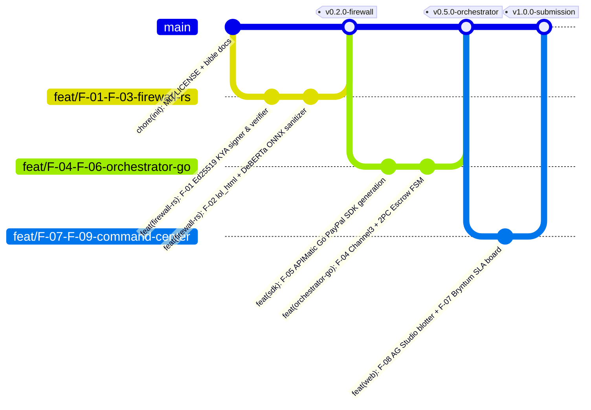

# Git Workflow & Release Strategy — TALOS
> Project: TALOS · Owner: Engineering Operations · Status: Approved v1.0 · Last updated: 2026-11-01
> Related: [PROJECT_BRIEF](../00-overview/PROJECT_BRIEF.md) · [CODING_STANDARDS](CODING_STANDARDS.md) · [CICD](../05-ops/CICD.md)

---

## 1. Repository & Licensing Mandate (`R-05` Stage-1 Gate)

> [!CAUTION]
> **Hackathon Stage-1 Disqualifier Guard (`R-05`)**: Per PayPal AI Hackathon Official Rules, every submission **must** display an Open Source License in the GitHub repository's **"About"** section on the main page.
> - `LICENSE` (MIT License) is committed in **Commit #1** at the root of the `main` branch.
> - The GitHub repo `description`, `website` (Render live URL), `topics` (`paypal`, `agentic-commerce`, `mcp`, `rust`, `golang`, `ag-grid`, `bryntum`, `apimatic`, `channel3`), and `MIT license` badge are verified immediately upon pushing.

---

## 2. Branching Model (Trunk-Based + Feature Short-Lived Branches)



### Branch Naming Convention
- `feat/F-xx-<short-slug>` — Feature implementation mapped to `PROJECT_BRIEF.md` (e.g., `feat/F-02-rust-dom-sanitizer`).
- `fix/R-xx-<short-slug>` — Risk mitigation or bug fix (e.g., `fix/R-03-redis-idempotency-lock`).
- `docs/<short-slug>` — Documentation and architecture updates.
- `test/<short-slug>` — Unit, E2E Playwright, or Postman Newman contract tests.

---

## 3. Conventional Commits & Ralph Loop Atomic Commits

Every commit message follows the **Conventional Commits v1.0.0** specification and references the corresponding Feature ID (`F-xx`), API ID (`API-xx`), or Ralph Loop Task ID (`TASK-xx`):

```text
<type>(<scope>): <TASK-ID / F-ID> <concise imperative summary>

- Detailed bullet 1 explaining architectural change
- Detailed bullet 2 with verification command run
```

### Valid `<type>` & `<scope>` Values
- **Types**: `feat`, `fix`, `perf`, `security`, `refactor`, `test`, `docs`, `ci`, `chore`
- **Scopes**: `firewall-rs`, `orchestrator-go`, `paypal-sdk`, `web`, `ag-studio`, `bryntum`, `channel3`, `db`, `postman`, `render`

### Examples
- `feat(firewall-rs): TASK-04 F-02 implement lol_html streaming DOM prompt-injection sanitizer`
- `feat(orchestrator-go): TASK-09 F-05 wire APIMatic Go SDK for PayPal Orders v2 AUTHORIZE`
- `feat(web): TASK-14 F-07 bind Bryntum Scheduler Pro drag-end event to API-10 PayPal VOID`

---

## 4. Pull Request & Merge Checklist (Definition of Done)

Before any branch merges into `main`:
- [ ] **Rust Gate**: `cargo fmt --check && cargo clippy -- -D warnings && cargo test` passes in `services/firewall-rs`.
- [ ] **Golang Gate**: `golangci-lint run && go test -race ./...` passes in `services/orchestrator-go`.
- [ ] **Frontend Gate**: `pnpm typecheck && pnpm lint && pnpm test:run` passes in `web/`.
- [ ] **OpenAPI & Postman Sync**: Any change to `API-01`..`API-16` updates `api/openapi.yaml` and `postman/Talos-Sandbox-MCP.postman_collection.json`.
- [ ] **Zero Secrets Audit**: `git diff` contains zero hardcoded API keys or `.env` files.
