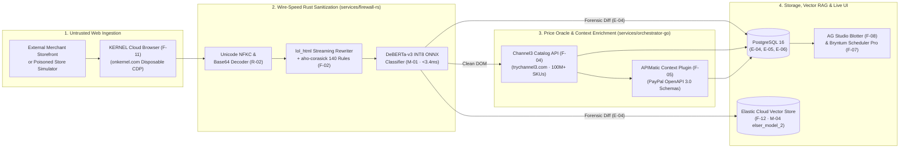

# AI Data Pipeline, DOM Ingestion & Threat RAG — TALOS
> Project: TALOS · Owner: Data & AI Infrastructure Team · Status: Approved v1.0 · Last updated: 2026-11-01
> Related: [PROJECT_BRIEF](../00-overview/PROJECT_BRIEF.md) · [ARCHITECTURE](../03-engineering/ARCHITECTURE.md) · [MODELS](MODELS.md) · [DATA_MODEL](../03-engineering/DATA_MODEL.md)

---

## 1. End-to-End Agentic Data Pipeline



---

## 2. Data Sources, Licensing & Refresh Cadence

| Data Source | Purpose in TALOS | Access Mechanism | License / Terms | Refresh / Caching Cadence |
| :--- | :--- | :--- | :--- | :--- |
| **Channel3 Product Graph (`trychannel3.com`)** | 100M+ verified e-commerce SKUs, GTINs, merchant URLs, and real-time market price distributions (`F-04`). | REST API (`POST /v1/products/search`) + Channel3 MCP. | Commercial API (Hackathon Sponsor Access). | Live query on cache miss; cached in Redis (`ch3:cache:{sku}`) for `15 minutes` and logged in `channel3_benchmarks` (`E-05`). |
| **Merchant Checkout DOMs (`KERNEL`)** | Live rendered HTML/CSS of external merchant product & checkout pages (`F-11`). | Disposable headless browser session via `onkernel.com` API. | Ephemeral transient inspection (`robots.txt` & RFC 9421 Web Bot Auth compliant). | Per-checkout evaluation (`0s` retention of raw PII; `180-day` retention of SHA-256 hash & sanitized excerpt in `E-04`). |
| **PayPal Sandbox Ledger (`api-m.sandbox.paypal.com`)** | Orders v2, Authorizations v2, Shipment Tracking v1, Customer Disputes v1 (`F-05`, `F-06`, `F-10`). | `sdk/paypal-go-apimatic` + Webhooks (`API-14`). | PayPal Developer Terms. | Real-time synchronous REST + asynchronous webhook push (`E-09`). |
| **ProtectAI Prompt-Injection Weights (`M-01`)** | Pre-trained weights for `deberta-v3-base-prompt-injection-v2`. | Quantized to INT8 ONNX (`models/deberta-v3-int8.onnx`). | **Apache-2.0 License**. | Static versioned artifact validated in CI (`SHA-256` pinned). |

---

## 3. Streaming Cleaning, Normalization & PII Scrubbing Pipeline

Before any merchant DOM text reaches `M-01` (`DeBERTa-v3`), `M-02` (`Claude 3.7 / GPT-4o`), PostgreSQL (`E-04`), or Elastic Cloud (`F-12`), it passes through four deterministic stages in `services/firewall-rs`:

1. **Stage A — Unicode & Encoding Normalization (`src/normalizer.rs` — `R-02`)**:
   - Applies Unicode Normalization Form KC (`NFKC`) via the `unicode-normalization` crate.
   - Strips all Unicode Tag characters (`U+E0000..U+E007F`), zero-width spaces (`U+200B..U+200D`, `U+FEFF`), and bidirectional override characters (`U+202A..U+202E`).
   - Scans HTML attribute values for Base64-encoded strings (`>=24` characters) and decodes them inline for inspection.
2. **Stage B — Streaming Structural Sanitization (`src/sanitizer.rs` — `F-02`)**:
   - `lol_html` strips `<script>`, `<style>`, `<iframe>`, `<object>`, `<svg>`, HTML comments, and any element with hidden CSS rules (`display:none`, `visibility:hidden`, `opacity:0`, `font-size:0px`, `left:-9999px`).
3. **Stage C — PII Redaction Filter (`DPDP Act 2023` §8)**:
   - Scrubs any customer phone numbers, Aadhaar/PAN patterns, credit card PANs (Luhn check), and non-merchant email addresses from the DOM excerpt before writing `FirewallScanLog` (`E-04`).
4. **Stage D — Sliding-Window Tokenization (`src/classifier.rs` — `M-01`)**:
   - Chunks the visible text + stripped node excerpts into `512`-token windows (`128`-token overlap) and runs INT8 ONNX inference via `ort`.

---

## 4. Elastic Cloud Vector Threat Index & Semantic RAG (`F-12`, `M-04`)

To empower **FinOps & Security Auditors (`P-04`)** and align with **Elastic (`Judge #11: Carly Richmond`)**, TALOS indexes every intercepted prompt-injection payload into **Elasticsearch 8.17**:

### 4.1 Elasticsearch Index Mapping (`talos-threat-vectors-v1`)
```json
{
  "mappings": {
    "properties": {
      "scan_id": { "type": "keyword" },
      "mandate_id": { "type": "keyword" },
      "merchant_url": { "type": "keyword" },
      "rule_id": { "type": "keyword" },
      "deberta_risk_score": { "type": "float" },
      "stripped_excerpt": { "type": "text" },
      "excerpt_embedding": {
        "type": "sparse_vector",
        "inference_id": ".elser_model_2_linux-x86_64"
      },
      "otel_trace_id": { "type": "keyword" },
      "created_at": { "type": "date" }
    }
  }
}
```

### 4.2 Semantic Retrieval & Re-Ranking Query
When `firewall-rs` intercepts a suspicious DOM fragment, `orchestrator-go` can query Elasticsearch using a hybrid **BM25 + `elser_model_2` Reciprocal Rank Fusion (RRF)** query to retrieve the top-3 historically similar attack signatures in `<85ms`, displaying the cluster lineage inside the **AG Grid Master-Detail forensic drawer** (`F-08`).
