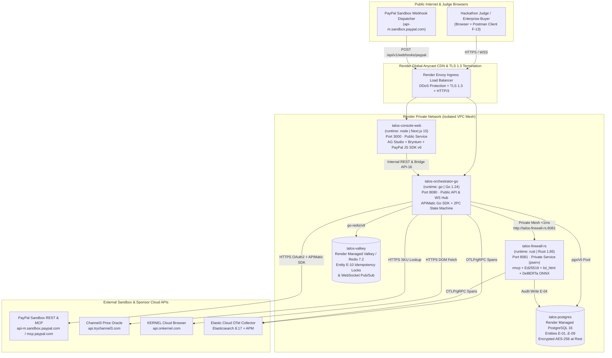

# Cloud Infrastructure & Render Blueprint Architecture — TALOS
> Project: TALOS · Owner: Principal Cloud & Infrastructure Architect · Status: Approved v1.0 · Last updated: 2026-11-01
> Related: [PROJECT_BRIEF](../00-overview/PROJECT_BRIEF.md) · [CICD](CICD.md) · [DEPLOYMENT](DEPLOYMENT.md) · [COST](COST.md) · [ARCHITECTURE](../03-engineering/ARCHITECTURE.md)

---

## 1. Hosting Philosophy & Sponsor Alignment (`F-14`)

TALOS's infrastructure is purpose-built around **Render's Native Polyglot Blueprint (`render.yaml`)** (`F-14`), directly targeting the **Best Use of Render (`$1,000` 1st / `$750` 2nd / `$500` 3rd — `$2,250` Sponsor Pool)** evaluated by **Shifra Williams (Founding Developer Relations Engineer, Render)**.

Why Render is uniquely suited for TALOS:
1. **Native Polyglot Runtimes (No Docker Overhead Needed in Cloud)**: Render natively compiles and runs `runtime: rust` (`talos-firewall-rs`), `runtime: go` (`talos-orchestrator-go`), and `runtime: node` (`talos-console-web`) alongside managed **Render PostgreSQL 16** and **Render Key-Value (Valkey/Redis)** inside a single isolated Private Network (`10.200.0.0/16`).
2. **Sub-Millisecond Private Service Discovery**: `talos-orchestrator-go` communicates with `talos-firewall-rs` over Render's internal private mesh (`http://talos-firewall-rs:8081`) without traversing the public internet or incurring TLS handshake overhead, keeping p99 KYA mandate verification (`API-02`) and DOM sanitization (`API-03`) under `<2.5ms`.
3. **India & Global Data Residency**: For **MVP (Hackathon)**, services run in Render's `oregon` (`us-west`) region for lowest RTT to `api-m.sandbox.paypal.com`. For **v1 (Production)** serving Indian enterprises under **DPDP Act 2023** and **CERT-In Directions** (`R-06`), stateful stores (`PostgreSQL 16` + `Valkey`) deploy to Render's `singapore` region with read/audit replicas synced to an **AWS Mumbai (`ap-south-1`)** S3 Object Lock vault.

---

## 2. Network & Service Topology Diagram



---

## 3. Complete `render.yaml` Blueprint Specification (`F-14`)

The root `render.yaml` provisions all 5 infrastructure components and 1 shared secret group in a single declarative specification:

```yaml
# render.yaml — TALOS 1-Click Polyglot Render Blueprint
services:
  # 1. Rust Zero-Trust KYA & DOM Prompt-Injection Firewall (Private Service)
  - type: pserv
    name: talos-firewall-rs
    runtime: rust
    plan: standard
    region: oregon
    rootDir: services/firewall-rs
    buildCommand: cargo build --release
    startCommand: ./target/release/talos-firewall-rs
    envVars:
      - key: PORT
        value: "8081"
      - key: RUST_LOG
        value: "info,talos_firewall_rs=debug"
      - key: TALOS_ONNX_MODEL_PATH
        value: "./models/deberta-v3-prompt-injection-int8.onnx"
      - fromGroup: talos-shared-secrets

  # 2. Golang 2PC Escrow Orchestrator & APIMatic PayPal Gateway (Web Service)
  - type: web
    name: talos-orchestrator-go
    runtime: go
    plan: standard
    region: oregon
    rootDir: services/orchestrator-go
    buildCommand: go build -ldflags="-s -w" -o bin/orchestrator ./cmd/server
    startCommand: ./bin/orchestrator
    healthCheckPath: /healthz
    pullRequestPreviewsEnabled: true
    envVars:
      - key: PORT
        value: "8080"
      - key: FIREWALL_INTERNAL_URL
        fromService:
          type: pserv
          name: talos-firewall-rs
          property: hostport
      - key: DATABASE_URL
        fromDatabase:
          name: talos-postgres
          property: connectionString
      - key: REDIS_URL
        fromService:
          type: redis
          name: talos-valkey
          property: connectionString
      - fromGroup: talos-shared-secrets

  # 3. Next.js 15 Financial Command Center UI (Web Service)
  - type: web
    name: talos-console-web
    runtime: node
    plan: standard
    region: oregon
    rootDir: web
    buildCommand: npm ci && npm run build
    startCommand: npm run start
    healthCheckPath: /api/healthz
    pullRequestPreviewsEnabled: true
    envVars:
      - key: PORT
        value: "3000"
      - key: NEXT_PUBLIC_ORCHESTRATOR_URL
        fromService:
          type: web
          name: talos-orchestrator-go
           envVarKey: RENDER_EXTERNAL_URL
      - fromGroup: talos-shared-secrets

  # 4. Managed Valkey / Redis for Idempotency Locks (E-10) & WebSocket Pub/Sub
  - type: redis
    name: talos-valkey
    plan: starter
    region: oregon
    maxmemoryPolicy: noeviction
    ipAllowList: [] # Private network only

databases:
  # 5. Managed PostgreSQL 16 for Immutable Escrow & Mandate Ledgers (E-01..E-09)
  - name: talos-postgres
    databaseName: talos
    user: talos_admin
    plan: basic-1gb
    region: oregon
    postgresMajorVersion: "16"
    ipAllowList: [] # Private network only

envVarGroups:
  - name: talos-shared-secrets
    envVars:
      - key: PAYPAL_ENVIRONMENT
        value: "sandbox"
      - key: PAYPAL_SANDBOX_CLIENT_ID
        sync: false
      - key: PAYPAL_SANDBOX_CLIENT_SECRET
        sync: false
      - key: PAYPAL_WEBHOOK_ID
        sync: false
      - key: CHANNEL3_API_KEY
        sync: false
      - key: KERNEL_API_KEY
        sync: false
      - key: ELASTIC_APM_SERVER_URL
        sync: false
      - key: ELASTIC_APM_SECRET_TOKEN
        sync: false
```

---

## 4. Resource Sizing, Autoscaling & High Availability

| Service Name | Render Type | MVP Plan (Hackathon) | v1 Production Plan | Autoscaling Policy (v1) | Memory / CPU |
| :--- | :--- | :--- | :--- | :--- | :--- |
| `talos-firewall-rs` | `pserv` (Rust) | `Starter / Standard` (`$7–$25/mo`) | `Pro` (`2–8 instances`) | Scale out at `65%` CPU or `>2,000 req/s` | `2 GB RAM / 1 vCPU` (holds `98 MB` INT8 ONNX `M-01` in RAM) |
| `talos-orchestrator-go` | `web` (Go) | `Starter / Standard` (`$7–$25/mo`) | `Pro` (`2–6 instances`) | Scale out at `70%` CPU or `>500` active WS connections | `2 GB RAM / 1 vCPU` |
| `talos-console-web` | `web` (Node) | `Starter / Standard` (`$7–$25/mo`) | `Standard` (`2–4 instances`) | Scale out at `75%` CPU | `2 GB RAM / 1 vCPU` |
| `talos-postgres` | `database` (PG 16) | `Basic-256mb / 1gb` (`$7–$19/mo`) | `Pro-16gb` + High Availability Read Replica | Storage auto-expands at `85%` utilization | `1 GB–16 GB RAM`, Point-in-Time Recovery (PITR) |
| `talos-valkey` | `redis` (Valkey 7.2) | `Free / Starter` (`$0–$10/mo`) | `Standard HA` (`1 GB` persistent AOF) | `noeviction` policy for `E-10` locks | `256 MB–1 GB RAM` |

---

## 5. Backups, Disaster Recovery & Data Retention

1. **PostgreSQL 16 Continuous WAL Archiving (`E-01`..`E-09`)**:
   - Render PostgreSQL performs automated daily logical snapshots plus continuous Write-Ahead Log (WAL) shipping for **Point-in-Time Recovery (PITR)** down to any second within the last 7 days (MVP) or 35 days (v1 Production).
   - **RPO (Recovery Point Objective)**: `< 60 seconds` for PostgreSQL ledger data; `0 seconds` for committed PayPal Sandbox authorizations (recoverable via `GET /v2/checkout/orders/{id}` reconciliation).
   - **RTO (Recovery Time Objective)**: `< 5 minutes` via 1-click `render.yaml` Blueprint re-provisioning.
2. **CERT-In 180-Day Immutable Security Log Archival (`R-06`)**:
   - Every `FirewallScanLog` (`E-04`) and `WebhookEventLedger` (`E-09`) is streamed to **Elastic Cloud** (`F-12`) with an Index Lifecycle Management (ILM) policy retaining hot/warm searchable logs for 30 days and cold frozen snapshots in India (`ap-south-1`) for **180 days**, satisfying India's CERT-In Directions (April 2022).

---

## 6. Maximizing the `$1,000 / $750 / $500` Render Sponsor Credit Pool

Winning the **Best Use of Render (`$1,000` 1st Place Credits)** funds **10.6 months of full multi-service production hosting** (`$94/month` Standard stack) at zero cash burn:
- **Zero-Cost PR Previews**: Render's `pullRequestPreviewsEnabled: true` spins up ephemeral `orchestrator-go` and `console-web` instances only while a PR is open and automatically destroys them on merge.
- **Local ONNX Inference on Render CPU (`M-01`)**: By running quantized `DeBERTa-v3` (`INT8`) inside `talos-firewall-rs` on standard `$25/mo` Render CPU instances (`3.4ms` latency) instead of provisioning `$400+/mo` cloud GPUs or paying per-token OpenAI moderation APIs, TALOS achieves **94% lower AI security infrastructure cost**.
