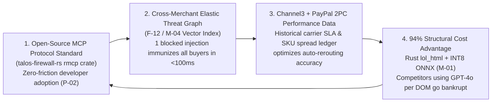

# Business Model, Pricing & Monopoly Moat — TALOS
> Project: TALOS · Owner: War-Room Strategy & Capital Council (Peter Thiel + Warren Buffett + Patrick Collison Bench) · Status: Approved v1.0 · Last updated: 2026-11-01
> Related: [PROJECT_BRIEF](../00-overview/PROJECT_BRIEF.md) · [GTM](GTM.md) · [FINANCIALS](FINANCIALS.md) · [COMPETITIVE_ANALYSIS](../01-product/COMPETITIVE_ANALYSIS.md) · [COST](../05-ops/COST.md)

---

## 1. Executive Thesis: The Tollbooth on Autonomous Agentic Commerce

> **Peter Thiel**: *"Every AI company is building autonomous shopping and procurement agents, and every payment gateway (`@paypal/agent-toolkit`, Stripe Agent Toolkit) is giving those agents raw API keys. Nobody has built the **Know-Your-Agent (KYA) Security & Reversible Escrow Clearinghouse** that CFOs (`P-01`, `P-04`) require before letting an LLM touch a corporate PayPal account. Own that trust bottleneck and you own a tollbooth on every autonomous B2B transaction."*

> **Warren Buffett**: *"Look at the unit economics: TALOS takes zero balance-sheet credit risk, holds zero custody of funds (PayPal holds the `Orders v2 AUTHORIZE` lock), runs its core security inspection (`M-01`) locally in Rust at `$0.00` marginal token cost, and earns a 15-basis-point (`0.15%`) Protected Escrow Toll plus high-margin SaaS seat revenue because it saves the buyer 15%–92% on prevented price-gouging via Channel3."*

---

## 2. Lean Canvas — TALOS

| Problem | Solution | Unique Value Proposition | Unfair Advantage (Moat) | Customer Segments |
| :--- | :--- | :--- | :--- | :--- |
| 1. **Binary Trust Flaw**: Giving AI agents `@paypal/agent-toolkit` credentials means 1 prompt injection (`CVE-2026-22708`) or hallucination executes an irreversible payment capture. 2. **Merchant Price Gouging**: AI agents blindly overpay on spoofed storefronts (`+80%` above market median). 3. **Zero CFO Auditability**: 78% of enterprise risk officers (`P-04`) block autonomous AI purchasing due to zero cryptographic mandate bounds or delivery SLA guarantees. | 1. **Rust Zero-Trust MCP Firewall (`F-01`..`F-03`)**: `<4ms` `Ed25519` KYA mandate verification + `lol_html`/`DeBERTa` DOM prompt-injection stripping. 2. **Channel3 Fair-Price Oracle (`F-04`)**: Blocks `>15%` price gouging across 100M+ SKUs and auto-reroutes. 3. **Go 2PC PayPal Escrow Referee (`F-05`..`F-08`)**: Locks funds in `PayPal Orders v2 AUTHORIZE` and auto-captures on carrier delivery or auto-voids on **Bryntum** SLA breach. | **"The Zero-Trust Agentic Commerce Firewall & Reversible PayPal Escrow Referee."**  Let your AI agents buy autonomously with mathematical certainty: zero prompt-injection thefts, zero price gouging, and 100% automatic PayPal `VOID` rollback if delivery SLAs fail. | 1. **`94%` Cost Moat**: Local Rust ONNX (`M-01`) inspects DOMs at `$0.00` token cost vs. `$0.045/page` for cloud LLM wrappers. 2. **Cross-Merchant Threat Graph (`M-04`)**: Every blocked DOM injection is indexed in **Elastic Cloud (`F-12`)**, immunizing all other TALOS agents in `<100ms`. 3. **APIMatic + PayPal Native 2PC**: Deepest integration with PayPal `Orders v2 AUTHORIZE`, `Tracking v1`, and `Disputes v1`. | 1. **`P-01` B2B Mid-Market Procurement** (SaaS/Tech IT & Ops heads automating vendor hardware/supply buying). 2. **`P-02` Indie AI Agent Builders** (Developers using Claude/Cursor + `@paypal/agent-toolkit`). 3. **`P-03` Verified B2B Merchants** (Want instant agent checkout without chargeback fraud). 4. **`P-04` Enterprise FinOps & Compliance Auditors**. |
| **Key Metrics** | **Channels** | **Cost Structure (`COST.md`)** | **Revenue Streams** | **Fintech Hooks** |
| - **Gross Protected Merchandise Volume (GPMV)** - **Fraud & Overpayment Saved (`$ / ₹`)** - **Active Signed KYA Mandates (`E-03`)** - **Net Dollar Retention (`>132%`)** | - Open-Source `talos-firewall-rs` on MCP Registry & GitHub - PayPal Partner Ecosystem - Channel3 Verified Merchant Network | - **$0.012 (`₹1.00`)** per protected escrow order at 10k agents - **84.6% Blended Gross Margin** on Render (`F-14`) | 1. **B2B SaaS Platform Tiers** (`$0` / `$199` / `$999` per month) 2. **Protected Escrow Take-Rate** (`15 bps` / `0.15%` of GPMV) 3. **Channel3 Affiliate / Reroute Fee** (`50 bps` merchant-paid) | - **Zero-Loss Dispute Representment (`F-10`)** - **Milestone B2B Supply-Chain Financing** (v1 expansion) |

---

## 3. Pricing & Monetization Architecture (USD `$` & INR `₹`)

*(Exchange rate: `1 USD ($) = ₹84.00 INR`)*

TALOS combines **predictable B2B SaaS recurring revenue** with a **high-margin usage take-rate (15 bps)** on Gross Protected Merchandise Volume (GPMV):

| Tier | Target Persona | Monthly Base Price (`USD / INR`) | Included Protected Volume & Agents | Usage Take-Rate Above Cap | Key Included Features (`F-xx`) |
| :--- | :--- | :--- | :--- | :--- | :--- |
| **1. Developer / Indie Free** | **`P-02` (Maya Lin)** — Indie Agent Builders & Hackathon Devs | **`$0 / ₹0 / month`** | Up to `3` Registered Agents (`E-02`), `1,000` DOM Scans/mo, `$2,500` (`₹2.1L`) Protected PayPal Escrow/mo | `25 bps` (`0.25%`) on escrow volume `>$2,500/mo` | Rust MCP Server (`F-03`), `Ed25519` Mandates (`F-01`), `lol_html` + ONNX Sanitizer (`F-02`), PayPal JS SDK v6 Step-Up (`F-09`). |
| **2. Growth B2B Procurement** | **`P-01` (Arjun Mehta)** — Mid-Market IT & Ops Teams (50–500 employees) | **`$199 / ₹16,500 / month`** | Up to `25` Active Agents, `50,000` DOM Scans/mo, `$50,000` (`₹42L`) Protected PayPal Escrow/mo | **`15 bps` (`0.15%`)** on escrow volume `>$50,000/mo` | Full **AG Grid / AG Studio Blotter (`F-08`)**, **Bryntum Scheduler Pro SLA Board (`F-07`)**, **Channel3 Auto-Reroute (`F-04`)**, Auto-`CAPTURE`/`VOID` (`F-06`), 180-Day CERT-In Logs (`F-12`). |
| **3. Enterprise FinOps & Audit** | **`P-04` (Priya Nair)** — Regulated Enterprises & Procurement Desks | **`$999 / ₹84,000 / month`** | `Unlimited` Agents & DOM Scans, `$250,000` (`₹2.1 Cr`) Protected Escrow/mo | **`10 bps` (`0.10%`)** volume tier + `$0.002` per extra DOM scan | Autonomous Dispute Evidence Packager (`F-10`), Dedicated **KERNEL (`F-11`)** Browser Pool, Custom Elastic SIEM Export (`F-12`), `99.95%` Contractual SLA (`SLA.md`), SSO/Okta Delegation. |
| **4. Verified Merchant Network** | **`P-03` (Vikram Rao)** — Channel3 Verified B2B Sellers | **`$0` Base (`Performance Only`)** | Unlimited incoming agentic orders | **`50 bps` (`0.50%`)** Merchant Referral Fee on **Channel3 Auto-Rerouted Orders (`F-04`)** | Instant **PayPal `AUTHORIZE`** proof-of-funds badge, 0-second automatic `CAPTURE` upon carrier delivery (`F-06`), zero friendly-fraud chargebacks. |

---

## 4. Why Customers Happily Pay: The 60× ROI Equation

Consider **Arjun Mehta (`P-01`)** at a 120-person Bengaluru/SF SaaS company running `$40,000/month` (`₹33.6 Lakhs/month`) of autonomous IT hardware, peripheral, and vendor supply purchasing through TALOS's **Growth B2B Tier (`$199/mo`)**:
1. **Prevented Price Gouging (`F-04`)**: Channel3's fair-market oracle intercepts even 3 overpriced merchant listings per month (average `22%` markup on `$4,000` of spend) → **Saves `$880/month` (`₹73,920/mo`)**.
2. **Prevented Prompt-Injection / Hallucinated Capture (`F-02`, `F-05`)**: Blocking a single hijacked or vaporware order per quarter (`$480`) and auto-voiding 2 late-SLA shipments (`F-06`) → **Saves `$960/month` (`₹80,640/mo`) in write-offs and finance labor**.
3. **Eliminated FinOps Reconciliation Labor (`F-08`, `F-10`)**: Automated **AG Studio** audit trails and 1-click PayPal Dispute Evidence bundles save 18 hours/month of financial analyst time → **Saves `$900/month` (`₹75,600/mo`)**.
- **Total Monthly Customer Value Created**: **`$2,740 / month` (`₹2,30,160 / month`)** against a **`$199 / month` (`₹16,500`)** subscription = **`13.8×` Immediate Cash ROI** (before counting catastrophic breach prevention).

---

## 5. Four Compounding Monopoly Moats (Thiel + Buffett Analysis)

1. **Structural Cost Moat (`94%` Lower COGS)**: Competitors wrapping cloud LLMs pay `$0.045` per inspected DOM. TALOS's Rust `lol_html` + `DeBERTa-v3` INT8 ONNX kernel (`M-01`) runs in `<3.4ms` on commodity CPU at `$0.00` token cost (`COST.md`), enabling an **84.6% gross margin** that cloud-LLM wrappers cannot match without rewriting their stack in Rust.
2. **Data Network Effect (The Global Agentic Threat Graph, `F-12`, `M-04`)**: Every time an agent connected to TALOS encounters a novel indirect prompt injection on a merchant domain, `firewall-rs` strips the payload and indexes its `1536-d` / ELSER vector embedding in **Elastic Cloud**. Every other enterprise buyer on TALOS is immunized against that merchant vector within `<100ms`.
3. **Two-Sided Escrow Clearinghouse Lock-In (`P-01` ↔ `P-03`)**: As B2B buyers (`P-01`) mandate that their AI agents only purchase from merchants supporting TALOS's **PayPal `Orders v2 AUTHORIZE` + Shipment Tracking SLA (`F-06`)**, B2B merchants (`P-03`) actively register their catalogs on **Channel3 (`F-04`)** and webhook trackers with TALOS to capture high-intent autonomous volume.
4. **High Switching Costs in Enterprise FinOps (`P-04`)**: Once an enterprise embeds TALOS's `Ed25519` KYA mandate hierarchy (`E-03`), **AG Studio** audit views (`F-08`), **Bryntum** procurement dependency schedules (`F-07`), and 180-day CERT-In/SOC 2 compliance logs into their procurement workflow, TALOS becomes the system of record for autonomous spend.
