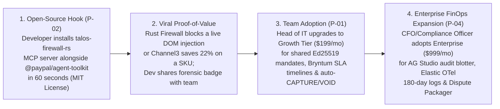

# Go-To-Market (GTM) & Distribution Playbook — TALOS
> Project: TALOS · Owner: Growth & Distribution Council (Seth Godin + Gary Vaynerchuk + Paul Graham Bench) · Status: Approved v1.0 · Last updated: 2026-11-01
> Related: [PROJECT_BRIEF](../00-overview/PROJECT_BRIEF.md) · [BUSINESS_MODEL](BUSINESS_MODEL.md) · [FINANCIALS](FINANCIALS.md) · [ROADMAP](../01-product/ROADMAP.md) · [PERSONAS](../01-product/PERSONAS.md)

---

## 1. Seth Godin's Smallest Viable Audience (The Beachhead)

> **Seth Godin**: *"Don't try to boil the ocean by pitching 'AI security for everyone.' Your smallest viable, hair-on-fire audience is two specific tribes who are already experimenting with autonomous commerce today: **(1) The 45,000+ AI builders (`P-02` Maya Lin) using `@paypal/agent-toolkit`, Claude Desktop, and Cursor who are terrified of connecting their live PayPal accounts to a browser agent**, and **(2) Tech-forward Mid-Market IT & Ops Heads (`P-01` Arjun Mehta) at 50–500 person SaaS companies in Bengaluru, San Francisco, and London** who want AI agents to buy studio/office hardware and cloud supplies without getting scammed."*

---

## 2. Bottom-Up Developer PLG → Top-Down Enterprise FinOps Flywheel

TALOS uses the exact **"Open-Source Security Kernel → Cloud Control Plane"** PLG playbook that scaled Cloudflare, Snyk, and HashiCorp:

---

## 3. Concrete Acquisition Roadmap: First `10` → `100` → `10,000` Users (Gary Vee Execution)

### Phase 1: The First `10` Design Partners (Weeks 1–4 Post-Hackathon — "Do Things That Don't Scale")
- **Target**: `5` indie AI agent framework maintainers (`P-02`) + `5` Bengaluru/SF mid-market SaaS IT procurement leads (`P-01`).
- **Tactical Actions**:
  1. **Publish the Interactive "Can Your AI Agent Survive Our Poisoned Storefront?" Challenge (`F-11`)**: Host our `PoisonedStoreSim.tsx` red-team benchmark publicly on Render (`F-14`). Developers point their existing browser agents at our test URL, watch their raw agent get hijacked by `CVE-2026-22708` in 3 seconds, and then toggle on `talos-firewall-rs` to see it blocked in `2.8ms`.
  2. **1-on-1 White-Glove Onboarding**: Personally wire `talos-firewall-rs` and our **APIMatic Go SDK (`F-05`)** into the procurement workflows of 5 Y Combinator / Peak XV / Startup India SaaS startups.

### Phase 2: The First `100` Paying B2B Teams & `1,500` Developers (Months 2–3)
- **Target**: Official MCP Registry listings + PayPal Developer Community + Channel3 Merchant co-marketing.
- **Tactical Actions**:
  1. **Official MCP Registry & Postman Network Launch (`F-03`, `F-13`)**: Publish `talos-firewall-rs` on the official Model Context Protocol Registry (`modelcontextprotocol.io`), Smithery.ai, Glama, and the **Postman Public API Network** (featuring our 1-click `"Run in Postman"` PayPal Sandbox collection).
  2. **Open-Source PRs into Agent Toolkits**: Contribute a reference `"Secured by TALOS KYA Mandate"` middleware example directly to the community examples for `@paypal/agent-toolkit`, LangChain, CrewAI, and AutoGen.
  3. **Gary Vee Short-Form Technical Content Engine**: Publish 3 weekly 60-second teardown videos on X/Twitter, LinkedIn, Hacker News, and YouTube Shorts showing real-world indirect prompt injections (`display:none`, Unicode `U+E0000` tag smuggling) being intercepted live in **AG Grid Master-Detail (`F-08`)** and auto-voided on **Bryntum Scheduler Pro (`F-07`)**.

### Phase 3: Scaling to `10,000` Active Agents & `$3.1M+` ARR (Months 4–12)
- **Target**: Mid-market & Enterprise FinOps teams (`P-01`, `P-04`) across US, EU, and India + Verified B2B Merchants (`P-03`).
- **Tactical Actions**:
  1. **Channel3 Verified Merchant Co-Selling Loop (`F-04`)**: Every time TALOS reroutes an overpriced checkout to a verified **Channel3** merchant (`P-03`), the merchant receives an order notification stamped *"Verified & Ring-Fenced via TALOS PayPal Escrow"*, driving zero-CAC merchant signups.
  2. **Enterprise ERP & Procurement Marketplaces**: List TALOS on the **PayPal Partner Directory**, **Elastic Cloud Partner Marketplace**, and **AWS/Render B2B Procurement catalogs**.

---

## 4. Strategic Partnerships & Indian / Public-Sector Pilot Path

| Partner Category | Specific Target Partners | Mutual Value Exchange |
| :--- | :--- | :--- |
| **Payment & Agent Rail** | **PayPal (`mcp.paypal.com`, `@paypal/agent-toolkit`, Braintree)** | TALOS unlocks enterprise B2B adoption of PayPal's agentic tools by removing the #1 CFO objection (unauthorized `CAPTURE` risk) while driving high-value `Orders v2 AUTHORIZE` volume. |
| **Catalog & Price Oracle** | **Channel3 (`trychannel3.com`)** | TALOS turns Channel3 from a passive discovery API into an active financial anti-gouging oracle (`F-04`) on every transaction. |
| **SDK & Schema Governance** | **APIMatic (`apimatic.io`)** | Showcases APIMatic Context Plugins + Go SDK codegen (`F-05`) as the gold standard for zero-hallucination financial tool calls. |
| **India B2B & Public Digital Infrastructure (DPI)** | **ONDC (Open Network for Digital Commerce) B2B Buyer Apps** & **Startup India / MeitY IndiaAI Mission** | As Indian enterprises adopt AI buyer agents on ONDC B2B and cross-border PayPal PA-CB rails (`R-06`), TALOS provides the **DPDP Act 2023 & CERT-In compliant** KYA mandate firewall and SLA escrow referee. |

---

## 5. Tailored Messaging Matrix per Persona (`P-01`..`P-04`)

| Persona | Core Hook (Headline) | Proof Point Shown in First 30 Seconds | Call to Action (CTA) |
| :--- | :--- | :--- | :--- |
| **`P-01` (Arjun Mehta — Head of IT & Procurement)** | *"Let AI agents source your company's hardware—with zero price gouging and automatic PayPal rollback if delivery is late."* | Live **Bryntum Scheduler Pro (`F-07`)** SLA bar expiring and firing an instant PayPal `VOID` (`API-10`) + **Channel3 (`F-04`)** saving `$231` on a Shure SM7B mic. | *"Start Free 14-Day B2B Sandbox Pilot"* |
| **`P-02` (Maya Lin — Indie AI Agent Builder)** | *"Connect `@paypal/agent-toolkit` to browser agents without losing sleep over `display:none` prompt injections."* | `<4ms` Rust `lol_html` + `DeBERTa-v3` ONNX (`F-02`) stripping a hidden `$480` hijack payload + 1-line MCP config. | `cargo install talos-firewall-rs` / `"Run in Postman"` (`F-13`) |
| **`P-03` (Vikram Rao — Verified B2B Merchant)** | *"Win high-intent AI agent orders with instant PayPal `AUTHORIZE` proof-of-funds and 0-second delivery settlement."* | Automatic `POST /v2/payments/authorizations/{id}/capture` (`F-06`) triggered the instant carrier tracking confirms `DELIVERED`. | *"Verify Your Catalog via Channel3"* |
| **`P-04` (Priya Nair — FinOps & Compliance Auditor)** | *"Cryptographic proof of every AI spending mandate, DOM scan, and dispute bundle—queryable in plain English."* | **AG Studio (`F-08`)** natural-language pivot + Master-Detail `Ed25519` & DOM diff inspector + **Elastic OTel (`F-12`)** trace. | *"Download Sample SOC 2 / DPDP Audit Package"* |
