# UI Specification, Visual Architecture & Screen Wireframes — TALOS
> Project: TALOS · Owner: Principal Design & Frontend Council · Status: Approved v2.0 (EGM Resolved) · Last updated: 2026-11-09
> Related: [PROJECT_BRIEF](../00-overview/PROJECT_BRIEF.md) · [PRD](../01-product/PRD.md) · [DESIGN_SYSTEM](DESIGN_SYSTEM.md) · [DATA_MODEL](../03-engineering/DATA_MODEL.md) · [API_SPEC](../03-engineering/API_SPEC.md) · [ACCESSIBILITY](ACCESSIBILITY.md) · [LOCALIZATION](LOCALIZATION.md)

---

## 0. Domain Terminology & Canonical ID Glossary

To ensure zero assumed institutional knowledge for first-time readers and judges, all domain acronyms and canonical identifiers link directly to [`PROJECT_BRIEF.md`](../00-overview/PROJECT_BRIEF.md), [`PRD.md`](../01-product/PRD.md), [`DATA_MODEL.md`](../03-engineering/DATA_MODEL.md), and [`API_SPEC.md`](../03-engineering/API_SPEC.md):
- **`KYA` (Know Your Agent)**: Cryptographic `Ed25519` + RFC 9421 permission slip ([`F-01`](../01-product/PRD.md), [`E-03`](../03-engineering/DATA_MODEL.md)) signed by a human buyer ([`P-01`](../00-overview/PROJECT_BRIEF.md)) that locks an AI shopping agent's maximum budget (`$300.00`), price-markup cap (`15%` / `1,500 bps`), and delivery deadline (`48 hours`).
- **`2PC` (Two-Phase Commit Escrow)**: Reversible payment settlement flow ([`F-05`](../01-product/PRD.md), [`E-06`](../03-engineering/DATA_MODEL.md)) using **PayPal Orders v2** where Phase 1 places a 29-day `AUTHORIZE` hold and Phase 2 executes `CAPTURE` upon carrier delivery—or instant `VOID` (`$0` fee) if the delivery Service-Level Agreement (`SLA`) is breached.
- **`Channel3` Fair-Price Oracle**: External product intelligence API (`trychannel3.com`, [`F-04`](../01-product/PRD.md), [`E-05`](../03-engineering/DATA_MODEL.md), [`API-06`](../03-engineering/API_SPEC.md)) benchmarking `100M+` SKUs to block merchant price gouging (e.g., rejecting a `$480` ask vs. `$249` market median) and reroute to a verified seller ([`P-03`](../00-overview/PROJECT_BRIEF.md)).
- **`KERNEL` Browser Sandbox**: Disposable cloud headless browser inspector (`onkernel.com`, [`F-11`](../01-product/PRD.md)) that streams raw merchant HTML into the Rust `lol_html` + `DeBERTa-v3` ONNX DOM Firewall ([`F-02`](../01-product/PRD.md), [`E-04`](../03-engineering/DATA_MODEL.md), [`API-03`](../03-engineering/API_SPEC.md)).

---

## 1. Visual-First Minimalist Landing & Command Center Architecture

TALOS's frontend (`web/` in Next.js 15 App Router) combines an **Open-Canvas Minimalist Visual Landing Experience** with an **Interactive 5-Module Financial Command Center** in strict causal order (`01 -> 02 -> 03 -> 04 -> 05`):

```mermaid
flowchart TB
    NAV["Sticky Glass Navbar: Brand + Workspace Switcher + Live Rust/Go/PayPal Status Pills + Theme Toggle"]
    HERO["Open-Canvas Visual Hero (StartupProductHero.tsx):<br/>Left: Display Headline + Primary CTA + 3 Icon-Led Benefit Callouts (48px Medallions)<br/>Right: 3D Optical Glass & Titanium Visual Plate (/assets/talos-hero-visual.png) + Interactive Shield Preview"]
    PILLARS["4 Visual Architectural Pillars (56px Duotone Icon Medallions + Flow Connectors 01 -> 02 -> 03 -> 04):<br/>01 KYA Permission Key -> 02 DOM X-Ray Scanner -> 03 Channel3 Price Scale -> 04 PayPal Reversible Vault"]
    STORY["5-Stage Visual Walkthrough Stepper (StoryWalkthroughFivePart.tsx):<br/>Top: 5 Icon-First Stage Nodes (48px Medallions) · Bottom: Visual Escrow Pipeline (/assets/talos-escrow-visual.png) + 3 Insight Cards"]
    ROW1["Causal Interactive Row (lg:grid-cols-12):<br/>Left (col-span-5): Module 01 Mandate Clearing Studio (F-01)<br/>Right (col-span-7): Module 02 Red-Team Interception Arena + Visual Storefront Card (F-11)"]
    KPI["Operator Telemetry & 4-KPI Icon Ribbon (SovereignTopTelemetryBar + GuidedDemoBanner):<br/>Protected GMV ($24,920) | Blocked Injections (3) | Channel3 Savings ($4,120) | Active Holds (2)"]
    BLOTTER["Module 03: AG Grid Enterprise v33 + AG Studio AI Copilot Live Escrow Blotter & Forensic Drawer (F-08)"]
    SLA["Module 04: Bryntum Scheduler Pro v6 Two-Way 48h Carrier SLA Timeline -> Live PayPal VOID (F-07)"]
    STEPUP["Module 05: PayPal JS SDK v6 Human Step-Up Co-Sign Authority (> $300 Cap) (F-09)"]

    NAV --> HERO --> PILLARS --> STORY --> ROW1 --> KPI --> BLOTTER --> SLA --> STEPUP
```

---

## 2. View 0 — Minimalist Visual Landing Hero, 4 Big-Icon Pillars & 5-Stage Visual Stepper

### 2.1 Visual Hero & 4 Architectural Pillars (`StartupProductHero.tsx`)
- **Spacious Open-Canvas Layout**: Eliminates outer nested box wrappers in favor of generous vertical rhythm (`py-10` to `py-14`), calm graphite negative space (`#141415`), and a single primary visual centerpiece (`/assets/talos-hero-visual.png`).
- **Big Semantic Icon Medallions (`48px`–`56px`)**: Every benefit callout and architectural pillar (`talos-pillar-1`..`4`) is anchored by a `48px` (`w-12 h-12`) or `56px` (`w-14 h-14`) sculpted icon medallion (`KeyRound`, `ScanEye`, `Scale`, `ShieldCheck`) with `24px`–`28px` vector strokes, replacing tiny `6px` text-only dots.
- **Interactive Visual Hero Stage**: The right column renders `/assets/talos-hero-visual.png` (AI Agent Prism $\rightarrow$ Optical X-Ray Shield deflecting red prompt-injection particles $\rightarrow$ Titanium PayPal Vault) paired with an interactive `Unprotected AI` vs. `With TALOS ON` visual pipeline overlay.

### 2.2 5-Stage Visual Story Stepper (`StoryWalkthroughFivePart.tsx`)
- **Top Stepper Row (`story-stage-1`..`5`)**: Compact, icon-led stage selector cards featuring a `48px` icon medallion, stage number badge (`Stage 01`..`05`), concise title, and metric pill—eliminating word-for-word paragraph duplication in the tab bar.
- **Active Stage Visual Showcase (`story-active-stage-detail`)**: Pairs `/assets/talos-escrow-visual.png` and a live 1-click simulation button with three icon-anchored cards (`What the Human Buyer Sees`, `What Happens Under the Hood`, `Real-World Wallet Consequence`).

---

## 3. View 1 & View 2 — AG Grid Enterprise Blotter (`F-08`) & Master-Detail Forensic Drawer (`F-02`, `F-04`)

- **Purpose**: Streams real-time row deltas (`applyTransactionAsync`) over `/ws/events` ([`API-15`](../03-engineering/API_SPEC.md)) with **AG Studio AI Copilot** ([`M-03`](../00-overview/PROJECT_BRIEF.md)) and inline Master-Detail forensics (`ForensicDetailPanel.tsx`).
- **3-Column Forensic Inspector (`ForensicDetailPanel.tsx`)**:
  1. **Column 1 (`forensic-card-dom-diff`)**: Rust `lol_html` + `DeBERTa-v3` ONNX DOM diff ([`E-04`](../03-engineering/DATA_MODEL.md)) showing stripped `<!-- SYSTEM OVERRIDE -->` payloads (`<4ms`) and `Ed25519` / RFC 9421 proofs.
  2. **Column 2 (`forensic-card-channel3`)**: Channel3 Cross-Merchant Price Spread visual bar chart ([`E-05`](../03-engineering/DATA_MODEL.md)) comparing `$480.00` Attempted Ask vs. `$249.00` Market Median (`+9,277 bps`).
  3. **Column 3 (`forensic-card-paypal-actions`)**: 1-click PayPal Sandbox 2PC controls (`Capture Escrow Now` [`API-09`](../03-engineering/API_SPEC.md), `Void Authorization` [`API-10`](../03-engineering/API_SPEC.md), `Submit Dispute Evidence Bundle` [`API-11`](../03-engineering/API_SPEC.md)).
- **Resilience (`R-01`)**: If `api-m.sandbox.paypal.com` times out (`>2.8s`), switches seamlessly to deterministic Sandbox replay cache.

---

## 4. View 3 — Bryntum Scheduler Pro Two-Way Payment SLA Board (`F-07`)

- **Purpose**: Binds every **PayPal 29-day Authorization Hold ([`E-06`](../03-engineering/DATA_MODEL.md))** and **48-Hour Carrier Shipping SLA ([`E-07`](../03-engineering/DATA_MODEL.md))** two-way to `BryntumSlaBoard.tsx` via [`API-13`](../03-engineering/API_SPEC.md).
- **Interactive States**:
  - **On-Track Hold (`PAYPAL_AUTHORIZED`)**: Cerulean bar with live carrier tracking (`DHL #9921` / `FedEx`).
  - **Delivered & Settled (`PAYPAL_CAPTURED`)**: Transitions to Emerald Green and unlocks downstream studio production phases.
  - **SLA Breached (`PAYPAL_VOIDED`)**: Dragging the 48h slider past cutoff or clicking `Terminate & Void Escrow` fires `POST /api/v1/escrow/{id}/void` ([`API-10`](../03-engineering/API_SPEC.md)), locks dependent phases in crimson, and exposes 1-click Channel3 backup rerouting.

---

## 5. View 4 — Causal Interactive Row: `01` KYA Mandate Studio (`F-01`) & `02` Red-Team Arena (`F-11`)

- **Strict Left-to-Right Causal Order**:
  1. **Left Column (`lg:col-span-5`) — Module `01` (`MandateStudio.tsx`)**: Human CFO signs `Ed25519` spending rules (`$300.00` cap, `1,500 bps` spread limit, `48h` SLA) and inspects the expandable `Ed25519` Hardware KYA Seal.
  2. **Right Column (`lg:col-span-7`) — Module `02` (`PoisonedStoreSim.tsx` + `SideBySideAgentComparison.tsx`)**:
     - **Visual Storefront Product Preview**: Displays a visual Shure SM7B product card, visible `$480.00` (+92.7% gouge) vs. `$249.00` Channel3 fair price, and an X-ray view of the hidden `display:none` attack payload.
     - **3 1-Click Scenario Triggers (`Act 1`, `Act 2`, `Act 3`) & Side-by-Side Comparison**: Compares `Unprotected AI Shopping Agent` (`-$480.00` lost) against `TALOS-Protected AI Shopping Agent` (`$231.00` saved in `2.84ms`).

---

## 6. View 5 — PayPal JS SDK v6 Step-Up Co-Sign Modal (`F-09`) & Dispute Evidence (`F-10`)

- **`PayPalStepUpModal.tsx` (`@paypal/react-paypal-js` v6)**: Pauses legitimate orders exceeding the `$300.00` autonomous cap (e.g., `$450.00` Genelec 8030C Studio Monitor Pair, `+$150.00` overage) for 1-click human co-signing (`API-10`).

---

## 7. Alternatives Considered

1. **Multi-Page Tab-Only App vs. Unified Progressive-Disclosure Single Canvas (Selected)**:
   - *Rejected*: Hiding each module behind separate full-page routes (`/mandates`, `/simulator`, `/blotter`, `/sla`) as the sole navigation model required 4 page reloads during the `<2:45` live demo and broke real-time visual correlation between the Simulator and AG Grid.
   - *Selected*: A unified progressive-disclosure canvas with dedicated sub-routes preserved for deep linking, paired with a top view-mode filter (`All Views`, `Story & Landing`, `AI Simulator`, `Operator Console`) and `Step-by-Step Guide Demo` mode.
2. **Text-Only Bento Boxes vs. Icon-Medallion + 3D Hardware Visual Architecture (Selected)**:
   - *Rejected*: Wrapping every paragraph in nested `1px` bordered boxes (`card -> subcard -> well`) with `11px` text and `6px` dots produced severe visual fatigue ("wall of text in boxes").
   - *Selected*: Open-canvas visual sections anchored by custom 3D hardware/glass plates (`/assets/talos-hero-visual.png`, `/assets/talos-escrow-visual.png`), `48px`–`56px` duotone icon medallions, and a strict 2-level container ceiling.

---

## 8. Risks, Viewport Budgets & Anti-Clutter Guardrails

| Risk / Failure Mode | Impact | Mandatory Architectural Guardrail |
| :--- | :--- | :--- |
| **Russian-Doll Box Clutter** | Nested borders (`>2` levels) collapse visual hierarchy into a grid of grey boxes. | **Max 2 Container Levels**: Never nest a bordered well inside a subcard inside a card. Use open canvas space, `48px` icon medallions, and subtle hairlines. |
| **Micro-Typography Fatigue** | Walls of `10px–11px` prose prevent 3-second judge comprehension. | **Visual-First Hierarchy**: Primary headlines use `Fraunces` (`32px–48px`), body copy uses readable `14px–16px` (`text-sm`/`text-base`), and every card is led by a `44px–56px` visual icon medallion. |
| **PayPal / Sponsor API Timeout (`R-01`)** | Live demo stalls if external sandbox endpoints exceed `2.8s`. | **Deterministic Replay Fallback**: Automatically falls back to signed local Sandbox state (`<15ms`) with zero UI layout shift. |

---

## 9. 4-Stage Investor Storyline & `fragment.im` Spatial Architecture (v3.0 — War-Room Council)

To ensure any investor, judge, or executive can understand, test, and simulate TALOS in under 60 seconds without decision overload or engineer jargon (see [`WAR_ROOM_COUNCIL_STORYLINE_AND_IMPLEMENTATION_PLAN.md`](../08-project/WAR_ROOM_COUNCIL_STORYLINE_AND_IMPLEMENTATION_PLAN.md)), the root landing route (`/`, `web/src/app/page.tsx`) is structured around a guided **4-Stage Investor Storyline**:

### 9.1 Stage 0: Above-the-Fold 5-Second Hook (`StartupProductHero.tsx` + `FragmentSpatialHero3D.tsx`)
- **Single Guided Entry Point**: Replaces the previous 21 competing Screen-1 buttons with a quiet 4-stage storyline header and **one primary CTA button**: **"Watch Live 60-Second Simulation ->"** (`data-testid="landing-try-demo-cta"`).
- **Zero-Jargon Headline**: *"Your AI Agent Has Your Wallet. TALOS Makes Sure It Never Gets Scammed."*
- **Business Value Strip (`data-testid="investor-business-pitch-strip"`)**: Frames *Problem $\rightarrow$ Live Demo $\rightarrow$ How Much Money It Saves ($231/tx) $\rightarrow$ How PayPal Makes Money*.
- **Interactive 3D Spatial Centerpiece (`FragmentSpatialHero3D.tsx` + `public/assets/talos-fragment-shield-3d.svg`)**: Implements `https://www.fragment.im/`-inspired pointer-driven 3D perspective tilt (`rotateX`/`rotateY`) and three `translateZ` depth shards (Layer 1: Hostile `$480` Scam Trap Intercepted; Layer 2: TALOS Geometric Shield `2.84ms`; Layer 3: PayPal Escrow Vault `$249` Verified / `+$231` Saved) with a 4-stage interactive simulation cue bar.

### 9.2 Interactive Scene 1: "Set the Rules" (`MandateStudio.tsx`)
- **Plain-English Framing**: Led by **"Step 1: Give Your AI a Spending Allowance ($300 Max)"** (`data-testid="storyline-scene-1-rules"`), allowing 1-click preset selection and `$300` allowance locking.
- **Progressive Cryptographic Proof**: Sets `sealExpanded = false` by default and encapsulates the `128-hex Ed25519` signature and `RFC 9421` headers inside `<TechnicalProofDrawer />`.

### 9.3 Interactive Scene 2: "Watch the AI Shop — 3 Real-World Scenarios" (`PoisonedStoreSim.tsx` + `SideBySideAgentComparison.tsx` + `PayPalStepUpModal.tsx`)
- **Surfaced "Aha!" Moment**: Mounts `SideBySideAgentComparison.tsx` directly in Scene 2 on `/` (`data-testid="storyline-scene-2-shop"`) with synchronized `/animate-motion-transfer` dual-branch trajectory:
  - **Scenario 1: The Scam Store ($480 Trap)** — Normal AI loses `$480` vs. TALOS blocks the hidden trick in `2.84ms` and buys for `$249` (**saving `$231`**).
  - **Scenario 2: The Honest Store ($249 Verified)** — PayPal holds `$249` safely in escrow (`PAYPAL_AUTHORIZED`) until FedEx (`#794892104852`) delivers at `26h <= 48h`, then releases payment (`PAYPAL_CAPTURED`) to the seller.
  - **Scenario 3: The Late Delivery & Big Order ($450)** — PayPal automatically refunds a late `$219` shipment (`56h > 48h` SLA) in **`0 seconds`** (`PAYPAL_VOIDED`), and pauses a `$450` order (`+$150` over the `$300` allowance) so a human can click **Approve with PayPal** (`PayPalStepUpModal.tsx`).
- **On-Demand DOM Forensics**: Encapsulates `lol_html + DeBERTa-v3 ONNX` stripped HTML diffs and `9277 bps` telemetry inside `<TechnicalProofDrawer />`.

### 9.4 Interactive Scene 3: "The CFO Dashboard (Where the Money Lives)" (`AgStudioBlotter.tsx` + `BryntumSlaBoard.tsx` + `TechnicalProofDrawer.tsx`)
- **PayPal Unit Economics Strip (`data-testid="paypal-revenue-model-strip"`)**: Explicitly displays *How PayPal Makes Money* (Verified Agentic Take-Rate + 29-Day/48h Escrow Float + `$0` Dispute Ops Cost).
- **Live Transaction Table & Delivery Timeline**: Connects `AgStudioBlotter.tsx` and `BryntumSlaBoard.tsx` in real time to Scene 1 & 2 clicks, with `ForensicDetailPanel.tsx` accessible on demand inside `<TechnicalProofDrawer />`.

